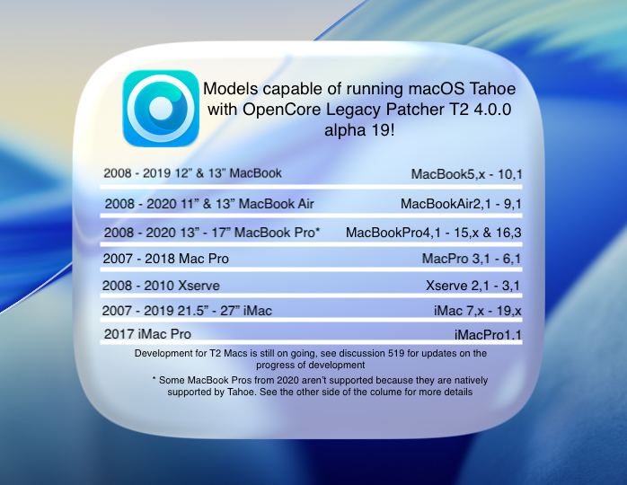

# macOS Tahoe


*Here we are, the last for intel Macs*

macOS 26 Tahoe is the last major macOS release that Apple ships for Intel Macs. It drops a large number of Intel Macs, most of them with a T2 security chip, which makes it the main focus of BridgePatcher.

Support for macOS Tahoe in BridgePatcher is currently in **alpha**. Expect bugs, and please report them on [GitHub Discussions](https://github.com/oclp-t2/BridgePatcher/discussions).


## Newly dropped hardware

* MacBookAir9,1 :       MacBook Air (Retina, 13-inch, 2020)
* MacBookPro15,1 :      MacBook Pro (15-inch, 2018 and 2019)
* MacBookPro15,2 :      MacBook Pro (13-inch, 2018 and 2019, 4 Thunderbolt 3 ports)
* MacBookPro15,3 :      MacBook Pro (15-inch, 2018 and 2019, Vega graphics)
* MacBookPro15,4 :      MacBook Pro (13-inch, 2019, 2 Thunderbolt 3 ports)
* MacBookPro16,3 :      MacBook Pro (13-inch, 2020, 2 Thunderbolt 3 ports)
* Macmini8,1 :          Mac mini (Late 2018)
* iMac19,1 :            iMac (Retina 5K, 27-inch, 2019)
* iMac19,2 :            iMac (Retina 4K, 21.5-inch, 2019)
* iMacPro1,1 :          iMac Pro (2017)

All of these models except the iMac (2019) have a T2 security chip.

The only Intel Macs that still run Tahoe natively are the MacBook Pro (16-inch, 2019), MacBook Pro (13-inch, 2020, 4 Thunderbolt 3 ports), iMac (Retina 5K, 27-inch, 2020) and Mac Pro (2019).

## Current status
BridgePatcher supports Tahoe for the models below, however some challenges remain. You can find information about them further down this page


For Macs **without** a T2 chip, BridgePatcher can install macOS Tahoe and apply root patches, however some challenges remain. You can find information about them further down this page.

For **T2 Macs**, Tahoe does not work yet. See [T2 security chip](#t2-security-chip) below and [T2 Macs and macOS Tahoe](MODELS.md#t2-macs-and-macos-tahoe) for the current status.

## Non-functional features

On majority of patched Macs, iPhone Mirroring and Apple Intelligence won't be functional.

iPhone Mirroring requires T2 for attestation and Apple Intelligence requires an NPU only found in Apple Silicon, the patcher is unable to provide a fix for these as they're hardware requirements.

## Issues

* [T2 Security chip](#t2-security-chip)
* [Audio support](#audio-support)
* [Dual socket CPUs with Mac Pros and Xserve](#dual-socket-cpus-with-mac-pro-2008-and-xserve-2008)
* [USB 1.1 (OHCI/UHCI) Support](#usb-1-1-ohci-uhci-support)
* [Graphics support and issues](#graphics-support-and-issues)


### T2 security chip

Booting unsupported T2 Macs through OpenCorePkg used to end in a kernel panic, because AppleKeyStore.kext ran into timeouts while communicating with the T2 chip:

```
"AppleKeyStore":3212:0: sks timeout strike 18
"AppleKeyStore":3212:0: sks timeout strike 19
"AppleKeyStore":3212:0: sks timeout strike 20
panic(cpu 0 caller 0xffffff801cd12509): "AppleSEPManager panic for "AppleKeyStore": sks request timeout" @AppleSEPManagerIntel.cpp:809
```

**This panic no longer occurs.** BridgePatcher now gets past the AppleKeyStore timeouts on unsupported T2 Macs, so the machines boot into the Tahoe installer.

The remaining issue is that the macOS installation currently ends with "Failed to install a software update" before it finishes. We cannot provide an estimate on when T2 installations will fully work yet.

If you want to help test or share results, please use [GitHub Discussions](https://github.com/oclp-t2/BridgePatcher/discussions).

### Audio support

macOS Tahoe no longer includes AppleHDA.kext, the driver used for built-in audio on Intel Macs. On affected Macs, BridgePatcher restores audio through the "Modern Audio" root patch, so make sure to run root patching after installing Tahoe.

### Dual socket CPUs with Mac Pro 2008 and Xserve 2008

As with macOS Sequoia, booting Tahoe on Mac Pro 2008 (MacPro3,1) or Xserve 2008 (Xserve2,1) with more than 4 cores will cause a kernel panic. BridgePatcher will automatically disable additional cores.

**If building OpenCore for older OS, this limitation can be disabled in Settings -> Build -> "MacPro3,1/Xserve2,1 Workaround".**

::: warning Note

Dual booting Tahoe and older will not be possible with all cores enabled due to reasons described before. In these cases you will be limited to 4 cores.

:::

### USB 1.1 (OHCI/UHCI) Support

For Penryn systems, pre-2013 Mac Pros and Xserve, USB 1.1 support was outright removed in macOS Ventura, therefore this applies all the way to Tahoe.
While USB 1.1 may seem unimportant, it handles many important devices on your system. These include:

* Keyboard and Trackpad for laptops
* IR Receivers
* Bluetooth

Refer to [the troubleshooting page](TROUBLESHOOT-HARDWARE.md#keyboard-mouse-and-trackpad-not-working-in-installer-or-after-update) on how to workaround this issue.


### Graphics support and issues

This build includes both Legacy Metal and non-Metal patches for macOS Tahoe, based on the upstream Dortania patches. Refer to the following links for more information about Legacy Metal and non-Metal support and their respective issues.

* [Legacy Metal](https://github.com/dortania/OpenCore-Legacy-Patcher/issues/1008)
* [Non-Metal](https://github.com/dortania/OpenCore-Legacy-Patcher/issues/108)

::: warning AMD Vega on T2 Macs

Graphics acceleration for the AMD Vega GPUs in the iMac Pro (2017) and the Vega-equipped MacBook Pro (15-inch, 2018 and 2019) is currently not provided on Tahoe.

:::
