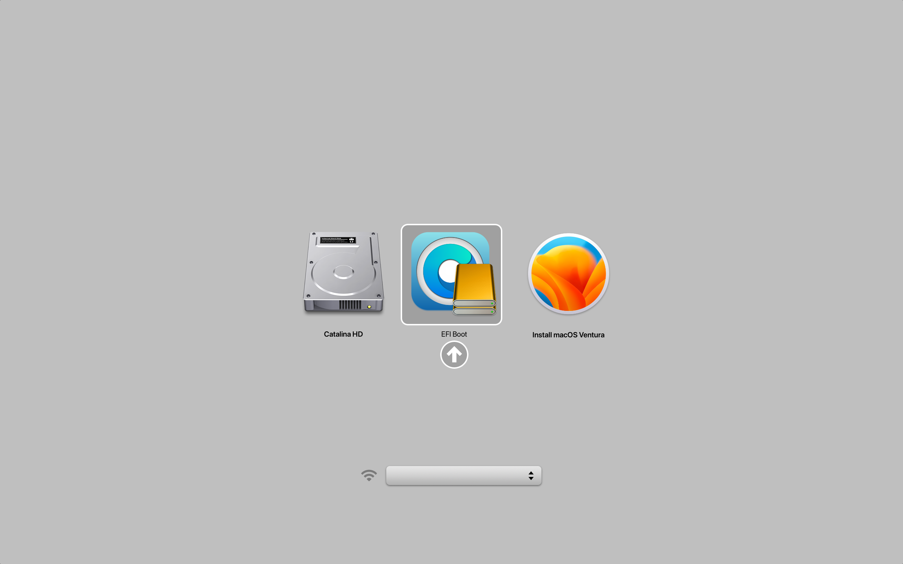
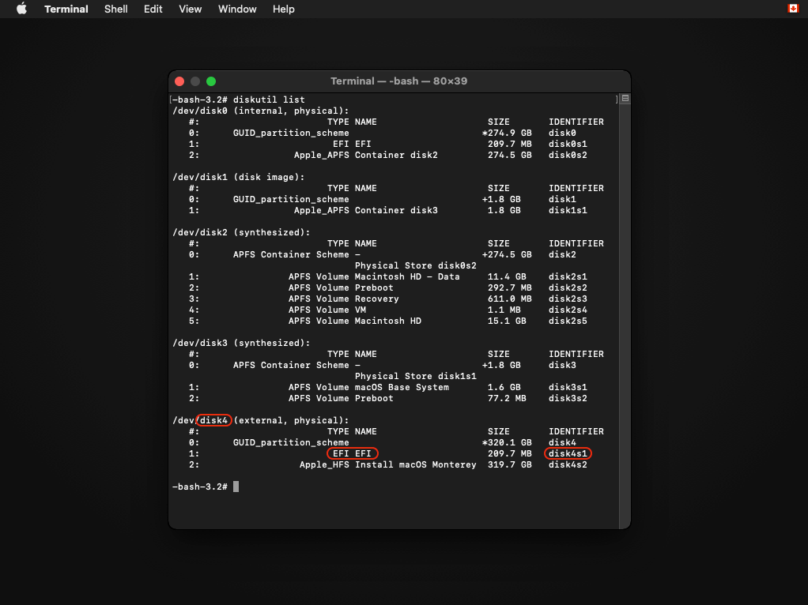
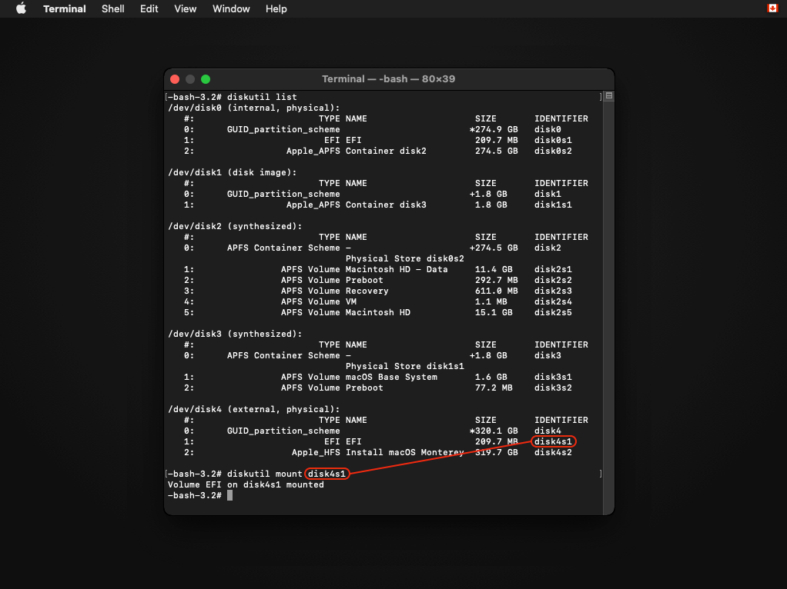
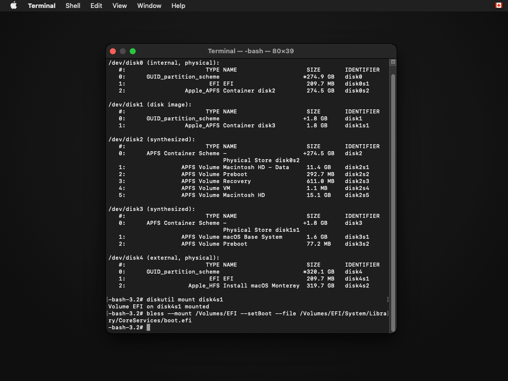
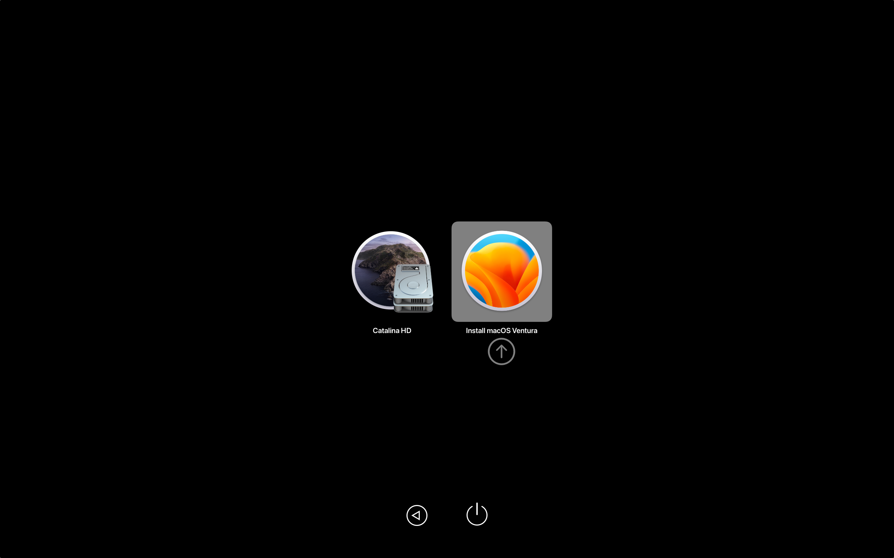
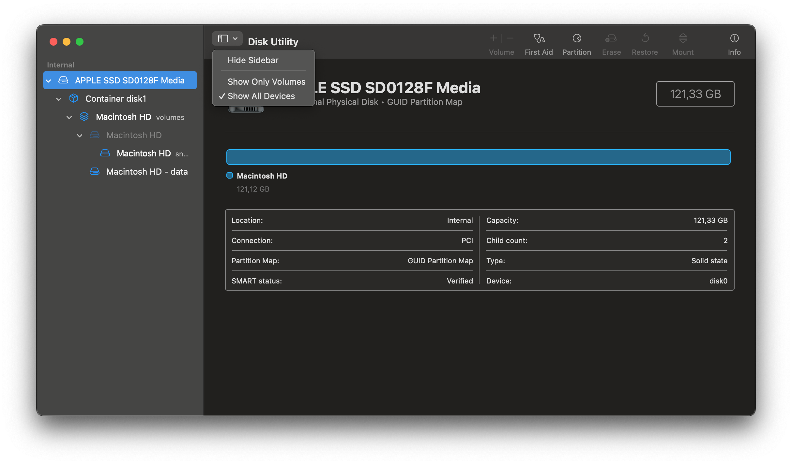
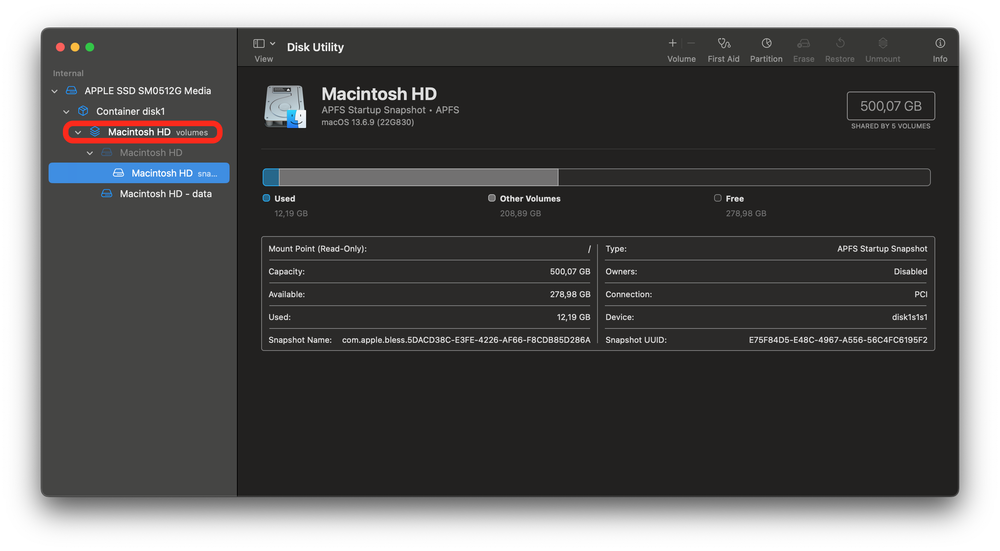
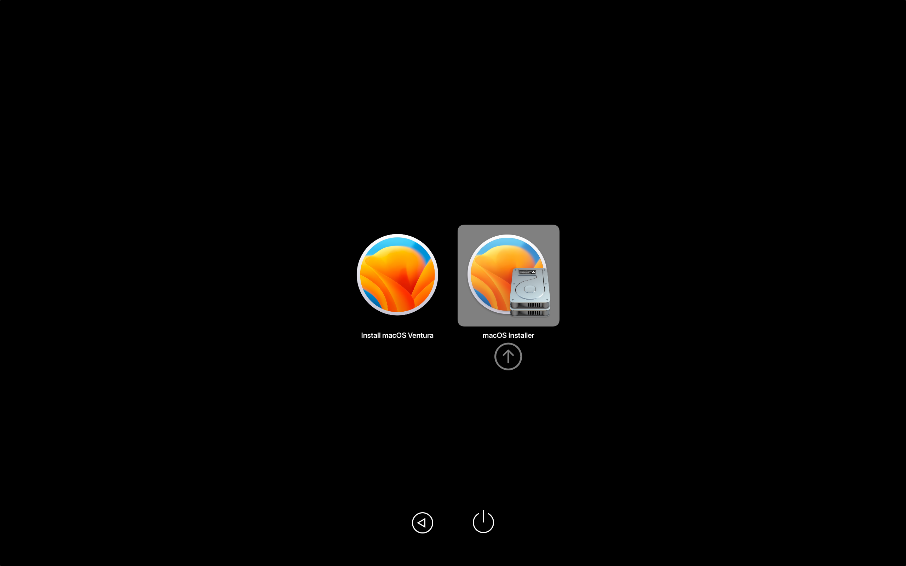

# OpenCore und macOS booten

Jetzt können wir endlich OpenCore booten!

Starte den Mac neu und halte dabei `⌥` gedrückt, um den Booteintrag „EFI Boot“ mit dem OpenCore-Symbol auszuwählen (hältst du zusätzlich die Taste `⌃`, wird dieser Eintrag zum Standard-Booteintrag):

* Das ist der Mac-Bootpicker (Startmanager)


<div align="left">
             
</div>

::: details Hinweis für Mac Pros/Xserves/iMacs mit nicht geflashten GPUs

(Übernommen aus der Anleitung [OpenCore on the Mac Pro](https://forums.macrumors.com/threads/opencore-on-the-mac-pro.2207814/))

Auch als Nutzer eines Mac Pro, Xserve oder iMac mit nicht geflashter GPU kannst du OpenCore problemlos booten und den gesamten Bootvorgang sehen.

Öffne zuerst das Terminal und führe folgenden Befehl aus:
```sh
sudo nvram "recovery-boot-mode=unused" && sudo reboot recovery
```
Dadurch startet dein Mac in die Wiederherstellungsumgebung (Recovery). Alternativ gelangst du auch in die Recovery, indem du beim Starten `⌘` + `R` gedrückt hältst.

Öffne als Nächstes das Terminal der Wiederherstellungsumgebung (Menüleiste > Dienstprogramme > Terminal oder `⌘` + `⇧` + `T`).

Jetzt brauchst du eine Liste der Laufwerkskennungen. Führe dazu folgenden Befehl aus:
```sh
diskutil list
```
Der Befehl sollte eine Liste der in deinem System verbauten Laufwerke ausgeben:

<div align="left">
             
</div>

Merke dir das Laufwerk mit der BridgePatcher-Installation. Die Laufwerkskennung brauchst du später.

Nun hängst du die EFI-Partition ein (dort ist BridgePatcher installiert – das kann abweichen, wenn du BridgePatcher auf einem FAT32-Volume installiert hast).

Führe folgenden Befehl aus (ersetze X durch die Laufwerksnummer):
```sh
diskutil mount diskXs1
```

<div align="left">
             
</div>

Wenn alles stimmt, sollte die EFI-Partition jetzt eingehängt sein.

Verwende nun den Befehl `bless`, um das Standard-Bootlaufwerk festzulegen:
```sh
bless --mount /Volumes/EFI --setBoot --file /Volumes/EFI/System/Library/CoreServices/boot.efi
```
Nach dem Ausführen sollte der Befehl keine Ausgabe erzeugen.

<div align="left">
             
</div>

Falls der Befehl doch eine Ausgabe erzeugt, prüfe, ob du ihn korrekt eingegeben hast.

Jetzt kannst du deinen Mac neu starten. BridgePatcher ist nun die Standard-Bootoption!
:::

Nachdem OpenCore geladen ist, wähle „Install macOS“:

* Das ist der OpenCore-Picker

<div align="left">
             
</div>


Bald erreichst du den Installationsbildschirm! Falls du beim Erstellen von BridgePatcher den Verbose-Modus aktiviert hast, läuft viel Text über den Bildschirm. Ab hier verläuft alles wie bei einer normalen macOS-Installation. Ein Beispiel, wie der Bootvorgang aussieht, zeigt das folgende Video:

<iframe width="560" height="315" src="https://www.youtube.com/embed/AN3zsbQV_n4?si=VAB9ge7Snpj_GrAE" title="YouTube-Videoplayer" frameborder="0" allow="accelerometer; autoplay; clipboard-write; encrypted-media; gyroscope; picture-in-picture; web-share" referrerpolicy="strict-origin-when-cross-origin" allowfullscreen></iframe>

**Wichtig:** Wenn du ein brandneues, bisher unbenutztes Laufwerk verwendest, wähle im Festplattendienstprogramm „Darstellung -> Alle Geräte einblenden“ und formatiere das gesamte Laufwerk, indem du den obersten Eintrag in der Seitenleiste auswählst. So vermeidest du, dass später beim Installieren von OpenCore auf das interne Laufwerk die interne EFI-Partition fehlt.


<div align="left">
             
</div>

::: warning Warnung für T1-Macs

Wenn du macOS Sonoma oder neuer auf einem T1-System (2016–2017) installierst, entfernt das vollständige Löschen des Laufwerks die T1-Funktionen (Touch Bar usw.). Lösche bei der Installation daher nur das Volume, das das Betriebssystem enthält.

<div align="left">
             
</div>

[Weitere Infos hier](TROUBLESHOOT-HARDWARE.md#keine-t1-funktionen-nach-der-installation-von-sonoma-oder-neuer)

:::


Falls dein Mac nach dem ersten Neustart immer wieder zum Anfang der Einrichtung zurückkehrt, schalte ihn aus, starte ihn erneut und halte die Wahltaste (Option) gedrückt. Wähle diesmal (nachdem du zuerst `EFI Boot` ausgewählt hast) im OpenCore-Picker die Option mit dem grauen Festplattensymbol. Sie heißt entweder `macOS Installer` oder trägt den Namen, den du dem Laufwerk während der Installation gegeben hast. Wiederhole diesen Schritt bei Bedarf nach jedem Neustart.

<div align="left">
             
</div>


::: warning Achtung

**Hinweis zum MacBookPro11,3**: Beim Booten von macOS Monterey musst du in den sicheren Modus booten, solange die Beschleunigungs-Patches noch nicht installiert sind. [Andernfalls landest du wegen fehlender NVIDIA-Treiber bei einem schwarzen Bildschirm.](https://github.com/dortania/OpenCore-Legacy-Patcher/issues/522) In den sicheren Modus gelangst du, indem du `⇧` + `Enter` gedrückt hältst, während du macOS Monterey im Bootmenü von BridgePatcher auswählst.

:::


# Sobald macOS installiert ist und bootet, geht es weiter mit [Nach der Installation](./POST-INSTALL.md)
