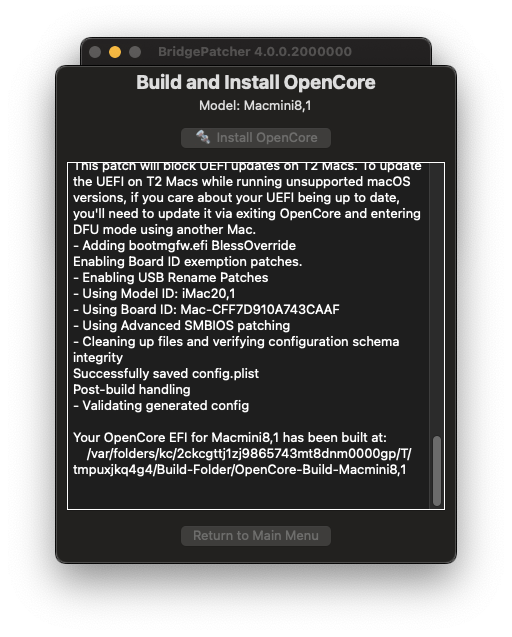
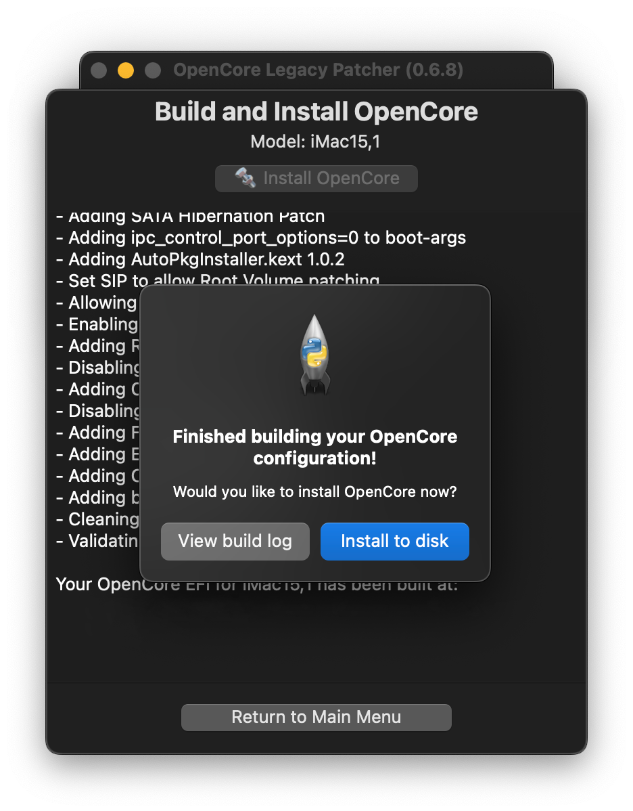
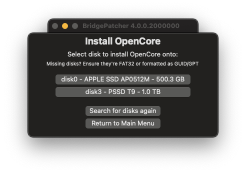
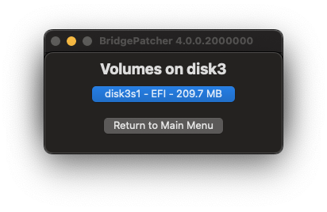

# OpenCore erstellen und installieren

Jetzt, wo wir einen macOS-Installer haben, erstellen wir unsere OpenCore-Konfiguration!

Falls du OpenCore Patcher noch nicht heruntergeladen hast, hol das jetzt nach:

* [OpenCore Legacy Patcher T2 Releases](https://github.com/albert-mueller/OpenCore-Legacy-Patcher-T2/releases)

Starte als Nächstes die `OpenCore-Patcher-T2.app`.

Hier wählen wir `OpenCore` und klicken auf `Install OpenCore`:

             

::: warning Warnung
OpenCore-Konfigurationen sind hardwarespezifisch.
Wenn du OpenCore für ein anderes Modell erstellst als das, auf dem du gerade arbeitest, musst du unbedingt das richtige Modell in den Einstellungen auswählen.
:::

| Erstellung starten | Erstellung abgeschlossen |
| :--- | :--- |
|  |  |

Sobald die Erstellung abgeschlossen ist, wählst du das Laufwerk aus, auf dem installiert werden soll:

* Wenn du einen macOS-USB-Stick manuell erstellt hast und er nicht aufgelistet wird, stelle sicher, dass er entweder als GUID/GPT formatiert ist oder eine FAT32-Partition für OpenCore besitzt.

| Laufwerk auswählen | Partition auswählen |
| :--- | :--- |
|  |  |

# Wenn du fertig bist, geht es weiter mit [OpenCore und macOS booten](./BOOT.md)
