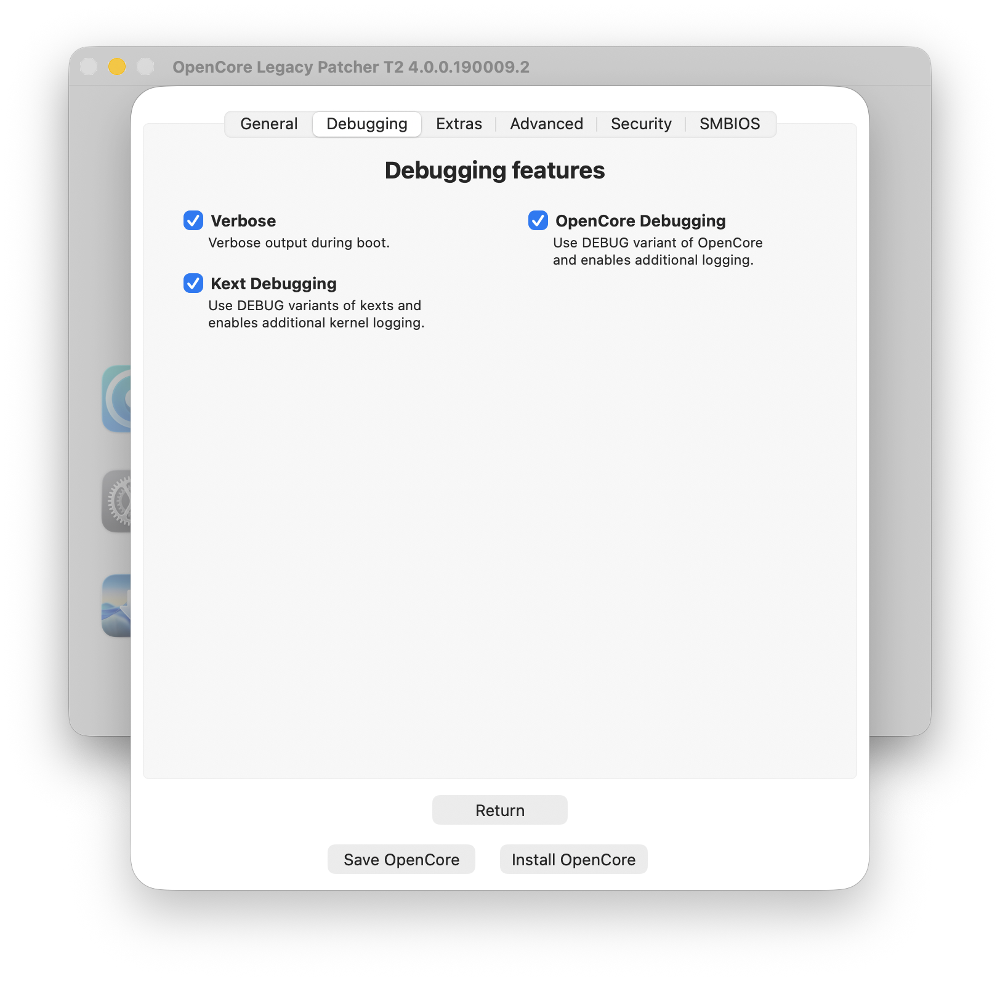
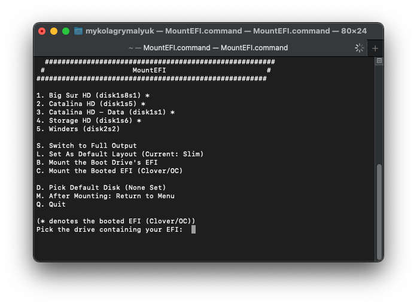
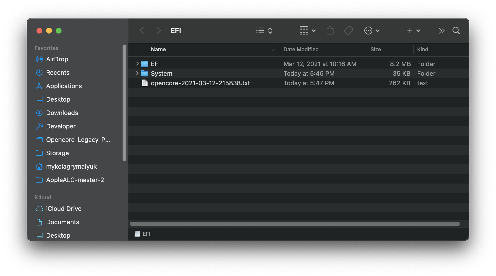

# Mit OpenCore debuggen

Wenn du auf einen merkwürdigen Fehler gestoßen bist und nicht sicher bist, ob es ein Bedienfehler ist oder am Patcher liegt, empfehlen wir dir, auf dem [OpenCore Patcher Paradise Discord-Server](https://discord.gg/rqdPgH8xSN) um Hilfe zu bitten.

## Selbst debuggen

Am einfachsten debuggst du selbst über die Patcher-Einstellungen. Dort gibt es viele verschiedene Optionen, die drei wichtigsten sind jedoch:

* „Enable Verbose Mode“
* „Enable OpenCore DEBUG“
* „Enable Kext DEBUG“

<div align="left">
             
</div>


Nachdem du diese drei Optionen aktiviert hast, erstelle OpenCore neu und installiere es auf dein Laufwerk. Dadurch erhältst du deutlich mehr Debug-Informationen, und es werden Logs auf die EFI-Partition geschrieben.

## OpenCore-Logs vom Laufwerk holen

Mit „Enable OpenCore DEBUG“ wird bei jedem Bootvorgang eine .txt-Datei auf der EFI-Partition erzeugt. Um an diese Logs zu kommen, [lade MountEFI herunter und starte es](https://github.com/corpnewt/MountEFI):

<div align="left">
             
</div>

Sobald du die EFI-Partition des Laufwerks mit macOS eingehängt hast, solltest du einige aufschlussreiche Logs sehen:

<div align="left">
             
</div>

## Kernel-Logs aus macOS holen

Mit „Enable Kext DEBUG“ werden bei jedem Bootvorgang deutlich ausführlichere Logs im System gespeichert. Um diese Logs zu erhalten, führe einfach den folgenden Befehl aus:

```sh
sudo dmesg > ~/Desktop/DMESG.txt
```

Danach liegt ein Log auf deinem Schreibtisch.

## Ein Issue bei uns melden

Jetzt, da du aussagekräftige Logs hast, kannst du [ein Issue bei uns melden](https://github.com/albert-mueller/OpenCore-Legacy-Patcher-T2/issues). Denk bitte daran, folgende Informationen anzugeben:

* Modell, für das du patchst (z. B. MacBookPro10,1)
* Ziel-Betriebssystem (z. B. macOS 11.2.3)
* Host-Betriebssystem (z. B. macOS 10.15.7)
* Upload deines OpenCore-Build-Ordners
* Upload deines OpenCore-Logs (falls zutreffend)
* Upload deines Kernel-Logs (falls zutreffend)

Bitte suche außerdem, ob das Problem schon einmal gemeldet wurde. So vermeiden wir doppelte Issues.
