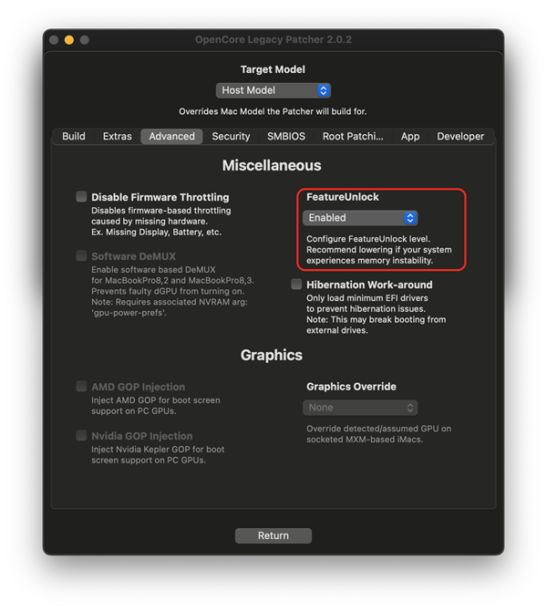
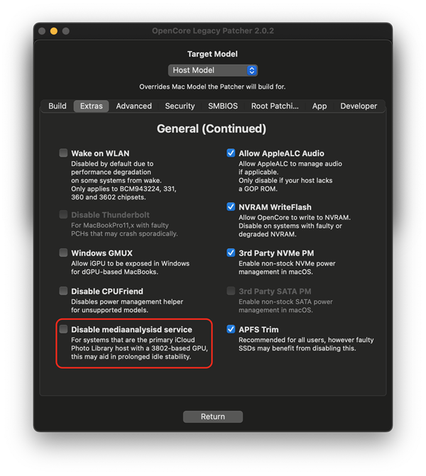

# FAQ

* [Anforderungen der App](#anforderungen-der-app)
* [Versionierung der App](#versionierung-der-app)
* [Wie stelle ich sicher, dass alles auf dem neuesten Stand ist?](#wie-stelle-ich-sicher-dass-alles-auf-dem-neuesten-stand-ist)
* [Wo werden die Einstellungen der Oberfläche gespeichert?](#wo-werden-die-einstellungen-der-oberflache-gespeichert)
* [Kann ich denselben USB-Installationsstick als universellen Installer verwenden?](#kann-ich-denselben-usb-installationsstick-als-universellen-installer-verwenden)
* [Kann ich OTA-Updates nutzen?](#kann-ich-ota-updates-nutzen)
* [Kann ich automatische Updates nutzen?](#kann-ich-automatische-updates-nutzen)
* [Warum sind macOS-Updates so groß?](#warum-sind-macos-updates-so-groß)
* [Kann ich auf macOS-Betas aktualisieren?](#kann-ich-auf-macos-betas-aktualisieren)
* [Kann ich macOS downgraden und meine Daten behalten?](#kann-ich-macos-downgraden-und-meine-daten-behalten)
* [Warum ist mein System langsam?](#warum-ist-mein-system-langsam)
* [Apps stürzen mit „illegal instruction“ ab](#apps-sturzen-mit-„illegal-instruction-ab)
* [Was bedeutet Metal und Nicht-Metal?](#was-bedeutet-metal-und-nicht-metal)
* [Was sind FeatureUnlock und mediaanalysisd?](#was-sind-featureunlock-und-mediaanalysisd)
* [Warum funktioniert iPhone-Synchronisierung nicht?](#warum-funktioniert-iphone-synchronisierung-nicht)
* [Wo ist Apple Intelligence?](#wo-ist-apple-intelligence)


## Anforderungen der App
Die Patcher-App benötigt zum Ausführen **macOS High Sierra 10.13.6** oder neuer.

Wegen Einschränkungen von Apples Werkzeug `createinstallmedia`, das zur Installer-Erstellung verwendet wird, gilt außerdem:
* **High Sierra 10.13** wird benötigt, um Installer für macOS Sonoma und Sequoia zu erstellen.
* **Catalina 10.14** wird benötigt, um Installer für macOS Tahoe zu erstellen.

Der Patcher ist für **macOS Big Sur 11.x bis macOS Sequoia 26.x** ausgelegt.

## Versionierung der App

Die Versionsnummer dieses Patchers ist so aufgebaut:

4.0.0 – die aktuelle Hauptversion
Alles nach der letzten Null ist die Build-Version des Patchers.
4.0.0.190001 bedeutet 4.0.0 Alpha 19.1.
Wenn du etwas wie 19.1.1 siehst, handelt es sich meist um eine kleine Fehlerbehebung oder ein Sicherheitsupdate.

## Wie stelle ich sicher, dass alles auf dem neuesten Stand ist?

Das Aktualisieren der BridgePatcher-Installation erfolgt in drei Schritten: zuerst die App, dann der Bootloader und schließlich die Root-Patches.

Wie du App und Patches aktualisierst, erfährst du unter [OpenCore und Patches aktualisieren](UPDATE.md).

## Wo werden die Einstellungen der Oberfläche gespeichert?

In jeder Version von BridgePatcher werden die Einstellungen unter ```/Users/Shared/.com.dortania.opencore-legacy-patcher.plist``` gespeichert. Die App nutzt diese Datei, um Einstellungen über Neustarts und App-Updates hinweg beizubehalten, sodass du sie nicht jedes Mal neu konfigurieren musst. Die Oberfläche wird zurückgesetzt, wenn ein anderes Modell als „Host Model“ ausgewählt ist, da das Erstellen für ein anderes Modell andere Einstellungen erfordert.

Bei Problemen lösche die Datei und starte die App neu, um die Oberfläche auf die Standardeinstellungen zurückzusetzen. Erstelle OpenCore anschließend mit den neu konfigurierten Einstellungen neu.

**Das bloße Anhaken von Optionen in den Einstellungen wendet diese erst an, wenn du „Install OpenCore“ erneut durchgeführt hast.** Dabei wird ein neues OpenCore mit den gewählten Einstellungen erstellt. Die angewendeten Einstellungen werden beim Erstellen in einer config.plist-Datei auf deiner EFI-Partition gespeichert.

::: warning Achtung

Berücksichtigt werden nur Einstellungen, die in BridgePatcher vorgenommen wurden. Änderungen, die außerhalb von BridgePatcher direkt in der Datei ```config.plist``` auf der EFI-Partition gemacht werden, **werden weiterhin zurückgesetzt**. Außerdem kann das manuelle Bearbeiten der ```config.plist``` dazu führen, dass die in der Oberfläche angezeigten Einstellungen nicht mehr mit den tatsächlich verwendeten übereinstimmen, da die App nicht weiß, ob die Datei manuell verändert wurde.

:::

## Kann ich denselben USB-Installationsstick als universellen Installer verwenden?

OpenCore-Konfigurationen sind gerätespezifisch, da verschiedene Systeme unterschiedliche Quirks benötigen. Wenn du OpenCore für ein anderes System erstellst als das, auf dem du gerade arbeitest, musst du vor dem Erstellen von OpenCore auf dem USB-Stick das Zielmodell in den Einstellungen auswählen.

Beim Erstellen von OpenCore auf einem anderen System kann BridgePatcher nicht die gesamte im Zielgerät verbaute Hardware kennen und verwendet daher sichere Standardwerte. Das ist aber möglicherweise nicht optimal, insbesondere bei nachgerüsteter Hardware. Daher wird empfohlen, OpenCore nach der Installation des Betriebssystems **auf dem Gerät selbst** neu zu erstellen, damit Einstellungen auf Basis der Hardwareerkennung angewendet werden.

## Kann ich OTA-Updates nutzen?

Ja. Für große Versionssprünge (z. B. von 13 auf 14) wird jedoch dringend empfohlen, einen USB-Stick zu verwenden, um größere Probleme zu vermeiden. Normale Updates sind meist unproblematisch; trotzdem ist es immer eine gute Idee, ein paar Tage abzuwarten, ob Patches kaputtgehen und repariert werden müssen.

Mehr Informationen zum Aktualisieren findest du unter [BridgePatcher auf ein macOS-Update vorbereiten](UPDATE.md#bridgepatcher-auf-ein-macos-update-vorbereiten).

## Kann ich automatische Updates nutzen?

Es wird dringend empfohlen, automatische Updates (auch das automatische Herunterladen) bei der Nutzung von BridgePatcher zu deaktivieren, da Apple die Funktionsweise automatischer Updates kürzlich geändert hat. Updates werden jetzt schon während des Downloads vorbereitet und verändern bereits das Systemvolume. Das kann aus heiterem Himmel zu einem kaputten System führen, weil sich das Betriebssystem in einem Zwischenzustand zwischen zwei Versionen befindet. Du kannst ein Update trotzdem jederzeit manuell starten, wenn du bereit bist.

Zum verwandten Fehler „System version mismatch“ beim Root-Patching und für weitere Informationen siehe [Fehler „System version mismatch“ beim Root-Patching](TROUBLESHOOT-APP.md#fehler-„system-version-mismatch-beim-root-patching).

* Hinweis: macOS Sequoia fragt ab Version 15.4 nach jeder Update-Installation, ob automatische Updates aktiviert werden sollen, und bietet keine Möglichkeit, das dauerhaft abzulehnen. Du musst die Option daher nach Updates eventuell immer wieder deaktivieren.

::: details So deaktivierst du Updates (zum Aufklappen klicken)

**macOS Ventura und neuer:**

Systemeinstellungen -> Allgemein -> Softwareupdate -> (i)-Taste neben „Automatische Updates“ -> „Neue Updates laden, wenn verfügbar“ deaktivieren.

**macOS Big Sur und Monterey:**

Systemeinstellungen -> Softwareupdate -> Weitere Optionen -> „Neue Updates laden, wenn verfügbar“ deaktivieren.

:::

## Warum sind macOS-Updates so groß?

macOS verwendet standardmäßig ein versiegeltes, schreibgeschütztes Systemvolume. Wenn das Siegel gebrochen ist, hält macOS das Volume für beschädigt und lädt bei jedem Update eine vollständige Kopie von macOS herunter, um es in einen bekannten Zustand zu „reparieren“. Damit Root-Patching funktioniert, muss dieses Siegel gebrochen werden, da Root-Patching zwangsläufig Dateien auf dem Laufwerk verändert. Deshalb müssen die Root-Patches auch nach jedem Update erneut installiert werden.

## Kann ich auf macOS-Betas aktualisieren?

Die Entwicklung und das Testen der BridgePatcher-Patches finden während der Betaphase statt, um eine stabile Version vorzubereiten. Daher kann BridgePatcher Betas nicht richtig unterstützen, und ältere Versionen sind möglicherweise inkompatibel. Installiere eine Beta nur, wenn du weißt, was du tust, realistische Erwartungen hast und es dir nichts ausmacht, dein System zur Wiederherstellung komplett neu aufzusetzen.

Beachte, dass wir keine Hilfe leisten, wenn eine Beta installiert wurde.

## Kann ich macOS downgraden und meine Daten behalten?

macOS erlaubt keine direkten Downgrades, du musst also das Laufwerk löschen, um zurückzukehren. Sichere deine Daten vorher mit Time Machine, ASR oder einer anderen Lösung.

## Warum ist mein System langsam?

#### Fehlende oder kaputte Root-Patches

Wenn dein System **wirklich** langsam ist und macOS kein Hintergrundbild sowie keine Transparenz in Dock und Menüleiste hat, installiere die Root-Patches, um die richtigen Treiber und Funktionen zu erhalten. Weitere Informationen findest du im Abschnitt [Post-Install-Volume-Patches anwenden](POST-INSTALL.md#post-install-volume-patches-anwenden).

**Root-Patches werden durch macOS-Updates entfernt und müssen nach Abschluss eines Updates erneut installiert werden.**

Patches können auch kaputtgehen, wenn automatische Updates aktiviert sind und ein Update das Systemvolume vorzeitig verändert. Weitere Informationen findest du unter [Fehler „System version mismatch“ beim Root-Patching](TROUBLESHOOT-APP.md#fehler-„system-version-mismatch-beim-root-patching).

#### Spotlight

Wenn deine macOS-Installation noch frisch ist, beginnt Spotlight, einen vollständigen Index des Laufwerks zu erstellen. Das kann hohe CPU-Last, hohe Temperaturen und allgemeine Langsamkeit verursachen. Wir empfehlen, das System ein paar Stunden laufen zu lassen; sobald Spotlight fertig indiziert hat, lässt die Last nach. Ob Spotlight die Ursache ist, prüfst du, indem du die Aktivitätsanzeige öffnest, im Menü „Darstellung“ die Option „Alle Prozesse“ wählst und nach CPU sortierst. Achte darauf, ob ein Prozess namens ```mds_stores``` viel CPU-Leistung beansprucht.

#### Anspruchsvollere macOS-Versionen

Neuere Betriebssysteme sind anspruchsvoller und können sich langsamer anfühlen. In diesem Fall lässt sich nicht viel dagegen tun.

#### Thermische Probleme oder schlechter/fehlender Akku

Wenn du in der Aktivitätsanzeige siehst, dass ```kernel_task``` viel CPU-Leistung beansprucht (auch hier ist Darstellung -> Alle Prozesse nötig), wird das System gedrosselt – meist aus folgenden Gründen:

Bei Laptops drosselt macOS die CPU ziemlich stark, wenn der Akku fehlt oder in schlechtem Zustand ist, um weiterzulaufen, da das Netzteil allein nicht genug Leistung für die Spitzenleistung liefern kann. Du kannst versuchen, die Drosselung in den BridgePatcher-Einstellungen zu deaktivieren, das führt aber meist zu unerwarteten Abschaltungen unter Last, wenn das Netzteil nicht mehr genug Leistung liefern kann. Außerdem sind die Trackpad-Einstellungen auf Laptops ohne Akku nicht verfügbar.

Auch thermische Probleme können die CPU drosseln. In diesem Fall kann es sinnvoll sein, die Wärmeleitpaste zu erneuern.

Mit [Intel Power Gadget (Web Archive)](https://web.archive.org/web/20220701164200/https://www.intel.com/content/dam/develop/external/us/en/documents/downloads/intel-power-gadget.dmg) kannst du die CPU-Frequenz überwachen; AVG und REQ sollten weitgehend übereinstimmen.

## Apps stürzen mit „illegal instruction“ ab

Wenn das Absturzprotokoll den Text „illegal instruction“ enthält, benötigt die App in der Regel die CPU-Befehlssätze AVX oder AVX2.

Seit macOS Ventura setzen alle davon unterstützten Macs AVX2 voraus. BridgePatcher kann macOS zwar so patchen, dass es ohne AVX2 bootet, doch viele Apps nutzen in neueren Versionen ebenfalls AVX und AVX2, da alle unterstützten Macs diese Befehlssätze voraussichtlich haben. Das ist ein Problem für ältere Systeme, auf deren CPUs ohne diese Befehle manche Apps nicht laufen. Manche älteren Macs benötigen daher ältere App-Versionen und können nicht auf neuere aktualisieren. AVX wurde mit der CPU-Generation Sandy Bridge eingeführt, AVX2 mit Haswell.

Im Grunde altern manche Modelle dadurch jetzt schnell, und ein neueres Betriebssystem bietet wegen der Hardwareanforderungen nicht immer Unterstützung für neuere Apps. Unterstützt eine App noch macOS-Versionen vor Ventura, hat sie eine Chance, auf dem alten System mit einer älteren macOS-Version zu laufen, da manche Macs, die diese Versionen nativ ausführen, kein AVX2 unterstützen und die App dann einen anderen Codepfad nutzt.

::: details Erste Mac-Modelle mit AVX-Unterstützung (zum Aufklappen klicken)

- Macmini5,x (2011)
- iMac12,x (2011)
- MacBookPro8,x (2011)
- MacBookAir4,x (2011)
- MacBook8,x (2015)
- MacPro6,1 (2013)
:::

::: details Erste Mac-Modelle mit AVX2-Unterstützung (zum Aufklappen klicken)

- Macmini7,x (2014)
- iMac14,x (2013)
- MacBookPro11,x (2013)
- MacBookAir6,x (2013)
- MacBook8,x (2015)
- MacPro7,1 (2019)
:::

## Was bedeutet Metal und Nicht-Metal?

Metal ist Apples proprietäre Grafik-API und ersetzt OpenGL/OpenCL; ab macOS Mojave hat sie das OpenGL-Rendering des Betriebssystems vollständig abgelöst. Mit „Nicht-Metal“ sind GPUs gemeint, die Metal nicht unterstützen und stattdessen OpenGL verwenden müssen. Da OpenGL als veraltet gilt, setzen viele neuere Apps Metal-Rendering voraus und laufen daher auf Systemen mit Nicht-Metal-GPUs nicht. Auch einige integrierte Apps wie Karten und alles, was darauf aufbaut (z. B. „Wo ist?“), werden auf Versionen nach Big Sur nicht korrekt dargestellt.

Als Faustregel gilt: Macs, die älter als 2012 sind, sind Nicht-Metal-Macs – ausgenommen Systeme mit aufrüstbarer GPU.

::: details macOS-GPU-Übersicht

Die Intel-GMA-Serie wird überhaupt nicht unterstützt, auch nicht mit BridgePatcher.

AMD-Navi-GPUs (Serie RX 5000–6000) funktionieren in Mac Pros von 2008 bis 2012 unter Ventura und neuer nicht, da diese kein AVX2 unterstützen.

| Grafikhersteller | Architektur | Serie | Unterstützt Metal |
| :--- | :--- | :--- | :--- |
| ATI | TeraScale 1 | HD 2XXX - HD 4XXX | <span style="color:red">Nein</span> |
| ^^ | TeraScale 2 | HD 5XXX - HD 6XXX | ^^ |
| AMD | GCN (und neuer) | HD 7XXX+ | <span style="color:green">Ja</span> |
| NVIDIA | Tesla | 8XXX - 3XX | <span style="color:red">Nein</span> |
| ^^ | Fermi | 4XX - 5XX | ^^ |
| ^^ | Kepler | 6XX - 7XX | <span style="color:green">Ja</span> |
| ^^ | Maxwell | 8XX - 9XX | <span style="color:red">Nein (ab 10.14)</span> |
| ^^ | Pascal | 10XX | ^^ |
| Intel | GMA | GMA 900 - GMA X3000 | <span style="color:red">Nein</span> |
| ^^ | Iron Lake | HD-Serie | ^^ |
| ^^ | Sandy Bridge | HD 3000 | ^^ |
| ^^ | Ivy Bridge (und neuer) | HD 4000 | <span style="color:green">Ja</span> |

:::

Weitere Informationen findest du auf den folgenden Seiten:
- [Unterstützte Modelle](MODELS.md)
- [Nicht-Metal-Issue auf GitHub](https://github.com/dortania/OpenCore-Legacy-Patcher/issues/108)
- [Probleme mit Nicht-Metal-GPUs](TROUBLESHOOT-NONMETAL.md)
- [Hardware-Probleme](TROUBLESHOOT-HARDWARE.md)


## Was sind FeatureUnlock und mediaanalysisd?

**Wichtig:** Diese Funktionen können an vielen Stellen Instabilität verursachen. Daher wurde entschieden, sie ab Dortanias OpenCore Legacy Patcher 2.1.0 standardmäßig zu deaktivieren (mediaanalysisd nur auf 3802-basierten* Systemen). Wenn du diese Funktionen trotz möglicher zusätzlicher Instabilität nutzen möchtest, kannst du sie in den BridgePatcher-Einstellungen aktivieren und OpenCore neu erstellen.

FeatureUnlock kann außerdem bei manchen macOS-Versionen und Systemen wegen einer Race Condition beim Systemstart Probleme haben. Falls das bei dir auftritt, starte mehrmals neu oder probiere eine andere (ältere) macOS-Version, um zu sehen, ob das hilft.

FeatureUnlock ist eine Erweiterung, die einige macOS-Funktionen freischaltet, darunter:
- Sidecar
- Universal Control
- AirPlay zum Mac
- Integrationskamera (Continuity Camera)
- Night Shift (Nicht-Metal)

Weitere Informationen, Voraussetzungen und die betroffenen Modelle für die FeatureUnlock-Funktionen findest du [hier](https://github.com/acidanthera/FeatureUnlock).

mediaanalysisd wird verwendet für:
- Gesichtserkennung in Fotos
- Live Text

| FeatureUnlock | mediaanalysisd |
| :--- | :--- |
|  |  |


::: details *Liste der 3802-Systeme (zum Aufklappen klicken)

* NVIDIA
    * Kepler (GPUs der Serie 600–800)
* Intel
    * Ivy Bridge (3. Generation, GPUs der Serie HD 4000)
    * Haswell (4. Generation, GPUs der Serie HD/Iris 4000–5000)

Diese GPUs finden sich typischerweise in Systemen von 2012 bis 2015.

:::

## Warum funktioniert iPhone-Synchronisierung nicht?

iPhone-Synchronisierung (iPhone Mirroring) erfordert einen T2-Chip und ist daher auf mit BridgePatcher gepatchten Systemen nicht verfügbar. Die Verbindung schlägt fehl, weil die T2-Attestierung nicht hergestellt werden kann. Auf nicht unterstützten T2-Macs ist iPhone-Synchronisierung möglicherweise ebenfalls nicht verfügbar, das muss aber noch getestet werden.

## Wo ist Apple Intelligence?

Apple Intelligence erfordert die Neural Engine, die es nur in Apple-Silicon-Chips gibt. Selbst wenn du einen Hackintosh mit einer CPU der 13. Generation und einer NPU nutzt, funktioniert es nicht – Apple Intelligence setzt Apple Silicon voraus, du brauchst also einen echten Apple-Silicon-Mac.
