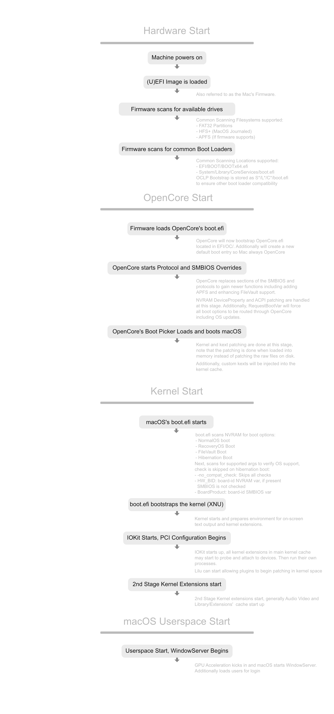

# Bootvorgang mit OpenCore Legacy Patcher T2

OpenCore Legacy Patcher T2 selbst ist eigentlich ein recht „dummes“ Programm. Im Wesentlichen bearbeitet es eine config.plist-Datei und verschiebt Dateien, ohne selbst viel Logik für den Bootvorgang mitzubringen. Die eigentliche Magie von OCLP steckt in [OpenCorePkg](https://github.com/acidanthera/OpenCorePkg), unserem Back-End, das diesen Patcher so leistungsfähig macht.

## Bootvorgang mit OpenCore

Um besser zu verstehen, wie OpenCore ältere Macs so nativ wiederbeleben kann, schauen wir uns an, *wie* OpenCore mit deinem Mac zusammenarbeitet:

