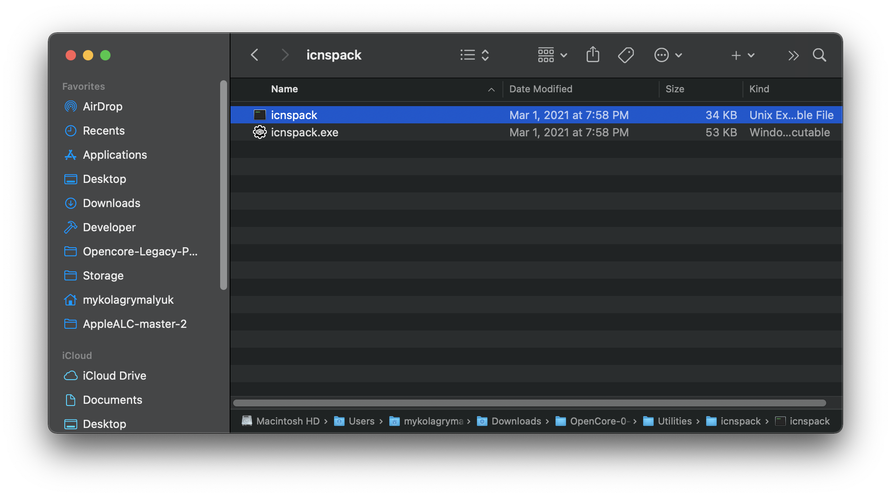
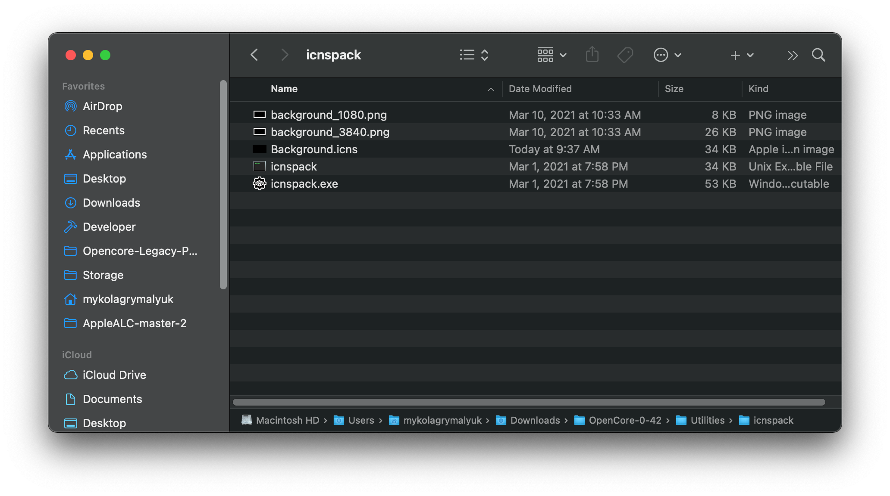
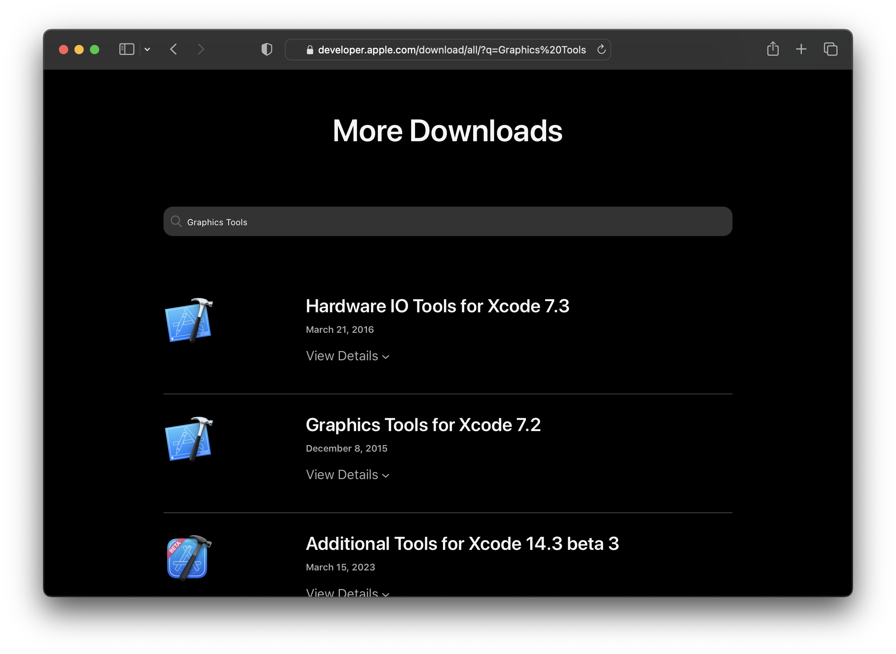
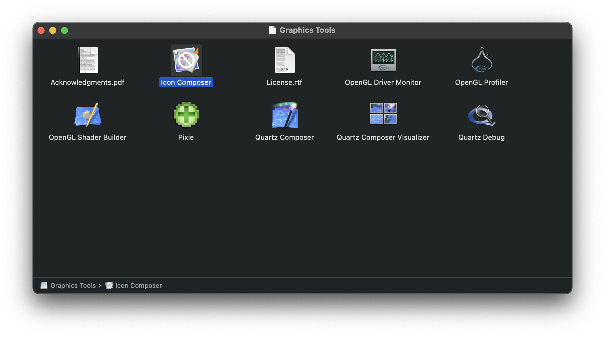
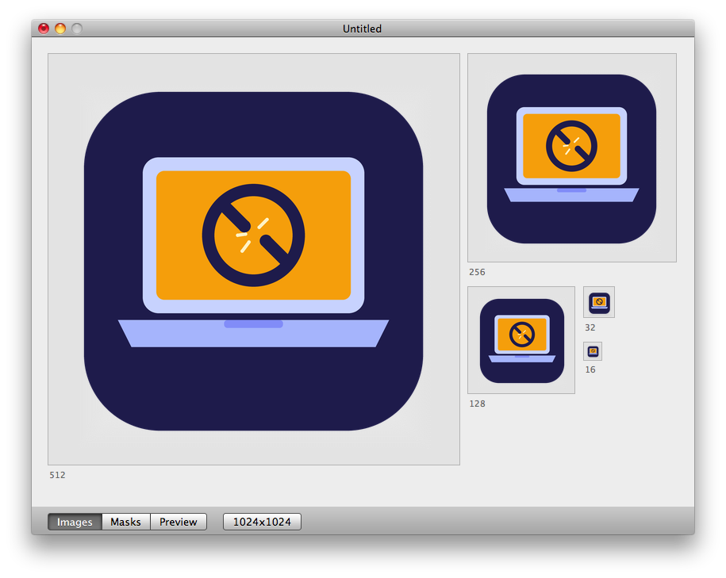
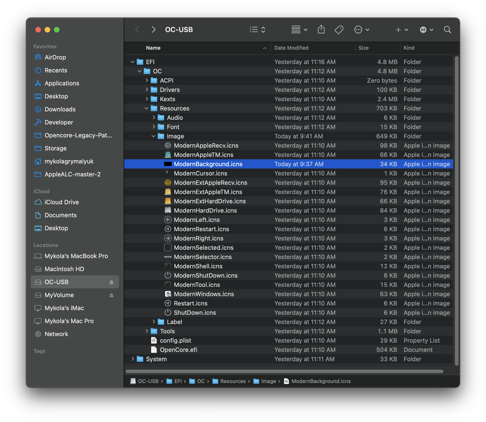
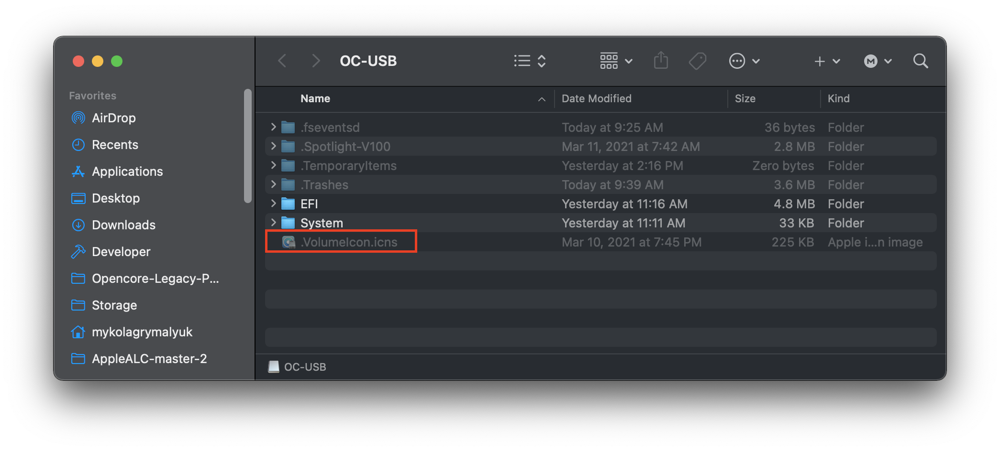

# Eigene Symbole für OpenCore und den Mac-Bootpicker erstellen

Für Nutzer, die ihr Setup persönlicher gestalten möchten, erlaubt OpenCore eigene Symbole und Bilder im Bootpicker.

* [Eigene OpenCore-Symbole](#eigene-opencore-symbole)
* [Eigene Symbole für den Mac-Bootpicker](#eigene-symbole-fur-den-mac-bootpicker)
* [Geänderte Symbole installieren](#geanderte-symbole-installieren)

# Eigene OpenCore-Symbole

Um eigene OpenCore-Symbole zu erzeugen, brauchst du Folgendes:

* Bilder im PNG-Format
* Jedes Bild in der folgenden Auflösung:
  * Cursor — Mauszeiger (erforderlich, bis 144x144).
  * Selected — Ausgewähltes Element (erforderlich, 144x144).
  * Selector — Auswahlmarkierung (erforderlich, bis 144x40).
  * Left — Nach links scrollen (erforderlich, 40x40).
  * Right — Nach rechts scrollen (erforderlich, 40x40).
  * HardDrive — Generisches Betriebssystem (erforderlich, 128x128).
  * Background — Zentriertes Hintergrundbild. (Empfohlene Maximalgröße 1920x1080)
  * Apple — Apple-Betriebssystem (128x128).
  * AppleRecv — Apple-Recovery (128x128).
  * AppleTM — Apple Time Machine (128x128).
  * Windows — Windows (128x128).
  * Other — Eigener Eintrag (siehe [Entries](https://dortania.github.io/docs/latest/Configuration.html), 128x128).
  * ResetNVRAM — Systemaktion oder Werkzeug zum Zurücksetzen des NVRAM (128x128).
  * Shell — Eintrag mit UEFI-Shell-Namen, z. B. für OpenShell (128x128).
  * Tool — Jedes andere Werkzeug (128x128).

Hinweis: Wir empfehlen, jedes Bild zusätzlich in doppelter Größe bereitzuhalten. So werden die Symbole korrekt skaliert, da .icns eigene Bilder für HiDPI und Nicht-HiDPI unterstützt.

Sobald du ein eigenes Bild hast, das du verwenden möchtest (z. B. als Hintergrund), lade das [neueste Release von OpenCorePkg](https://github.com/acidanthera/OpenCorePkg/releases) herunter und öffne den Ordner `Utilities/icnspack/`:



Wechsle nun im Terminal mit `cd` in diesen Ordner und führe Folgendes aus:

```sh
./icnspack Background.icns <insert_x1_image> <insert_x2_image>
```

Danach findest du dein erzeugtes Symbol im Ordner von `icnspack`:



# Eigene Symbole für den Mac-Bootpicker

Eigene Bootpicker-Symbole sind auf älteren Macs deutlich komplizierter. Auf Macs ab Ende 2013 funktioniert die Methode aus [Eigene OpenCore-Symbole](#eigene-opencore-symbole) problemlos. Auf vielen Macs von 2012 und älter sind die so erzeugten Symbole jedoch nicht mit der Firmware kompatibel.

Um Symbole für ältere Macs zu erzeugen, brauchst du Folgendes:

* Einen Rechner mit macOS 10.4 bis 10.11
* Icon Composer.app (für den offiziellen Download ist ein Apple-Developer-Konto nötig)
  * Ohne Developer-Konto findest du Mirrors hier:
    * [Icon Composer 10.6](https://github.com/dortania/OpenCore-Legacy-Patcher/blob/main/docs/Icon-Composer-10.6.zip)
    * [Icon Composer 10.11](https://github.com/dortania/OpenCore-Legacy-Patcher/blob/main/docs/Icon-Composer-10.11.zip)
* Das PNG-Bild, das du umwandeln möchtest

Öffne die [Seite „More Downloads“ auf developer.apple.com](https://developer.apple.com/download/more/) und suche nach den `Graphics Tools`, die von deinem Betriebssystem unterstützt werden (für 10.6 und älter steckt die App in den `Developer Tools`):



Öffne nach dem Download das Disk-Image – darin findest du Icon Composer.app:



Starte die App und ziehe die Bilder einfach in die jeweiligen Bereiche:



Sichere und exportiere anschließend die neue icns-Datei.

# Geänderte Symbole installieren

Stelle vor der Installation sicher, dass Vault beim Erstellen von OpenCore deaktiviert war. Wenn du unsicher bist, erstelle OpenCore einfach neu und setze dabei die Patcher-Einstellung „Vault“ auf „false“.

* <span style="color:red"> Warnung</span>: Wenn du deine OpenCore-EFI falsch bearbeitest, kann deine Installation unbrauchbar werden. Stelle sicher, dass du eine nativ unterstützte macOS-Version installiert hast, in die du bei Problemen booten kannst.

Nachdem du sichergestellt hast, dass du OpenCore gefahrlos bearbeiten kannst, musst du das Laufwerk einhängen, auf dem OpenCore liegt. Lade dazu [MountEFI](https://github.com/corpnewt/MountEFI) herunter und starte es:


Wähle das Laufwerk, auf dem du OpenCore installiert hast, und hänge es ein.

* [OpenCore-Symbole aktualisieren](#opencore-symbole-aktualisieren)
* [Symbole des Mac-Bootpickers aktualisieren](#symbole-des-mac-bootpickers-aktualisieren)

### OpenCore-Symbole aktualisieren

Öffne auf deinem Laufwerk `EFI/OC/Resources/Image/` – dort siehst du alle Symbole. Damit Background.icns zum in OpenCore eingestellten Theme passt, fügen wir dem Dateinamen das Präfix `Modern` hinzu:



Starte jetzt neu – du solltest deine geänderten Symbole sehen!

### Symbole des Mac-Bootpickers aktualisieren

Das Aktualisieren der Symbole des Mac-Bootpickers ist eigentlich ganz einfach: Lege das Symbol einfach unter dem Namen `.VolumeIcon.icns` im Wurzelverzeichnis des Laufwerks ab.



Starte jetzt neu, und du siehst das neue Symbol!
