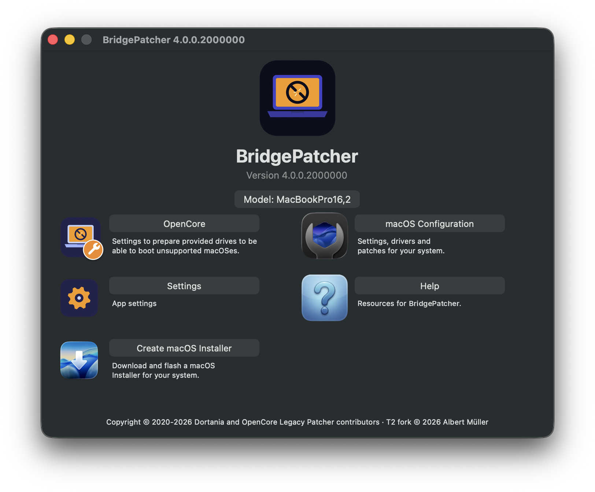
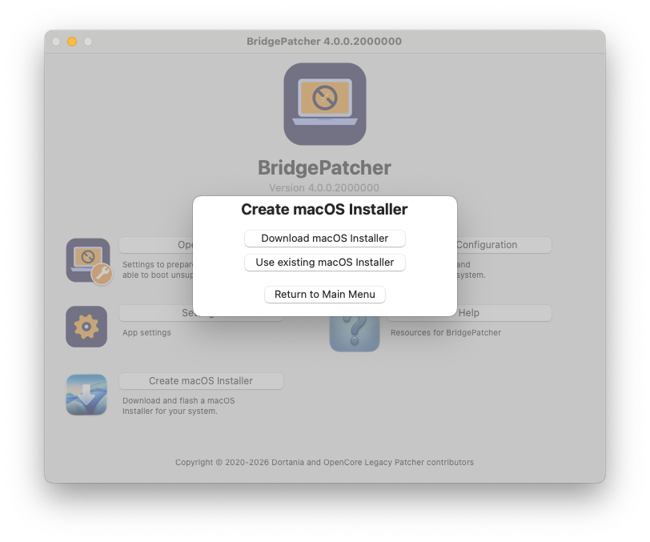
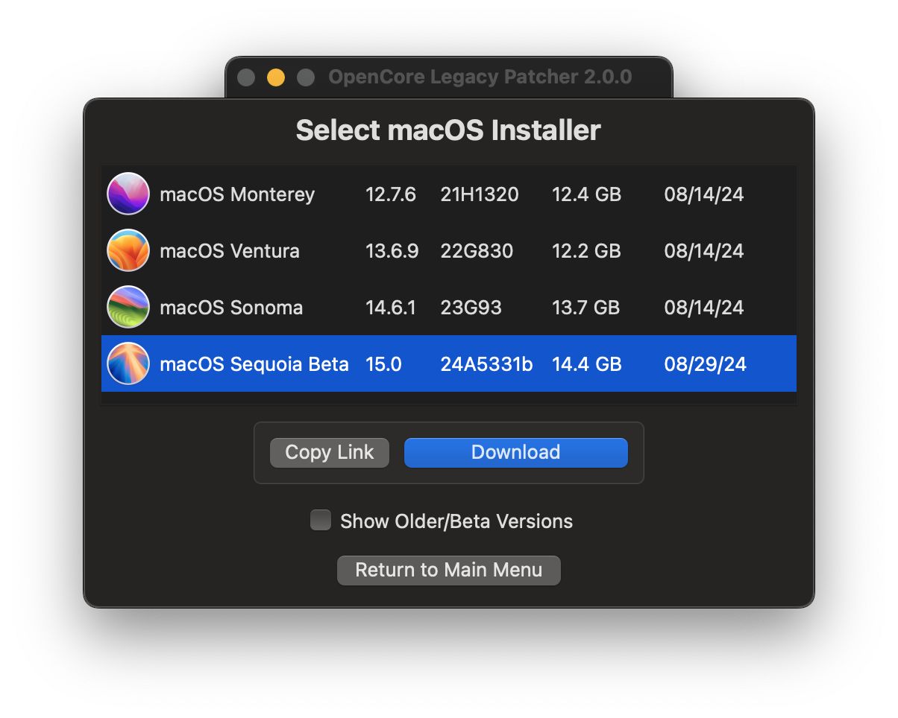
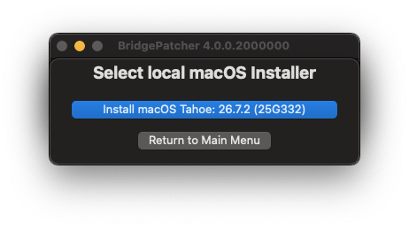
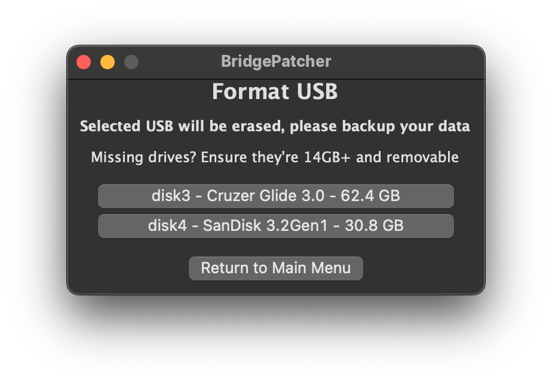
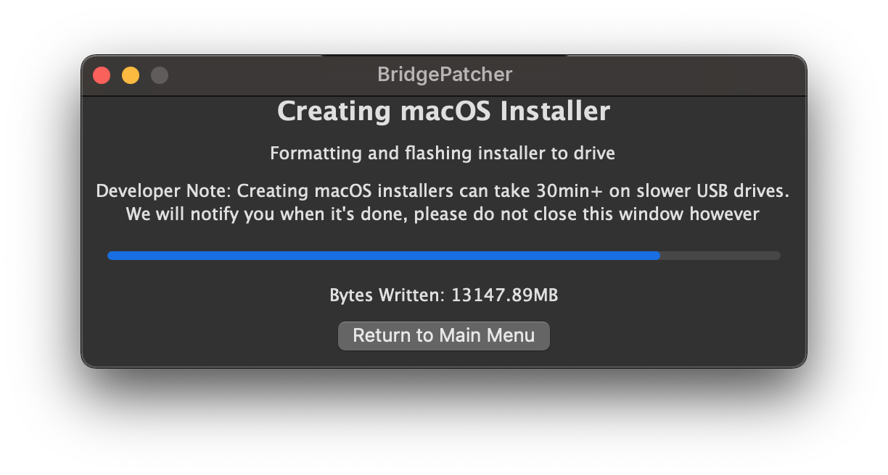
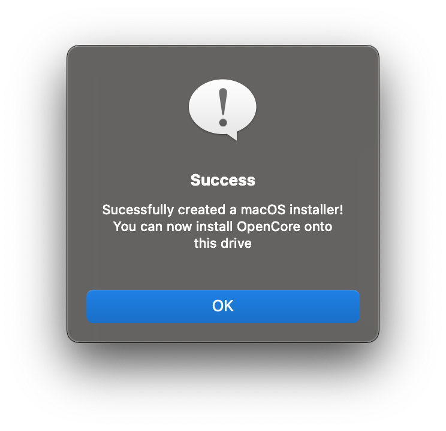
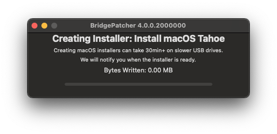

# macOS-Installer erstellen

In diesem Dokument geht es darum, den macOS-Installer herunterzuladen und auf einen USB-Stick zu schreiben. Wenn du macOS auf einem anderen System installieren möchtest als dem, auf dem du gerade arbeitest, wähle am besten jetzt schon vor dem Fortfahren das Mac-Modell in den Einstellungen aus, damit das automatische Root-Patching später korrekt funktioniert.

* Hinweis: Ein 32-GB-Stick wird empfohlen – bei neueren Versionen von Sonoma und Sequoia passen Installer und Patches nicht mehr auf einen 16-GB-Stick. Für ältere Versionen kann ein 16-GB-Stick funktionieren.

Bevor du fortfährst, lies bitte die Anforderungen an die Anwendung und an die Erstellung des macOS-Installers [in der FAQ.](FAQ.md#anforderungen-der-app) Neuere macOS-Versionen setzen ein neueres Host-Betriebssystem voraus, bevor du einen Installer erstellen kannst. Das liegt an den Anforderungen von Apples `createinstallmedia`-Werkzeug, auf dem OCLP aufbaut.

## Installer herunterladen

Zuerst brauchst du die App:

* [OpenCore Legacy Patcher T2 Release-Apps](https://github.com/oclp-t2/OpenCore-Legacy-Patcher-T2/releases)

Öffne die App nach dem Herunterladen, und du solltest vom Hauptmenü begrüßt werden.

Wähle zuerst die Schaltfläche „Create macOS Installer“. Dir werden dann zwei Optionen angeboten.

Für dieses Beispiel gehen wir davon aus, dass du einen Installer brauchst. Wähle „Download macOS installer“, um eine Liste der Installer zu erhalten. Klicke auf die Version, die du herunterladen möchtest.

| Hauptmenü | Menü zur Installer-Erstellung | Verfügbare Installer |
| :--- | :--- | --- |
|  |  |  |

## Installer erstellen

Sobald der Download abgeschlossen ist, kannst du den Installer auf einen USB-Stick schreiben.

* Hinweis: Der gesamte USB-Stick wird formatiert.

| Heruntergeladenen Installer wählen | Zu formatierendes Laufwerk wählen |
| :--- | :--- |
|  |  |

Jetzt beginnt der Patcher, den Installer auf den Stick zu schreiben!

| Schreibvorgang | Erfolgsmeldung | Schreibvorgang abgeschlossen |
| :--- | :--- | :--- |
|  |  |  |

# Wenn du fertig bist, geht es weiter mit [OpenCore erstellen und installieren](./BUILD.md)
