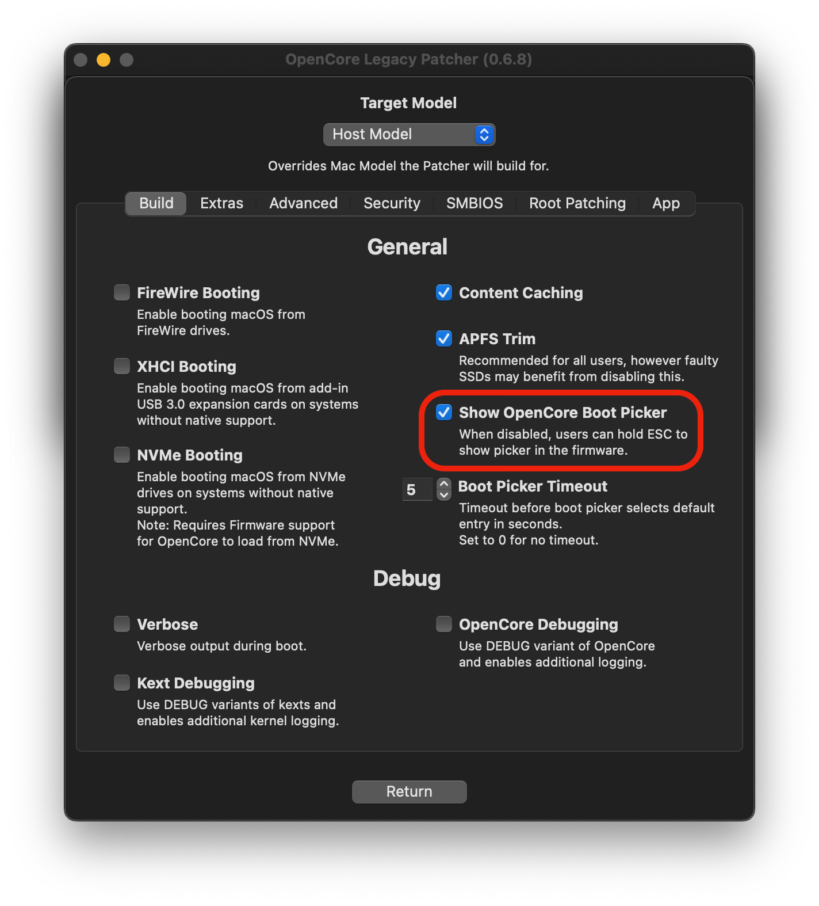
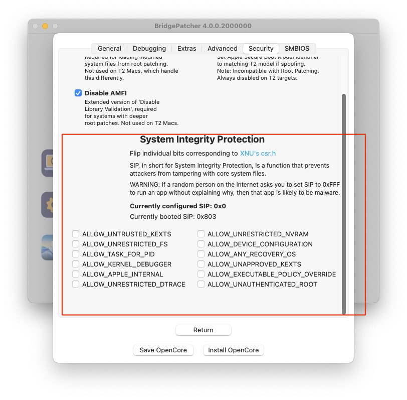
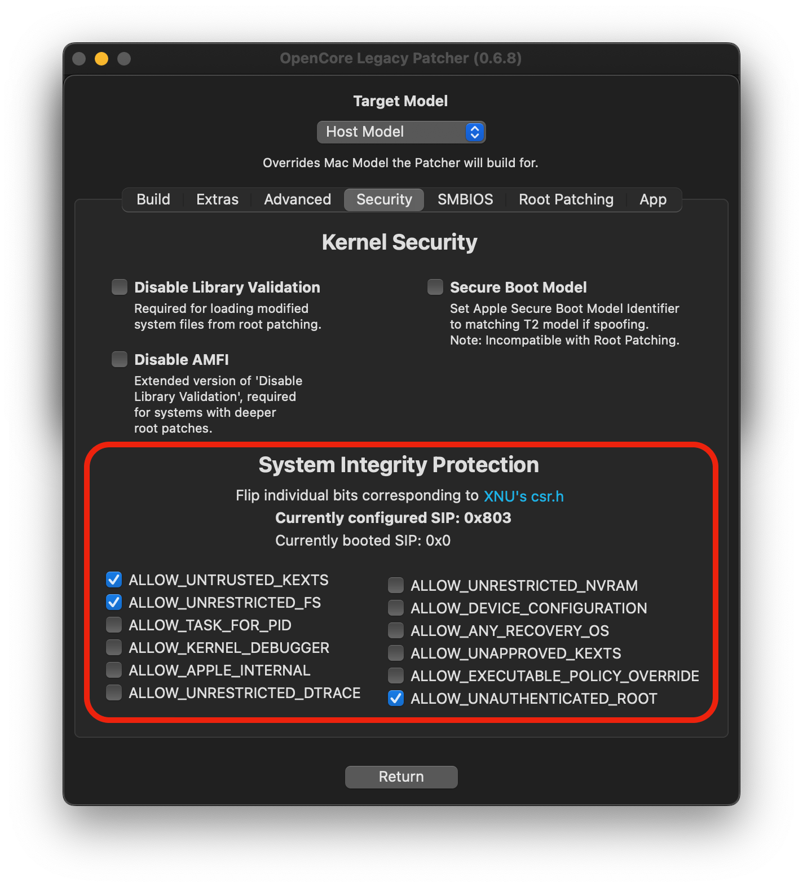
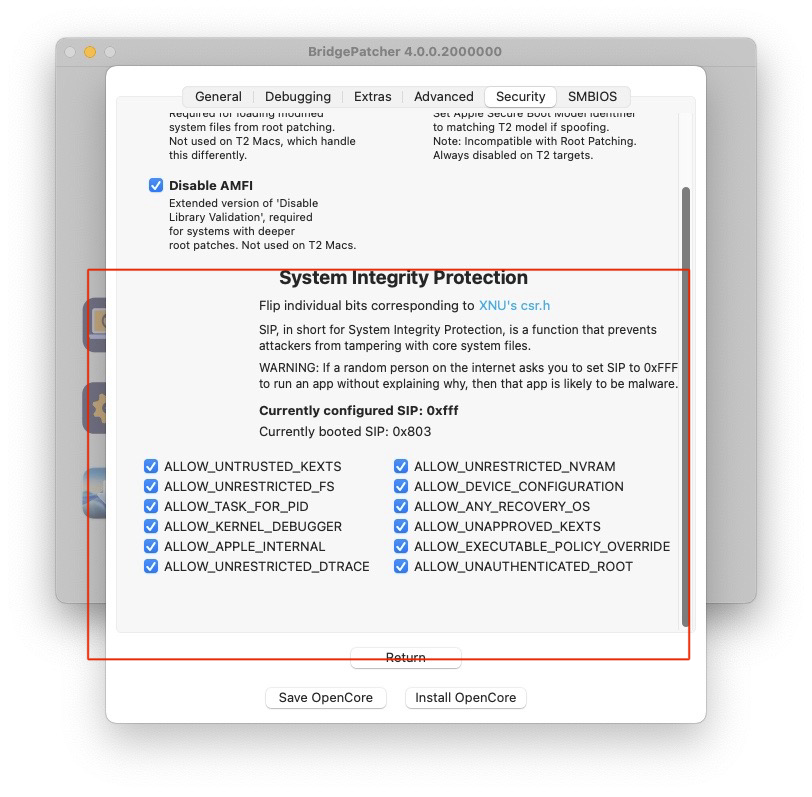
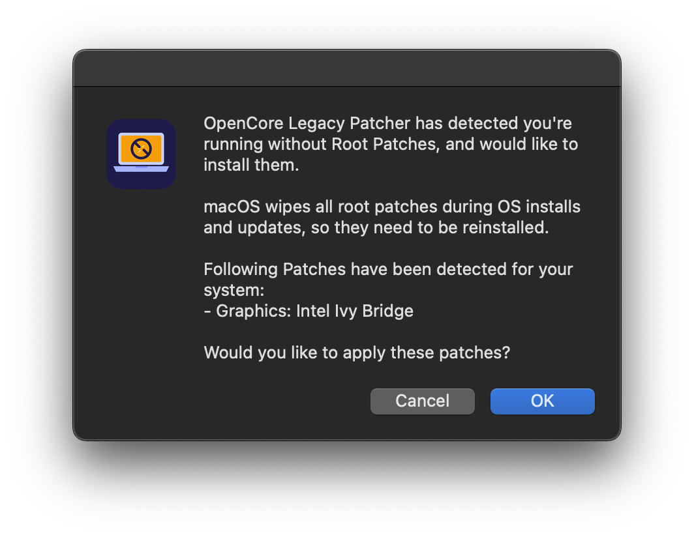
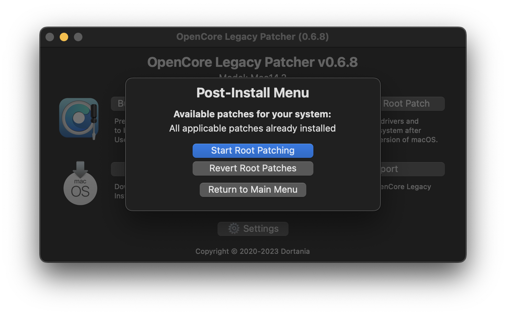
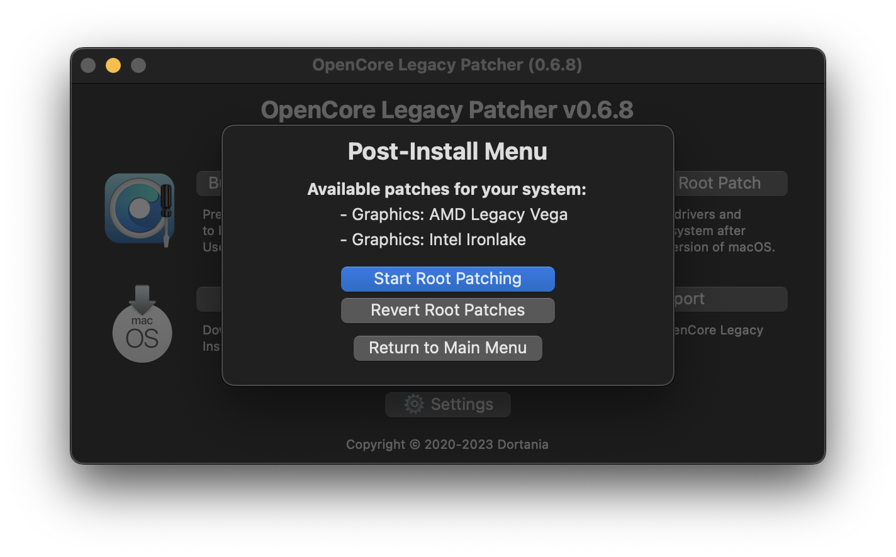
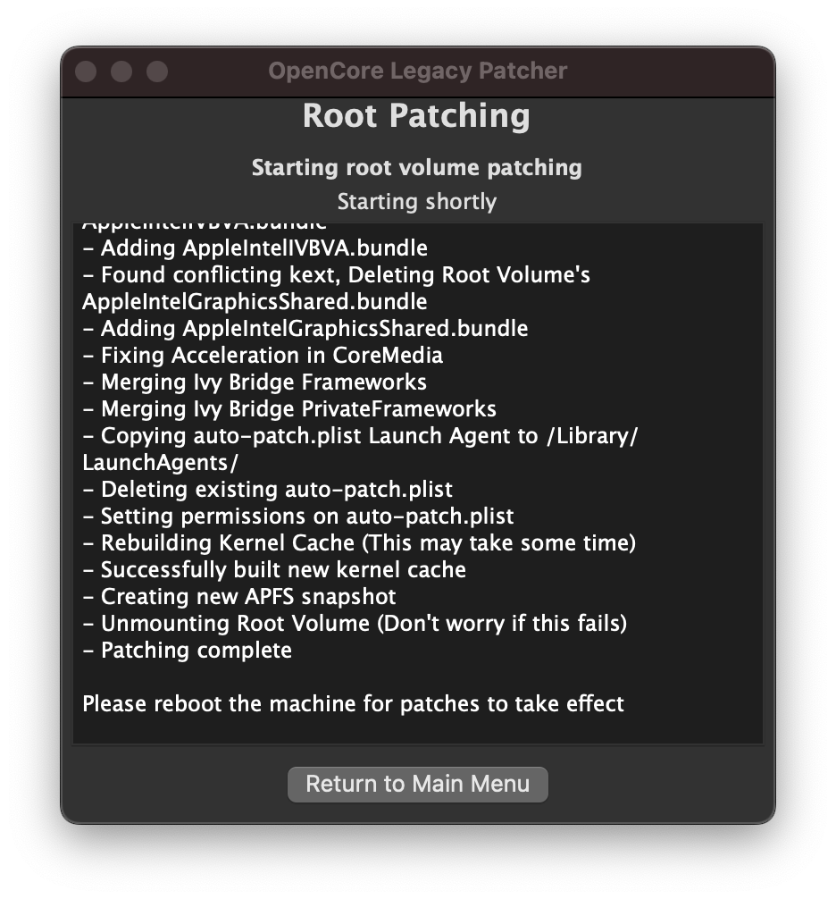

# Nach der Installation

* [Ohne USB-Stick booten](None#ohne-usb-stick-booten)
* [Nahtlos ohne Bootpicker booten](None#nahtlos-ohne-bootpicker-booten)
* [SIP-Einstellungen](None#sip-einstellungen)
* [Post-Install-Volume-Patches anwenden](None#post-install-volume-patches-anwenden)

## Ohne USB-Stick booten

Nachdem du macOS über OpenCore installiert hast, kannst du booten und die normale Einrichtung durchlaufen. Ohne eingesteckten USB-Stick zu booten, ist ganz einfach:

* Lade OpenCore Legacy Patcher T2 herunter
* Passe die Patcher-Einstellungen nach Wunsch an
* Erstelle OpenCore erneut
* Installiere OpenCore auf dem internen Laufwerk
* Starte neu, halte dabei die Wahltaste (Option) gedrückt und wähle die interne EFI

Und voilà! Kein USB-Stick mehr nötig.

Falls dein internes Laufwerk nicht erkannt wird, findest du Hilfe unter [Internes Laufwerk fehlt beim Erstellen von OpenCore](TROUBLESHOOT-APP.md#internes-laufwerk-fehlt-beim-erstellen-von-opencore).

## Nahtlos ohne Bootpicker booten

Starte dazu den OpenCore Patcher, öffne die Patcher-Einstellungen und deaktiviere im Tab „Build“ die Option „Show OpenCore Bootpicker“:

             

Nachdem du die Option deaktiviert hast, erstelle deine OpenCore-EFI erneut und installiere sie auf das gewünschte Laufwerk. Um den OpenCore-Picker trotzdem anzuzeigen, halte einfach die Taste „ESC“ gedrückt, während du auf „EFI Boot“ klickst, und lass sie los, sobald du oben links den Mauszeiger siehst.

## SIP-Einstellungen

SIP (System Integrity Protection, Systemintegritätsschutz) muss auf Systemen gelockert werden, bei denen Root-Patching nötig ist, um Daten auf dem Laufwerk zu patchen. Das hängt von der macOS-Version und vom jeweiligen Modell ab.

OCLP ermittelt standardmäßig die passenden SIP-Optionen für macOS-Version und Mac-Modell; in den meisten Fällen musst du an diesen Einstellungen nichts ändern.

:::warning Achtung

Wenn du unsicher bist, ob du die SIP-Einstellungen ändern solltest, lass sie, wie sie sind. Auf Systemen, auf denen du das Post-Install-Root-Patching bereits ausgeführt hast, kannst du SIP nicht aktivieren, ohne die aktuelle Installation möglicherweise zu beschädigen.

:::

| SIP aktiviert | SIP gelockert (OCLP-Standard) | SIP deaktiviert |
| :--- | :--- | :--- |
|  |  |  |

Die Anleitung im aufklappbaren Bereich unten erklärt, wie die SIP-Einstellungen in OCLP funktionieren, wo gelockertes SIP nötig ist und wo vollständiges SIP aktiviert werden kann.

::: details SIP manuell konfigurieren (zum Aufklappen klicken)

Die SIP-Einstellungen findest du im Tab „Security“, wie in den Bildern gezeigt. Um sie zu ändern, nimm hier die Änderungen vor, kehre ins Hauptmenü zurück und erstelle OpenCore über die erste Option neu.

Wo SIP aktiviert werden kann, musst du es manuell aktivieren.

Am einfachsten prüfst du im Bereich „Post Install Root Patch“, ob du SIP vollständig aktivieren kannst: Wenn dort steht, dass dein System keine Patches benötigt (oder du die Patches nicht installierst, z. B. weil du auf einem Mac Pro mit aufgerüsteter GPU unter Monterey kein WLAN brauchst), kannst du davon ausgehen, dass vollständiges SIP aktiviert werden kann.

**Ventura und neuer**

Alle nicht unterstützten Systeme benötigen gelockertes SIP.

**Monterey**

Die meisten nicht unterstützten Systeme ab 2013 können vollständiges SIP aktivieren.

Systeme vor 2012 („Nicht-Metal“) sowie NVIDIA-Kepler- und Intel-HD-4000-GPUs benötigen gelockertes SIP. Mac Pros benötigen ebenfalls gelockertes SIP für die originalen WLAN-Karten und GPUs (wegen des Root-Patchings). Wenn du aber kein WLAN brauchst (oder es aufrüsten willst) und eine aufgerüstete GPU nutzt, ist kein Root-Patching nötig, und SIP kann vollständig aktiviert werden.

**Big Sur**

Alle Metal-fähigen Systeme ab 2012 (inkl. NVIDIA Kepler und Intel HD 4000) sowie Mac Pros mit aufgerüsteter GPU können mit vollständig aktiviertem SIP laufen.
Nicht-Metal-Systeme benötigen weiterhin gelockertes SIP.

:::

## Post-Install-Volume-Patches anwenden

Post-Install-Volume-Patches, manchmal auch Root-Patches genannt, sind Patches, die auf dem Laufwerk installiert werden müssen, damit einige ältere Macs ihre Funktionen zurückerhalten.

Dazu gehören zum Beispiel:

- Grafiktreiber
- WLAN-Treiber
- Bluetooth-Treiber
- Touch-Bar-/T1-Treiber
- Treiber für die integrierte Kamera (iSight)
- USB-1.1-Treiber
- Weitere Patches für die Kompatibilität mit älteren Treibern

OCLP patcht dein System automatisch, wenn der USB-Installationsstick mit OCLP erstellt und vor der Installer-Erstellung das richtige Modell ausgewählt wurde. Wenn du den USB-Stick nicht mit OCLP erstellt hast oder das automatische Patchen fehlgeschlagen ist, musst du OCLP manuell herunterladen und die Root-Patches installieren, da die App fehlt, wenn das automatische Patchen nicht erfolgreich war.

**Root-Patches werden durch macOS-Updates entfernt und müssen nach jedem Update erneut installiert werden.** OCLP fordert dich nach macOS-Updates oder immer dann, wenn keine Patches auf dem System erkannt werden, zur Installation auf. Du kannst künftige Updates auch über den USB-Installer installieren; dabei greift das automatische Patchen, und du sparst dir das manuelle Patchen, das beim Aktualisieren über die Systemeinstellungen nötig ist.

Im Post-Install-Menü siehst du, ob die passenden Patches installiert sind, einschließlich Datum und Version, mit der das System gepatcht wurde.

::: warning Wichtig

In manchen Fällen muss OCLP Pakete aus dem Internet laden, etwa das KDK oder MetallibSupportPkg, falls sie noch nicht auf dem System vorhanden sind. Dann installiert OCLP beim ersten Patchvorgang unter Umständen nur den WLAN-Treiber, damit du dich mit dem Internet verbinden kannst – nach dem Neustart gibt es also noch keine Grafikbeschleunigung.

Sobald eine Internetverbindung besteht und die nötigen Pakete geladen werden können, musst du das Root-Patching manuell erneut ausführen, um die übrigen Patches zu installieren. Du kannst auch Ethernet nutzen; dann sollten alle Patches auf einmal installiert werden.

[Die betroffenen Systeme und GPUs findest du unten.](None#pakete-die-eine-netzwerkverbindung-erfordern)

:::

:::warning Achtung

Wenn du den Migrationsassistenten nutzen musst, um Daten auf deine neue macOS-Installation zu übertragen, [folge dieser Anleitung](TIMEMACHINE.md).

:::

| Automatische Installationsaufforderung | Status | Liste der Patches | Patchen abgeschlossen |
| :--- | :--- | :--- | :--- |
|  |  |  |  |

Du kannst Root-Patches in der App auch manuell installieren und wieder entfernen.

### Pakete, die eine Netzwerkverbindung erfordern

#### MetallibSupportPkg

Erforderlich für Systeme mit Ivy Bridge, Haswell und NVIDIA Kepler (3802) unter Sequoia oder neuer. Du kannst es manuell über folgenden Link herunterladen:

* [MetallibSupportPkg](https://github.com/dortania/MetallibSupportPkg/releases)

**Achte darauf, dass der Build exakt zu deiner macOS-Version passt.**

::: details Vollständige Liste der GPU-Modelle, die MetallibSupportPkg benötigen (zum Aufklappen klicken)

* NVIDIA
    * Kepler (GTX-600–700-Serie, Quadro-K-Serie)
* Intel
   * Ivy Bridge (HD-4000-Serie)
   * Haswell (Iris/HD-4000–5000-Serie)

:::

#### KDK / Kernel Debug Kit

Macs mit AMD-Legacy-GCN-GPUs (also Metal) unter Ventura oder neuer benötigen Apples Kernel Debug Kit, um das Root-Patching zu starten. Du kannst das KDK über folgenden Link manuell herunterladen:

* [KDKSupportPkg](https://github.com/dortania/KdkSupportPkg/releases)

Nimm das Kernel Debug Kit, dessen Version deiner installierten macOS-Version am nächsten kommt, und installiere es auf dem Gerät.

:::details Macs und GPUs, die ein KDK benötigen (zum Aufklappen klicken)

GPUs:
* Radeon-HD-7000-Serie
* Radeon-R9-Serie
* FirePro D300/D500/D700

Mac-Modelle mit GCN-GPUs:
* iMac 2014–2015 (iMac15,1–17,1)
* Mac Pro 2013 (MacPro6,1)
* MacBook Pro 2015 15", Version mit dedizierter GPU (MacBookPro11,5)

Aufgerüstete Macs:
* Mac Pro 2008–2012 (MacPro3,1–5,1), falls mit einer AMD-GCN-GPU aufgerüstet.
* iMac 2009–2011 (iMac10,1–12,1), falls mit einer AMD-GCN-GPU aufgerüstet.

:::

### Weitere Informationen

Die folgenden Einträge zeigen GPUs, die nicht mehr nativ unterstützt werden, also Root-Volume-Patching mit OpenCore Legacy Patcher T2 benötigen:

:::details GPUs, die in den verschiedenen macOS-Versionen gepatcht werden müssen

AMD-Navi-GPUs (Serie RX 5000–6000) funktionieren in Mac Pros von 2008 bis 2012 unter Ventura und neuer nicht, da diese kein AVX2 unterstützen.

**Ventura/Sonoma/Sequoia**

* NVIDIA:
  * Tesla (Serie 8000–300)
  * Kepler (Serie 600–800)
* AMD:
  * TeraScale (Serie 2000–6000)
  * GCN 1–3 (Serie 7000 – R9)
  * Polaris (Serie RX 4xx/5xx, falls die CPU kein AVX2 unterstützt)
* Intel:
  * Iron Lake
  * Sandy Bridge (Serie 2000–3000)
  * Ivy Bridge (Serie 4000)
  * Haswell (Serie 4400, 4600, 5000)
  * Broadwell (Serie 6000)
  * Skylake (Serie 500)

**Monterey**

* NVIDIA:
  * Tesla (Serie 8000–300)
  * Kepler (Serie 600–800)
* AMD:
  * TeraScale (Serie 2000–6000)
* Intel:
  * Iron Lake
  * Sandy Bridge (Serie 2000–3000)
  * Ivy Bridge (Serie 4000)

**Big Sur**

* NVIDIA:
  * Tesla (Serie 8000–300)
* AMD:
  * TeraScale (Serie 2000–6000)
* Intel:
  * Iron Lake
  * Sandy Bridge (Serie 2000–3000)

:::

:::details WLAN-Karten, die in macOS Monterey gepatcht werden müssen

* Broadcom:
  * BCM94328
  * BCM94322
* Atheros

:::
