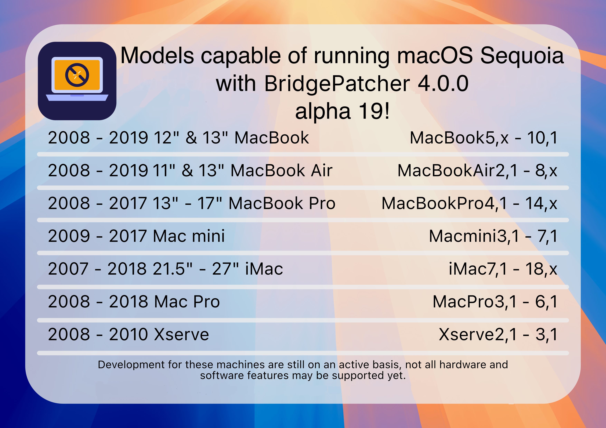

# macOS Sequoia


Ein neues Jahr, eine neue Version.

Diesmal hat Apple überraschend wenige Macs fallen gelassen. Mit OpenCore Legacy Patcher 2.0.0 wurde eine erste Unterstützung für macOS Sequoia eingeführt.


## Neu nicht mehr unterstützte Hardware

* MacBookAir8,1 :       MacBook Air (2018)
* MacBookAir8,2 :       MacBook Air (2019)

## Aktueller Stand

OpenCore Legacy Patcher 2.0.0 unterstützt Sequoia auf den unten aufgeführten Modellen, einige Herausforderungen bleiben aber bestehen. Informationen dazu findest du weiter unten auf dieser Seite.



Die T2-bedingte AppleKeyStore-Panic, die die kürzlich fallen gelassenen MacBookAir8,x-Modelle (und andere nicht unterstützte T2-Macs) früher am Booten über OpenCorePkg hinderte, ist in OpenCore Legacy Patcher T2 behoben. Die T2-Unterstützung befindet sich aber noch im Alpha-Stadium: Die Installation wird noch nicht abgeschlossen. Den aktuellen Stand findest du unten unter [T2-Sicherheitschip](#t2-sicherheitschip).

## Nicht funktionierende Funktionen

Auf den meisten gepatchten Macs funktionieren iPhone-Synchronisierung und Apple Intelligence nicht.

iPhone-Synchronisierung benötigt den T2 für die Attestierung und Apple Intelligence eine NPU, die es nur in Apple Silicon gibt. Da es sich um Hardwareanforderungen handelt, kann der Patcher dafür keine Lösung bieten.

## Probleme

* [Dual-Socket-CPUs in Mac Pros und Xserve](#dual-socket-cpus-im-mac-pro-2008-und-xserve-2008)
* [T2-Sicherheitschip](#t2-sicherheitschip)
* [Unterstützung für USB 1.1 (OHCI/UHCI)](#unterstutzung-fur-usb-1-1-ohci-uhci)
* [Grafikunterstützung und -probleme](#grafikunterstutzung-und-probleme)


### Dual-Socket-CPUs im Mac Pro 2008 und Xserve 2008

Das Booten von Sequoia auf einem Mac Pro 2008 (MacPro3,1) oder Xserve 2008 (Xserve2,1) mit mehr als 4 Kernen verursacht eine Kernel Panic. OpenCore Legacy Patcher T2 deaktiviert die zusätzlichen Kerne automatisch.

Das liegt an der Dual-Socket-Bauweise dieser Geräte und vermutlich an einer Inkompatibilität der Firmware bzw. ACPI-Tabellen.

**Wenn du OpenCore für ein älteres Betriebssystem erstellst, kannst du diese Einschränkung unter Settings -> Build -> „MacPro3,1/Xserve2,1 Workaround“ deaktivieren.**

::: warning Hinweis

Aus den oben genannten Gründen ist ein Dualboot von Sequoia und älteren Versionen mit allen aktivierten Kernen nicht möglich. In diesem Fall bist du auf 4 Kerne beschränkt.

:::

### T2-Sicherheitschip

Das Booten von T2-Macs wie der MacBookAir8,x-Serie (2018/19) über OpenCorePkg endete früher in einer Kernel Panic, weil AppleKeyStore.kext bei der Kommunikation mit dem T2-Chip in Timeouts lief:

```
"AppleKeyStore":3212:0: sks timeout strike 18
"AppleKeyStore":3212:0: sks timeout strike 19
"AppleKeyStore":3212:0: sks timeout strike 20
panic(cpu 0 caller 0xffffff801cd12509): "AppleSEPManager panic for "AppleKeyStore": sks request timeout" @AppleSEPManagerIntel.cpp:809
```

**Diese Panic tritt nicht mehr auf.** OpenCore Legacy Patcher T2 kommt auf nicht unterstützten T2-Macs inzwischen über die AppleKeyStore-Timeouts hinweg, sodass die Geräte in den Installer booten.

Die T2-Unterstützung befindet sich aber noch im **Alpha**-Stadium. Das verbleibende Problem: Die macOS-Installation endet derzeit vor dem Abschluss mit „Failed to install a software update“. Wann T2-Installationen vollständig funktionieren, können wir noch nicht abschätzen.

Wenn du beim Testen helfen oder Ergebnisse teilen möchtest, nutze bitte die [GitHub Discussions](https://github.com/albert-mueller/OpenCore-Legacy-Patcher-T2/discussions).

### Unterstützung für USB 1.1 (OHCI/UHCI)

Bei Penryn-Systemen, Mac Pros vor 2013 und Xserve wurde die USB-1.1-Unterstützung in macOS Ventura komplett entfernt; das gilt daher bis einschließlich Sequoia.
USB 1.1 mag unwichtig erscheinen, steuert aber viele wichtige Geräte deines Systems, darunter:

* Tastatur und Trackpad bei Laptops
* Infrarotempfänger
* Bluetooth

Wie du das Problem umgehst, erfährst du auf [der Seite zur Fehlerbehebung](TROUBLESHOOT-HARDWARE.md#tastatur-maus-und-trackpad-funktionieren-im-installer-oder-nach-einem-update-nicht).


### Grafikunterstützung und -probleme
Dieser Build enthält sowohl Legacy-Metal- als auch Nicht-Metal-Patches für macOS Sequoia. Weitere Informationen zur Legacy-Metal- und Nicht-Metal-Unterstützung und den jeweiligen Problemen findest du unter folgenden Links:

* [Legacy Metal](https://github.com/dortania/OpenCore-Legacy-Patcher/issues/1008)
* [Nicht-Metal](https://github.com/dortania/OpenCore-Legacy-Patcher/issues/108)
