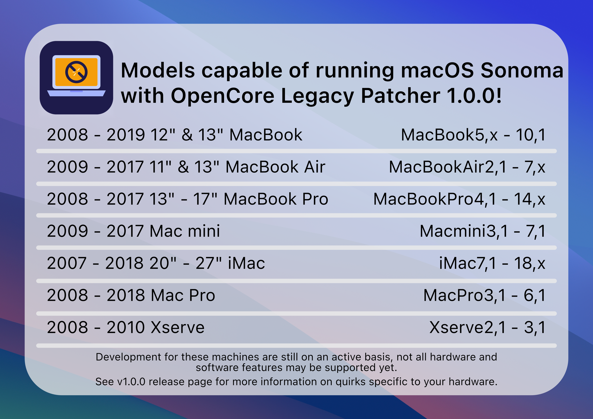

# macOS Sonoma

*Da sind wir wieder, es ist uns immer ein Vergnügen~*

Apple hat erneut eine Reihe von Modellen fallen gelassen und setzt damit den Ausstieg aus Intel-Macs fort. Mit der Veröffentlichung von OpenCore Legacy Patcher 1.0.0 wurde erste Unterstützung für macOS Sonoma implementiert.

## Neu fallen gelassene Hardware

* MacBook10,1:       MacBook (Retina, 12 Zoll, 2017)
* MacBookPro14,1:    MacBook Pro (13 Zoll, 2017, zwei Thunderbolt-3-Anschlüsse)
* MacBookPro14,2:    MacBook Pro (13 Zoll, 2017, vier Thunderbolt-3-Anschlüsse)
* MacBookPro14,3:    MacBook Pro (15 Zoll, 2017)
* iMac18,1:          iMac (21,5 Zoll, 2017)
* iMac18,2:          iMac (Retina 4K, 21,5 Zoll, 2017)
* iMac18,3:          iMac (Retina 5K, 27 Zoll, 2017)

## Aktueller Stand

OpenCore Legacy Patcher 1.0.0 unterstützt Sonoma auf allen unten aufgeführten Modellen, einige Herausforderungen bleiben jedoch bestehen. Informationen dazu findest du weiter unten auf dieser Seite.

## Probleme

* [Bluetooth](#bluetooth)
* [T1-Sicherheitschip](None#t1-sicherheitschip)
* [Unterstützung für USB 1.1 (OHCI/UHCI)](None#unterstutzung-fur-usb-1-1-ohci-uhci)
* [Grafikunterstützung und Probleme](None#grafikunterstutzung-und-probleme)

### Bluetooth

Auf Modellen vor 2012 funktioniert Bluetooth nach dem Start manchmal nicht. Ein NVRAM-Reset kann Abhilfe schaffen.

Bei Dual-Boot-Systemen kann das Problem auch nach dem Reset zurückkehren.

### T1-Sicherheitschip

**Behoben in 1.1.0 und neuer, die ursprüngliche Erklärung steht unten**

::: details Unterstützung für den T1-Sicherheitschip

Sonoma hat die Unterstützung für T1-Chips entfernt, die in den meisten Macs von 2016 und 2017 verbaut sind. Auf diesen Systemen funktioniert daher Folgendes nicht:

* FileVault aktivieren oder deaktivieren
* Das Fenster mit den Passworteinstellungen öffnen
* Fingerabdrücke hinzufügen (bei einem Upgrade werden vorhandene Fingerabdrücke gelöscht)
* Karten zu Apple Pay hinzufügen

[Weitere Informationen hier](https://github.com/dortania/OpenCore-Legacy-Patcher/issues/1103)

:::

::: warning Warnung
Beachte, dass beim Löschen des gesamten Laufwerks die T1-Firmware entfernt und nicht neu installiert wird. Weitere Informationen findest du unter [Fehlerbehebung](TROUBLESHOOT-HARDWARE.md#keine-t1-funktionen-nach-der-installation-von-sonoma-oder-neuer).
:::

### Unterstützung für USB 1.1 (OHCI/UHCI)

Bei Penryn-Systemen, Mac Pros vor 2013 und Xserve wurde die Unterstützung für USB 1.1 in macOS Ventura komplett entfernt, und das setzt sich natürlich in Sonoma fort.
Auch wenn USB 1.1 unwichtig erscheinen mag, hängen viele wichtige Geräte deines Systems daran, darunter:

* Tastatur und Trackpad bei Laptops
* IR-Empfänger
* Bluetooth

Auf [der Fehlerbehebungsseite](TROUBLESHOOT-HARDWARE.md#tastatur-maus-und-trackpad-funktionieren-im-installer-oder-nach-einem-update-nicht) erfährst du, wie du dieses Problem umgehen kannst.

### Grafikunterstützung und Probleme
Dieser Build enthält sowohl Legacy-Metal- als auch Non-Metal-Patches für macOS Sonoma. Unter den folgenden Links findest du weitere Informationen zur Unterstützung von Legacy Metal und Non-Metal sowie zu den jeweiligen Problemen.

* [Legacy Metal](https://github.com/dortania/OpenCore-Legacy-Patcher/issues/1008)
* [Non-Metal](https://github.com/dortania/OpenCore-Legacy-Patcher/issues/108)
