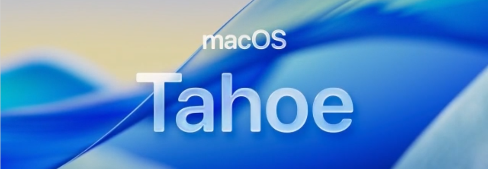

# macOS Tahoe



*Da sind wir nun – das letzte für Intel-Macs*

macOS 26 Tahoe ist das letzte große macOS-Release, das Apple für Intel-Macs ausliefert. Es lässt eine große Zahl von Intel-Macs fallen, die meisten davon mit T2-Sicherheitschip – deshalb ist es der Hauptfokus von OpenCore Legacy Patcher T2.

Die Unterstützung für macOS Tahoe in OpenCore Legacy Patcher T2 befindet sich derzeit im **Alpha**-Stadium. Rechne mit Fehlern und melde sie bitte in den [GitHub Discussions](https://github.com/albert-mueller/OpenCore-Legacy-Patcher-T2/discussions).


## Neu fallen gelassene Hardware

* MacBookAir9,1 :       MacBook Air (Retina, 13 Zoll, 2020)
* MacBookPro15,1 :      MacBook Pro (15 Zoll, 2018 und 2019)
* MacBookPro15,2 :      MacBook Pro (13 Zoll, 2018 und 2019, vier Thunderbolt-3-Anschlüsse)
* MacBookPro15,3 :      MacBook Pro (15 Zoll, 2018 und 2019, Vega-Grafik)
* MacBookPro15,4 :      MacBook Pro (13 Zoll, 2019, zwei Thunderbolt-3-Anschlüsse)
* MacBookPro16,3 :      MacBook Pro (13 Zoll, 2020, zwei Thunderbolt-3-Anschlüsse)
* Macmini8,1 :          Mac mini (Ende 2018)
* iMac19,1 :            iMac (Retina 5K, 27 Zoll, 2019)
* iMac19,2 :            iMac (Retina 4K, 21,5 Zoll, 2019)
* iMacPro1,1 :          iMac Pro (2017)

Alle diese Modelle außer dem iMac (2019) haben einen T2-Sicherheitschip.

Die einzigen Intel-Macs, auf denen Tahoe noch nativ läuft, sind das MacBook Pro (16 Zoll, 2019), das MacBook Pro (13 Zoll, 2020, vier Thunderbolt-3-Anschlüsse), der iMac (Retina 5K, 27 Zoll, 2020) und der Mac Pro (2019).

## Aktueller Stand

Auf Macs **ohne** T2-Chip kann OpenCore Legacy Patcher T2 macOS Tahoe installieren und Root-Patches anwenden, einige Herausforderungen bleiben jedoch bestehen. Informationen dazu findest du weiter unten auf dieser Seite.

Auf **T2-Macs** funktioniert Tahoe noch nicht. Den aktuellen Stand findest du unten unter [T2-Sicherheitschip](None#t2-sicherheitschip) sowie unter [T2-Macs und macOS Tahoe](MODELS.md#t2-macs-und-macos-tahoe).

## Nicht funktionierende Funktionen

Auf den meisten gepatchten Macs funktionieren iPhone-Synchronisierung (iPhone Mirroring) und Apple Intelligence nicht.

iPhone Mirroring benötigt den T2 zur Attestierung und Apple Intelligence eine NPU, die es nur bei Apple Silicon gibt. Da es sich um Hardwareanforderungen handelt, kann der Patcher dafür keine Lösung bieten.

## Probleme

* [T2-Sicherheitschip](None#t2-sicherheitschip)
* [Audiounterstützung](None#audiounterstutzung)
* [Dual-Socket-CPUs bei Mac Pros und Xserve](None#dual-socket-cpus-bei-mac-pro-2008-und-xserve-2008)
* [Unterstützung für USB 1.1 (OHCI/UHCI)](None#unterstutzung-fur-usb-1-1-ohci-uhci)
* [Grafikunterstützung und Probleme](None#grafikunterstutzung-und-probleme)


### T2-Sicherheitschip

Das Booten nicht unterstützter T2-Macs über OpenCorePkg endete früher in einer Kernel Panic, weil AppleKeyStore.kext bei der Kommunikation mit dem T2-Chip in Timeouts lief:

```
"AppleKeyStore":3212:0: sks timeout strike 18
"AppleKeyStore":3212:0: sks timeout strike 19
"AppleKeyStore":3212:0: sks timeout strike 20
panic(cpu 0 caller 0xffffff801cd12509): "AppleSEPManager panic for "AppleKeyStore": sks request timeout" @AppleSEPManagerIntel.cpp:809
```

**Diese Panic tritt nicht mehr auf.** OpenCore Legacy Patcher T2 kommt auf nicht unterstützten T2-Macs inzwischen an den AppleKeyStore-Timeouts vorbei, sodass die Geräte in den Tahoe-Installer booten.

Das verbleibende Problem: Die macOS-Installation endet derzeit vor dem Abschluss mit „Failed to install a software update“. Wir können noch nicht abschätzen, wann T2-Installationen vollständig funktionieren werden.

Wenn du beim Testen helfen oder Ergebnisse teilen möchtest, nutze bitte die [GitHub Discussions](https://github.com/albert-mueller/OpenCore-Legacy-Patcher-T2/discussions).

### Audiounterstützung

macOS Tahoe enthält AppleHDA.kext nicht mehr, den Treiber für die eingebaute Audioausgabe von Intel-Macs. Auf betroffenen Macs stellt OpenCore Legacy Patcher T2 den Ton über den Root-Patch „Modern Audio“ wieder her – führe nach der Installation von Tahoe also unbedingt das Root-Patching aus.

### Dual-Socket-CPUs bei Mac Pro 2008 und Xserve 2008

Wie schon bei macOS Sequoia führt das Booten von Tahoe auf einem Mac Pro 2008 (MacPro3,1) oder Xserve 2008 (Xserve2,1) mit mehr als 4 Kernen zu einer Kernel Panic. OpenCore Legacy Patcher T2 deaktiviert die zusätzlichen Kerne automatisch.

**Wenn du OpenCore für ein älteres Betriebssystem erstellst, kann diese Einschränkung unter Settings -> Build -> „MacPro3,1/Xserve2,1 Workaround“ deaktiviert werden.**

::: warning Hinweis

Dual-Boot von Tahoe und älteren Versionen ist aus den oben genannten Gründen nicht mit allen aktivierten Kernen möglich. In diesem Fall bist du auf 4 Kerne beschränkt.

:::

### Unterstützung für USB 1.1 (OHCI/UHCI)

Bei Penryn-Systemen, Mac Pros vor 2013 und Xserve wurde die Unterstützung für USB 1.1 in macOS Ventura komplett entfernt; das gilt daher bis einschließlich Tahoe.
Auch wenn USB 1.1 unwichtig erscheinen mag, hängen viele wichtige Geräte deines Systems daran, darunter:

* Tastatur und Trackpad bei Laptops
* IR-Empfänger
* Bluetooth

Auf [der Fehlerbehebungsseite](TROUBLESHOOT-HARDWARE.md#tastatur-maus-und-trackpad-funktionieren-im-installer-oder-nach-einem-update-nicht) erfährst du, wie du dieses Problem umgehen kannst.


### Grafikunterstützung und Probleme

Dieser Build enthält sowohl Legacy-Metal- als auch Non-Metal-Patches für macOS Tahoe, basierend auf den Upstream-Patches von Dortania. Unter den folgenden Links findest du weitere Informationen zur Unterstützung von Legacy Metal und Non-Metal sowie zu den jeweiligen Problemen.

* [Legacy Metal](https://github.com/dortania/OpenCore-Legacy-Patcher/issues/1008)
* [Non-Metal](https://github.com/dortania/OpenCore-Legacy-Patcher/issues/108)

::: warning AMD Vega auf T2-Macs

Grafikbeschleunigung für die AMD-Vega-GPUs im iMac Pro (2017) und im MacBook Pro mit Vega (15 Zoll, 2018 und 2019) wird unter Tahoe derzeit nicht bereitgestellt.

:::
