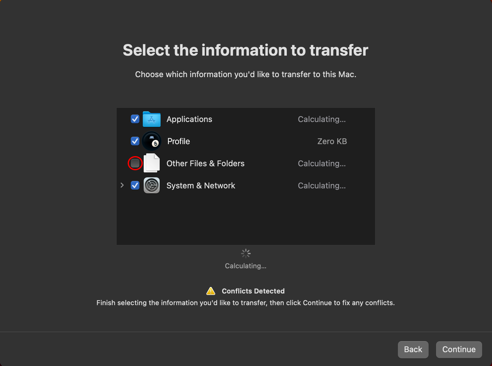

# Time-Machine-Backup wiederherstellen

BridgePatcher installiert bei der ersten Installation vom USB-Stick automatisch Root-Patches, damit die Ersteinrichtung reibungslos funktioniert. Ein unglücklicher Nebeneffekt ist jedoch, dass eine vollständige Wiederherstellung per Time Machine bei installierten Root-Patches fehlschlägt und ein paar Tricks nötig sind, um eine Kernel Panic zu vermeiden. Unten findest du zwei Methoden zur Wiederherstellung.

**Methode 2 wird nur unter Monterey und neuer unterstützt. Big Sur unterstützt das Zurücksetzen von Snapshots nicht.**

::: warning Warnung für Sequoia

Time Machine funktioniert unter Sequoia möglicherweise selbst nach dem Entfernen der Root-Patches nicht und führt zu einer Schleife mit dem Fenster „Migration abgeschlossen“. Falls du auf dieses Problem stößt, stelle unter einem älteren Betriebssystem wieder her und aktualisiere anschließend auf Sequoia.

:::

## Methode 1 – Wiederherstellung mit installierten Root-Patches (teilweise)

**Warnung:** Beachte, dass bei dieser Methode Ordner **außer** „Schreibtisch“, „Dokumente“, „Programme“ usw. (die Hauptordner im Benutzerprofil) möglicherweise nicht wiederhergestellt werden. Für eine vollständige Wiederherstellung verwende Methode 2 unten.

1. Starte die Time-Machine-Wiederherstellung entweder im Systemassistenten (Ersteinrichtung) oder im Migrationsassistenten.
2. Wenn du die zu übertragenden Informationen auswählen sollst, **deaktiviere** „Andere Dateien und Ordner“ wie im Bild unten gezeigt.
3. Starte die Übertragung.

             

Jetzt sollten dein Benutzerprofil, deine Programme und Einstellungen wiederhergestellt sein.

## Methode 2 – Wiederherstellung ohne Root-Patches (vollständig)

1. Stelle bei der Ersteinrichtung (Systemassistent) das Backup nicht wieder her. Nimm stattdessen alle Einstellungen so vor, als würdest du neu anfangen.
2. Sobald du den Schreibtisch erreichst, öffne die BridgePatcher-Anwendung und entferne die Root-Patches im Bereich „Post Install Volume Patches“.
3. Starte deinen Mac neu.
   * Hinweis: Dein Mac wird sich mangels Grafiktreibern langsam anfühlen, und die Auflösung kann falsch sein. WLAN ist in den meisten Fällen ebenfalls nicht verfügbar – liegt dein Backup auf einem Netzlaufwerk, verwende Ethernet.
4. Melde dich an und starte den Migrationsassistenten.
5. Führe die Wiederherstellung durch.
6. Wenn sie abgeschlossen ist, öffne die BridgePatcher-App und installiere die Root-Patches erneut.

Jetzt solltest du per Time Machine vollständig wiederhergestellt sein und alle Patches aktiv haben.
