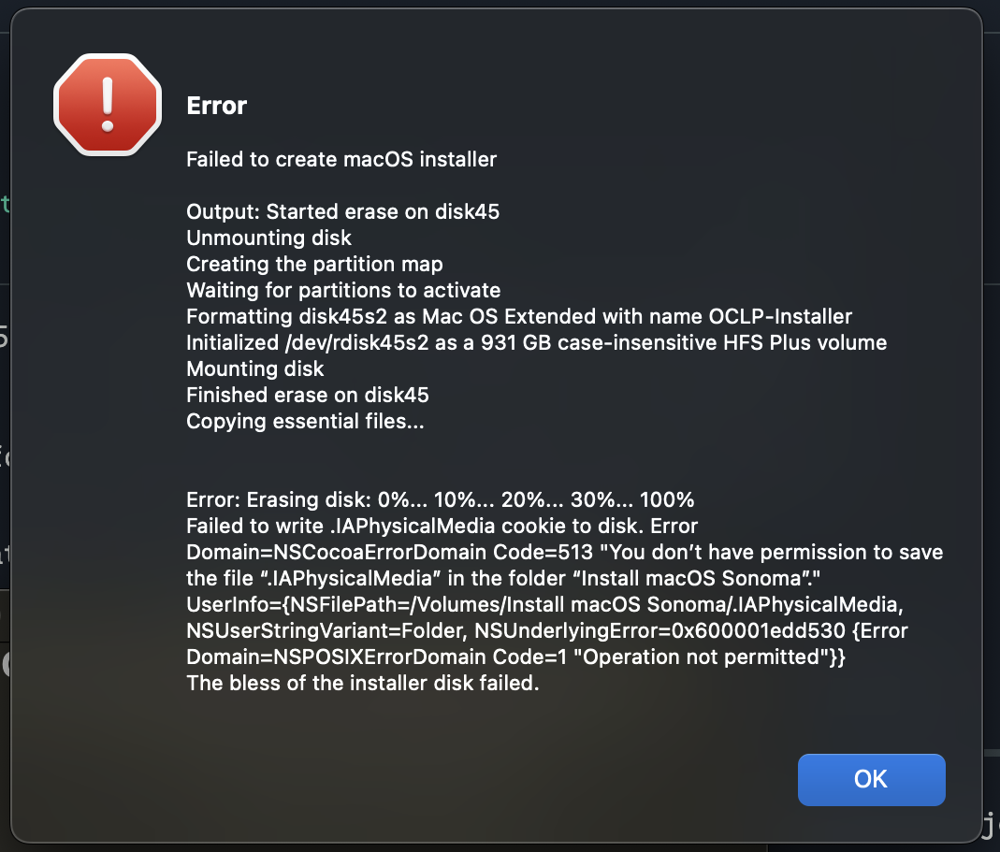
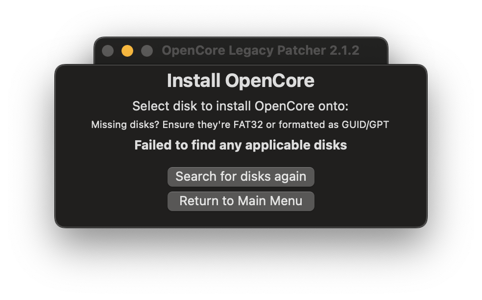

# Probleme mit der App

* [OpenCore Legacy Patcher T2 startet nicht](#opencore-legacy-patcher-t2-startet-nicht)
* [Fehler „You don't have permission to save...“ beim Erstellen des USB-Installers](#fehler-„you-don-t-have-permission-to-save-beim-erstellen-des-usb-installers)
* [Internes Laufwerk fehlt beim Erstellen von OpenCore](#internes-laufwerk-fehlt-beim-erstellen-von-opencore)
* [„Unable to resolve dependencies, error code 71“ beim Root-Patching](#„unable-to-resolve-dependencies-error-code-71-beim-root-patching)
* [Fehler „System version mismatch“ beim Root-Patching](#fehler-„system-version-mismatch-beim-root-patching)


## OpenCore Legacy Patcher T2 startet nicht

Wenn die App nicht startet (z. B. das Symbol im Dock nur hüpft), versuche, OpenCore Legacy Patcher T2 über das Terminal mit folgendem Befehl zu starten:

```sh
/Library/Application\ Support/albert-mueller/OpenCore-Patcher-T2/OpenCore-Patcher-T2.app/Contents/MacOS/OpenCore-Patcher-T2
```


## Fehler „You don't have permission to save...“ beim Erstellen des USB-Installers

In manchen Fällen erscheint der Fehler „The bless of the installer disk failed“ mit der Begründung „You don't have permission to save...“.


<div align="left">
             
</div>


Um das zu beheben, kannst du versuchen, OpenCore Legacy Patcher T2 den „Festplattenvollzugriff“ zu erteilen. Gehe dazu zunächst in die Einstellungen:

* Ventura und Sonoma: Systemeinstellungen -> Datenschutz & Sicherheit -> Festplattenvollzugriff

* Big Sur und Monterey: Systemeinstellungen -> Sicherheit & Datenschutz -> Festplattenvollzugriff

Aktiviere OpenCore-Patcher-T2 in der Liste. Falls es dort nicht aufgeführt ist, klicke auf das Pluszeichen, um einen neuen Eintrag hinzuzufügen, und wähle OpenCore-Patcher-T2 im Ordner „Programme“ aus.

Starte OpenCore Legacy Patcher T2 neu und versuche erneut, deinen USB-Stick zu erstellen.

Optional: Nachdem du deinen USB-Stick erstellt hast, kannst du OpenCore-Patcher-T2 wieder aus dem Festplattenvollzugriff entfernen.

## Internes Laufwerk fehlt beim Erstellen von OpenCore

Wenn du ein brandneues Laufwerk verwendest, das noch nie benutzt oder nie in einem macOS-Format formatiert wurde, kann in OCLPT2 beim Erstellen auf dem internen Laufwerk folgender Fehler auftreten:

<div align="left">
             
</div>

Es gibt zwei Möglichkeiten, das zu beheben:

1. Erstelle mit dem Festplattendienstprogramm eine neue FAT32-Partition mit etwa 100 MB; der Name spielt keine Rolle. OpenCore erkennt sie, und du kannst deine EFI dort erstellen.

2. Wähle bei der Installation von macOS im Festplattendienstprogramm „Darstellung -> Alle Geräte einblenden“ und formatiere das gesamte Laufwerk, indem du den obersten Eintrag in der Seitenleiste auswählst.

<div align="left">
             
</div>

## „Unable to resolve dependencies, error code 71“ beim Root-Patching

Dieser Fehler bedeutet in der Regel, dass störende Kernel-Erweiterungen vorhanden sind. Um ihn zu beheben, musst du sie entfernen.

Halbautomatisch:

1. Öffne das Terminal
2. Gib `sudo zsh` ein
3. Gib `cd "/Volumes/Macintosh HD/Library/Extensions" && ls | grep -v "HighPoint*\|SoftRAID*" | xargs rm -rf` ein
   * Ersetze „Macintosh HD“ unbedingt durch den Namen deines Laufwerks
4. Führe den OCLP-Root-Patcher erneut aus

Manuell:

1. Öffne /Library/Extensions
2. Lösche alles **außer** HighPointIOP.kext, HighPointRR.kext und SoftRAID.kext
3. Führe den OCLP-Root-Patcher erneut aus

Wenn das nicht hilft, öffne „/Library/Developer/KDKs“ und lösche alles darin.

Wenn es immer noch nicht klappt, gib `sudo bless --mount "/Volumes/Macintosh HD/" --bootefi --last-sealed-snapshot` ein.
* Ersetze auch hier „Macintosh HD“ durch den Namen deines Laufwerks

Führe den OCLPT2-Root-Patcher anschließend erneut aus.

## Fehler „System version mismatch“ beim Root-Patching

Aufgrund einer Änderung von Apple verändern Updates das Systemvolume jetzt **bereits während des Downloads**. Das kann plötzlich zu kaputten Patches führen, da sich das Betriebssystem dann in einem Zwischenzustand zwischen zwei Versionen befindet. Beim Root-Patching kann daher ein Fehler wie der folgende auftreten:

`SystemVersion.plist build version mismatch: found 15.4 (24E247), expected 13.7.5 (22H527)`

In diesem Beispiel wird Version 13.7.5 (Ventura) erwartet, die gerade läuft. macOS hat aber bereits ein Update auf Version 15.4 (Sequoia) vorbereitet und das Dateisystem schon dafür verändert – einschließlich der neuen Versionsnummer in der SystemVersion.plist, aus der OCLP sie ausliest. Der Fehler „version mismatch“ ist eine Schutzmaßnahme, die verhindert, dass OCLP ein System in diesem merkwürdigen Zwischenzustand patcht, was sehr wahrscheinlich dazu führen würde, dass es nicht mehr bootet.

Es gibt einige Möglichkeiten, das zu beheben:

1. Aktualisiere auf die bereits vorbereitete Version.
   * Das funktioniert nur, wenn die neuere Version derzeit von OCLP unterstützt wird.
2. Installiere macOS neu.
   * Du kannst eine Installation über das bestehende System ohne Löschen des Laufwerks versuchen, um deine Daten zu behalten. Das klappt aber möglicherweise nicht, da das System teilweise schon auf der neueren Version ist und die Installation dann ein Downgrade bemängelt.
3. Nutze das experimentelle Werkzeug „PurgePendingUpdate“ [vom Discord-Server](https://discord.gg/rqdPgH8xSN).
   * Gehe zu `support-forum` und dann zum Beitrag `Information and known issues`, um den Link zum Werkzeug zu finden.
   * Lade es herunter und führe es im Terminal aus, um das ausstehende Update zu entfernen, und patche dann erneut. Falls „purge failed“ erscheint, kannst du das ignorieren.
   * Manchmal musst du der Datei vorher mit `chmod +x` Ausführungsrechte geben (den Pfad zur Datei nach dem Befehl eintippen oder die Datei ins Terminal ziehen), bevor das Werkzeug ausgeführt werden kann.
   * Möglicherweise wird das später in OCLP integriert, einen Zeitplan gibt es dafür aber noch nicht.

**Nach der Wiederherstellung wird dringend empfohlen, automatische macOS-Updates zu deaktivieren, damit das nicht erneut passiert.**

* Hinweis: macOS Sequoia fragt ab Version 15.4 nach jeder Update-Installation, ob automatische Updates aktiviert werden sollen, und bietet keine Möglichkeit, das dauerhaft abzulehnen. Du musst die Option daher nach Updates eventuell immer wieder deaktivieren.

::: details So deaktivierst du Updates (zum Aufklappen klicken)

**macOS Ventura und neuer:**

Systemeinstellungen -> Allgemein -> Softwareupdate -> (i)-Taste neben „Automatische Updates“ -> „Neue Updates laden, wenn verfügbar“ deaktivieren.

**macOS Big Sur und Monterey:**

Systemeinstellungen -> Softwareupdate -> Weitere Optionen -> „Neue Updates laden, wenn verfügbar“ deaktivieren.

:::
