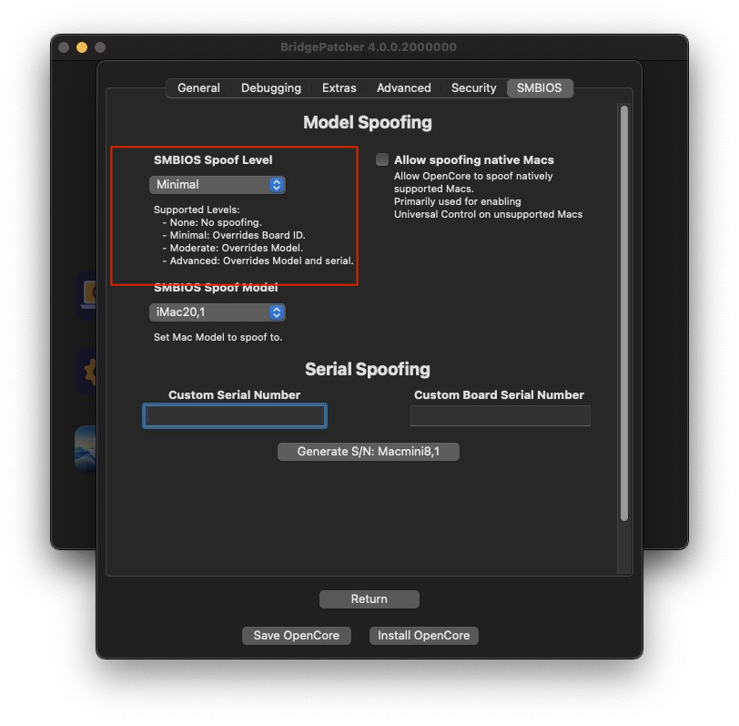
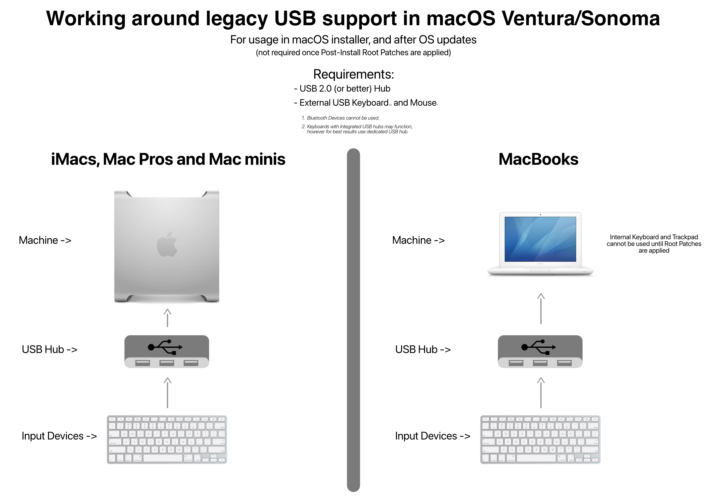
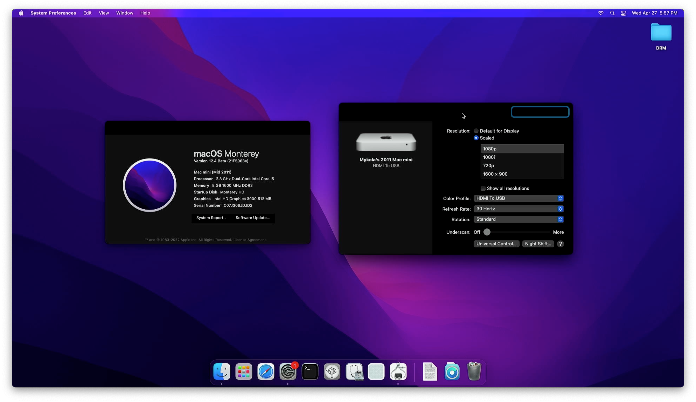
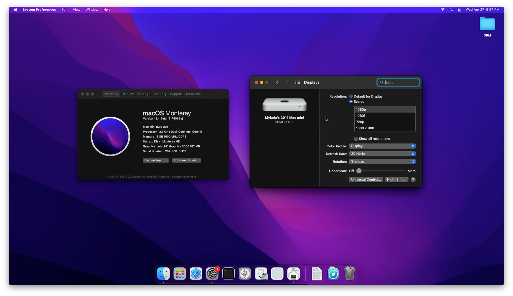

# Hardware-Probleme

#### Allgemein

* [Keine Helligkeitssteuerung](#keine-helligkeitssteuerung)
* [Keine WLAN-Verbindung unter Monterey mit älteren Karten](#keine-wlan-verbindung-unter-monterey-mit-alteren-karten)
* [Keine Grafikbeschleunigung](#keine-grafikbeschleunigung)
* [Keine DisplayPort-Ausgabe auf Mac Pros mit NVIDIA Kepler](#keine-displayport-ausgabe-auf-mac-pros-mit-nvidia-kepler)
* [Zweite CPU auf MacPro3,1/Xserve2,1 nicht sichtbar](#zweite-cpu-auf-macpro3-1-xserve2-1-nicht-sichtbar)
* [Keine Beschleunigung nach dem Wechsel auf eine Metal-GPU im Mac Pro](#keine-beschleunigung-nach-dem-wechsel-auf-eine-metal-gpu-im-mac-pro)
* [Tastatur, Maus und Trackpad funktionieren im Installer oder nach einem Update nicht](#tastatur-maus-und-trackpad-funktionieren-im-installer-oder-nach-einem-update-nicht)
* [Keine T1-Funktionen nach der Installation von Sonoma oder neuer](#keine-t1-funktionen-nach-der-installation-von-sonoma-oder-neuer)

#### Nicht-Metal

* [Tastaturbeleuchtung funktioniert nicht](#tastaturbeleuchtung-funktioniert-nicht)
* [Stark verzerrte Darstellung nach dem Ruhezustand auf ATI/AMD von macOS 11.3 bis Monterey](#stark-verzerrte-darstellung-nach-dem-ruhezustand-auf-ati-amd-terascale-1-von-macos-11-3-bis-monterey)
* [GPU-Umschaltung auf MacBook Pros 2011 mit 15" und 17" funktioniert nicht](#gpu-umschaltung-auf-macbook-pros-2011-mit-15-und-17-funktioniert-nicht)
* [Fehlerhafte Farben auf ATI-TeraScale-2-GPUs (HD5000/HD6000)](#fehlerhafte-farben-auf-ati-terascale-2-gpus-hd5000-hd6000)
* [Anmeldung auf MacBook Pros 2011 mit 15" und 17" nicht möglich](#anmeldung-auf-macbook-pros-2011-mit-15-und-17-nicht-moglich)
* [Schwarze Kästen auf HD3000-iGPUs](#schwarze-kasten-auf-hd3000-igpus)
* [Bluetooth-Geräte lassen sich nicht koppeln](#bluetooth-gerate-lassen-sich-nicht-koppeln)

Falls du nicht weißt, was als Nicht-Metal-GPU gilt, sieh dir die Übersicht in der [FAQ](FAQ.md#was-bedeutet-metal-und-nicht-metal) an.

## Keine Helligkeitssteuerung

Mit OCLP v0.0.22 haben wir für viele Modelle Unterstützung für die Helligkeitssteuerung hinzugefügt. Manche Nutzer haben aber festgestellt, dass ihre Helligkeitstasten nicht funktionieren.

Als Workaround empfehlen wir folgende App:

* [Brightness Slider](https://actproductions.net/free-apps/brightness-slider/)

## Keine WLAN-Verbindung unter Monterey mit älteren Karten

Mit OCLP v0.2.5 haben wir Unterstützung für ältere WLAN-Karten unter Monterey hinzugefügt. Manche Nutzer haben aber festgestellt, dass sie sich nicht mit Drahtlosnetzwerken verbinden können.

Als Workaround empfehlen wir, dich manuell über die Option „Anderes Netzwerk“ im WLAN-Menü der Menüleiste zu verbinden oder das Netzwerk manuell in den Netzwerkeinstellungen hinzuzufügen.

## Keine Grafikbeschleunigung

In macOS werden GPU-Treiber oft mit jeder großen Version aus dem System entfernt. Wenn du OCLP v0.4.4 oder neuer nutzt, solltest du nach dem ersten Booten nach der macOS-Installation zur Installation der Root-Volume-Patches aufgefordert worden sein. Falls du das manuell erledigen musst, kannst du es in der Patcher-App tun. Nach dem Neustart sind die Beschleunigung sowie bei Laptops die Helligkeitssteuerung wieder aktiv.

Weitere Informationen findest du unter [Post-Install-Volume-Patches anwenden](POST-INSTALL.md#post-install-volume-patches-anwenden).

Wenn du nach der Installation des Betriebssystems in einem Mac Pro die originale GPU gegen eine Metal-GPU getauscht hast, findest du eine Anleitung unter [Keine Beschleunigung nach dem Wechsel auf eine Metal-GPU im Mac Pro](#keine-beschleunigung-nach-dem-wechsel-auf-eine-metal-gpu-im-mac-pro).

In der folgenden Liste siehst du, welche GPUs in welchen macOS-Versionen gepatcht werden müssen.

:::details GPUs, die in den verschiedenen macOS-Versionen gepatcht werden müssen

AMD-Navi-GPUs (Serie RX 5000–6000) funktionieren in Mac Pros von 2008 bis 2012 unter Ventura und neuer nicht, da diese kein AVX2 unterstützen.

**Sequoia**

* NVIDIA:
  * Tesla (Serie 8000–300)
  * Kepler (Serie 600–800)
* AMD:
  * TeraScale (Serie 2000–6000)
  * GCN 1–3 (Serie 7000 – R9)
  * Polaris (Serie RX 4xx/5xx, falls die CPU kein AVX2 unterstützt)
* Intel:
  * Iron Lake
  * Sandy Bridge (Serie 2000–3000)
  * Ivy Bridge (Serie 4000)
  * Haswell (Serie 4400, 4600, 5000)
  * Broadwell (Serie 6000)
  * Skylake (Serie 500)

**Sonoma**

* NVIDIA:
  * Tesla (Serie 8000–300)
  * Kepler (Serie 600–800)
* AMD:
  * TeraScale (Serie 2000–6000)
  * GCN 1–3 (Serie 7000 – R9)
  * Polaris (Serie RX 4xx/5xx, falls die CPU kein AVX2 unterstützt)
* Intel:
  * Iron Lake
  * Sandy Bridge (Serie 2000–3000)
  * Ivy Bridge (Serie 4000)
  * Haswell (Serie 4400, 4600, 5000)
  * Broadwell (Serie 6000)
  * Skylake (Serie 500)

**Ventura**

* NVIDIA:
  * Tesla (Serie 8000–300)
  * Kepler (Serie 600–800)
* AMD:
  * TeraScale (Serie 2000–6000)
  * GCN 1–3 (Serie 7000 – R9)
  * Polaris (Serie RX 4xx/5xx, falls die CPU kein AVX2 unterstützt)
* Intel:
  * Iron Lake
  * Sandy Bridge (Serie 2000–3000)
  * Ivy Bridge (Serie 4000)
  * Haswell (Serie 4400, 4600, 5000)
  * Broadwell (Serie 6000)
  * Skylake (Serie 500)

**Monterey**

* NVIDIA:
  * Tesla (Serie 8000–300)
  * Kepler (Serie 600–800)
* AMD:
  * TeraScale (Serie 2000–6000)
* Intel:
  * Iron Lake
  * Sandy Bridge (Serie 2000–3000)
  * Ivy Bridge (Serie 4000)


**Big Sur**

* NVIDIA:
  * Tesla (Serie 8000–300)
* AMD:
  * TeraScale (Serie 2000–6000)
* Intel:
  * Iron Lake
  * Sandy Bridge (Serie 2000–3000)

:::


## Keine DisplayPort-Ausgabe auf Mac Pros mit NVIDIA Kepler

Wenn du Probleme mit der DisplayPort-Ausgabe auf Mac Pros hast, aktiviere unter Settings -> SMBIOS Settings die Option „Minimal Spoofing“ und erstelle/installiere OpenCore neu. Dadurch glauben die macOS-Treiber, du hättest einen neueren MacPro7,1, und das Problem ist behoben.


<div align="left">
             
</div>


## Zeitweise Probleme mit USB 1.1 und Bluetooth auf MacPro3,1 – MacPro5,1

Bei Problemen mit USB-1.1-Geräten (z. B. Mäusen, Tastaturen und Bluetooth-Chipsätzen): Ab macOS Big Sur ist die systemseitige Zuverlässigkeit des UHCI-Controllers in älteren Mac Pros schlechter geworden.

* UHCI ist ein USB-1.1-Controller, der mit den USB-2.0-Anschlüssen deines Systems verbunden ist. Sobald ein USB-1.1-Gerät erkannt wird, übernimmt der UHCI-Controller auf Hardware-/Firmware-Ebene die Kontrolle über das Gerät.
  * EHCI ist der USB-2.0-Controller in älteren Mac Pros.

Deshalb empfehlen wir, einen USB-2.0-/3.0-Hub zwischen deine Geräte und den Anschluss am Mac Pro zu setzen. UHCI und EHCI können nicht gleichzeitig verwendet werden, ein USB-Hub erzwingt also immer den EHCI-Controller.

* Alternativ kannst du einen Kaltstart der Hardware versuchen und prüfen, ob macOS den UHCI-Controller dann richtig erkennt.


## Zweite CPU auf MacPro3,1/Xserve2,1 nicht sichtbar

Ab macOS Sequoia muss OCLP die zweite CPU in diesen Systemen deaktivieren, um eine Kernel Panic zu vermeiden. Das bedeutet auch, dass standardmäßig selbst unter älteren Versionen nur eine CPU nutzbar ist. Um unter älteren Versionen wieder beide CPUs zu aktivieren, gehe so vor:

1. Öffne Settings -> Tab `Build`.
2. Deaktiviere `MacPro3,1/Xserve2,1 Workaround`.
3. Erstelle OpenCore neu.
4. Starte neu.

**Ist Sequoia oder neuer installiert, können unter keinen Umständen beide CPUs aktiviert werden, auch nicht bei Multiboot. Andernfalls bootet Sequoia nicht mehr.**

[Weitere Informationen hier](https://github.com/dortania/OpenCore-Legacy-Patcher/issues/1136#:~:text=we%20cannot%20verify.-,MacPro3%2C1%20Dual%20Socket%20Support,-Currently%20on%20macOS)

## Keine Beschleunigung nach dem Wechsel auf eine Metal-GPU im Mac Pro

Wenn du die macOS-Installation mit der originalen Grafikkarte abgeschlossen hast (z. B. um den Bootpicker zu sehen) und danach auf eine Metal-fähige GPU gewechselt hast, fehlt dir möglicherweise die Beschleunigung.

Um das zu beheben, öffne OCLP und entferne die Root-Patches, damit deine Metal-GPU wieder funktioniert. Unter macOS Ventura und neuer ist bei den meisten Konfigurationen nach dem Entfernen ein erneutes Patchen nötig. Der Grund: Bei der USB-Installation wird automatisch root-gepatcht, und der Autopatcher geht davon aus, dass du die originale Grafikkarte verwendest, und führt deshalb das Nicht-Metal-Patching durch. **Metal- und Nicht-Metal-GPUs können nicht gleichzeitig verwendet werden**, da das Nicht-Metal-Patching Metal vollständig umgeht und einige Teile wie Treiber für andere Karten entfernen muss – deshalb haben Metal-Karten nach dem Wechsel keine Beschleunigung.

Alternativ kannst du vor der Installation „AutoPkg-Assets.pkg“ aus /Library/Packages auf dem USB-Stick entfernen. Dieses Paket enthält die Dateien für das Root-Patching; fehlen sie, wird das System nicht automatisch gepatcht. Um den Ordner zu sehen, blende versteckte Dateien mit `Command` + `Shift` + `.` ein.

## Tastatur, Maus und Trackpad funktionieren im Installer oder nach einem Update nicht

Ab macOS Ventura sind keine USB-1.1-Treiber mehr im Betriebssystem enthalten. Bei Macs mit älteren USB-1.1-Controllern kann OpenCore Legacy Patcher T2 die Unterstützung erst wiederherstellen, nachdem die Root-Volume-Patches mit den Treibern installiert wurden. Bei der macOS-Installation oder nach einem Update musst du daher einen USB-Hub zwischen Mac und Tastatur/Maus setzen, um den USB-2.0-Modus zu erzwingen und so die Root-Patches installieren zu können.

* Als MacBook-Nutzer brauchst du zusätzlich zum USB-Hub eine externe Tastatur/Maus.

Betroffen sind unter anderem diese Modelle:

| Familie     | Jahr                 | Modell                        | Hinweise                                              |
| :---------- | :--------------------| :---------------------------- | :---------------------------------------------------- |
| MacBook     | Mitte 2010 und älter | MacBook5,1 - MacBook7,1       |                                                       |
| MacBook Air | Ende 2010 und älter  | MacBookAir2,1 - MacBookAir3,x |                                                       |
| MacBook Pro | Mitte 2010 und älter | MacBookPro4,1 - MacBookPro7,x | Außer 15" und 17" von Mitte 2010 (MacBookPro6,x)      |
| iMac        | Ende 2009 und älter  | iMac7,1 - iMac10,x            | Außer iMac 27" Core i5/i7 von Ende 2009 (iMac11,1)    |
| Mac mini    | Mitte 2011 und älter | Macmini3,1 - Macmini5,x       |                                                       |
| Mac Pro     | Mitte 2010 und älter | MacPro3,1 - MacPro5,1         |                                                       |


<div align="left">
             
</div>

::: warning Hinweis

Unter macOS Sonoma scheint sich das weiter verschlechtert zu haben, und manche Hubs funktionieren möglicherweise nicht. Falls das bei dir auftritt, probiere einen anderen Hub.

:::

### Alternative Methode für Softwareupdates

Alternativ kannst du vor dem Update unter Allgemein -> Teilen die Option „Entfernte Anmeldung“ aktivieren, wodurch SSH eingeschaltet wird. So kannst du das System über das Terminal eines anderen Rechners steuern und das Post-Install-Volume-Patching ausführen.

**Das gilt nur für Updates über die Softwareaktualisierung, nicht für das Booten in den Installer per USB-Stick.**

Verwende folgende Befehle:

1. `ssh username@lan-ip-address` – Verbindet per SSH; ersetze Benutzername und IP-Adresse durch die des Systems
2. `/Applications/OpenCore-Patcher.app/Contents/MacOS/OpenCore-Patcher --patch_sys_vol` – Installiert die Root-Patches über die Kommandozeile
3. `sudo reboot`.

Weitere Informationen findest du hier:

* [Legacy UHCI/OHCI support in Ventura #1021](https://github.com/dortania/OpenCore-Legacy-Patcher/issues/1021)


## Keine T1-Funktionen nach der Installation von Sonoma oder neuer

Wenn deine Touch Bar usw. nicht funktioniert, sind die T1-Funktionen verloren gegangen.

Wird das gesamte Laufwerk mit dem Festplattendienstprogramm von Sonoma oder neuer gelöscht, wird die T1-Firmware entfernt, und der Installer von macOS Sonoma und neuer stellt sie mangels Unterstützung nicht wieder her. Fehlt die Firmware in der EFI, funktioniert der T1 nicht – unabhängig davon, ob OCLP den Treiber beim Root-Patching wiederherstellt. Um die T1-Funktionen zurückzubekommen, musst du Ventura oder älter erneut installieren. Das kann auch auf einem anderen Volume oder einem externen Laufwerk geschehen, solange das Betriebssystem einmal gebootet wird. Danach kannst du das alte System löschen bzw. das externe Laufwerk abziehen.


Damit das künftig nicht passiert, lösche bei T1-Systemen nur das Volume, das das Betriebssystem enthält.

<div align="left">
             
</div>


## Tastaturbeleuchtung funktioniert nicht

Da `hidd` gezwungen wird, im Fallback-Modus zu starten, erkennt das Betriebssystem beleuchtete Tastaturen möglicherweise nicht mehr. Zum Glück funktionieren die Treiber selbst noch, sodass Apps wie [LabTick](https://www.macupdate.com/app/mac/22151/lab-tick) die Helligkeit manuell einstellen können.

::: details Für Big Sur (zum Aufklappen klicken)

Wegen des Metal-Backends scheint die erweiterte Farbausgabe dieser Apps die Bedienoberfläche stark zu beeinträchtigen. Als Abhilfe hat es laut [Nutzerberichten](https://forums.macrumors.com/threads/macos-11-big-sur-on-unsupported-macs-thread.2242172/post-29870324) sehr geholfen, die Farbausgabe des Monitors von „Milliarden“ auf „Millionen“ Farben umzustellen. Apps, mit denen sich das leicht einstellen lässt, sind [SwitchResX](https://www.madrau.com), [ResXreme](https://macdownload.informer.com/resxtreme/) und [EasyRes](http://easyresapp.com).

:::

## Stark verzerrte Darstellung nach dem Ruhezustand auf ATI/AMD TeraScale 1 von macOS 11.3 bis Monterey

**Für macOS Ventura ab 0.6.6 behoben. Unter Big Sur und Monterey tritt das Problem weiterhin auf.**

Betroffen sind TeraScale-1-GPUs (also ATI/AMD Radeon HD2000–4000). Die einzige bekannte Lösung ist ein Downgrade auf macOS 11.2.3 oder älter. Außerdem kann Ab- und erneutes Anmelden das Problem ohne Neustart beheben.

Falls Apple 11.2.3 aus seinem Katalog entfernt, stellen wir unten einen Mirror bereit:

* [Install macOS 11.2.3 20D91](https://archive.org/details/install-mac-os-11.2.3-20-d-91)

## GPU-Umschaltung auf MacBook Pros 2011 mit 15" und 17" funktioniert nicht

Derzeit funktioniert mit OpenCore Legacy Patcher T2 das Umschalten zwischen iGPU und dGPU nicht. Am einfachsten legst du eine bestimmte GPU fest, indem du die dGPU deaktivierst, wenn du bei der stromsparenderen iGPU bleiben möchtest.

Am besten bootest du dazu in die Recovery (oder in den Einzelbenutzermodus, falls die dGPU gar nicht mehr funktioniert) und führst folgenden Befehl aus:

```sh
nvram FA4CE28D-B62F-4C99-9CC3-6815686E30F9:gpu-power-prefs=%01%00%00%00
```

Dadurch wird die dGPU deaktiviert, und die iGPU funktioniert unter Big Sur. Beachte, dass externe Bildschirmausgänge direkt mit der dGPU verbunden sind und daher nicht mehr genutzt werden können. Lösungen wie [DisplayLink-Adapter](https://www.displaylink.com/products/usb-adapters) können diese Einschränkung umgehen; du musst dann aber ältere Treiber (5.2.6) verwenden:

* [DisplayLink USB Graphics Software for macOS – For Mojave and Catalina – 5.2.6](https://www.synaptics.com/products/displaylink-graphics/downloads/macos-5.2.6)

Hinweis: Dieser Treiber bietet unter macOS nur eingeschränkte Unterstützung; volle Grafikbeschleunigung ist auf Bildschirmen, die über DisplayLink angesteuert werden, derzeit nicht verfügbar.


## Fehlerhafte Farben auf ATI-TeraScale-2-GPUs (HD5000/HD6000)

Behoben mit OpenCore Legacy Patcher v0.4.2.

::: details Alte Lösung (vor 0.4.2)

Wegen eines merkwürdigen Fehlers bei ATIs TeraScale-2-GPUs sehen viele Nutzer nach der Installation der Beschleunigungs-Patches und dem Neustart in macOS fehlerhafte bzw. flackernde Farben. Ursache ist eine falsche Annahme in den GPU-Treibern, die dem Bildschirm den Farbraum „Milliarden Farben“ aufzwingt. Zur Behebung stellst du deinen Bildschirm einfach auf eine geringere Farbtiefe wie „Millionen Farben“ um.

Apps, mit denen sich die Farbtiefe einstellen lässt:

* [SwitchResX](https://www.madrau.com)
* [ResXtreme](https://macdownload.informer.com/resxtreme/)

:::

## Anmeldung auf MacBook Pros 2011 mit 15" und 17" nicht möglich

Standardmäßig geht OpenCore Legacy Patcher T2 davon aus, dass MacBookPro8,2/3 eine defekte dGPU haben, und deaktiviert die Beschleunigung. Für die meisten Nutzer ist das die sicherste Option, da das Aktivieren der dGPU-Beschleunigung auf Macs mit defekter dGPU dazu führt, dass sie nicht booten.

Ist bei deinem Gerät die dGPU jedoch nicht per NVRAM deaktiviert, landest du in einer Anmeldeschleife. Das lässt sich recht einfach umgehen:

1. Boote macOS im Einzelbenutzermodus
    * Drücke Cmd+S im OpenCore-Menü, wenn du den Mac einschaltest
2. Wenn die Eingabeaufforderung erscheint, gib das Argument zum Deaktivieren der dGPU ein (siehe unten)
3. Starte neu – das gepatchte macOS sollte jetzt normal funktionieren
4. Wenn du die dGPU trotzdem nutzen möchtest, starte OpenCore Legacy Patcher T2 und aktiviere in den Einstellungen die TS2-Beschleunigung. Gehe zu `Settings -> Root Patching -> TeraScale 2 Acceleration` und führe das Root-Patching erneut aus.
5. Setze entweder den NVRAM zurück oder setze `gpu-power-prefs` auf Nullen, um die dGPU wieder zu aktivieren

```sh
# Zwingt GMUX, nur die iGPU zu verwenden (deaktiviert also die dGPU)
nvram FA4CE28D-B62F-4C99-9CC3-6815686E30F9:gpu-power-prefs=%01%00%00%00
# Zum Zurücksetzen einfach Nullen schreiben oder den NVRAM deines Macs zurücksetzen
nvram FA4CE28D-B62F-4C99-9CC3-6815686E30F9:gpu-power-prefs=%00%00%00%00
```

## Schwarze Kästen auf HD3000-iGPUs

Ein etwas merkwürdiges Problem auf Macs mit Intel HD3000: Auf Bildschirmen von Drittanbietern werden manche Bedienelemente schwarz und unlesbar. Wähle zur Behebung in den Bildschirmeinstellungen eines der generischen Farbprofile `Display` oder `Display P3`.

* Betrifft hauptsächlich HDMI-Bildschirme; DVI und DisplayPort sind in der Regel nicht betroffen.
* Im Systemassistenten drückst du `Cmd` + `Option` + `Control` + `T`, um das Terminal zu öffnen. Führe dort `open /System/Applications/System\ Preferences.app` aus.
* Mit macOS Ventura sind mehr Macs betroffen, darunter MacBook Airs und MacBook Pros.

| Standard-Farbprofil | Profil Display/Display P3 |
| :---                | :---                      |
|  |  |

## Bluetooth-Geräte lassen sich nicht koppeln

Unter macOS Ventura funktionieren Hover-Zustände möglicherweise nicht korrekt, sodass die Schaltfläche „Verbinden“ in den Systemeinstellungen nicht erscheint. Zur Behebung:

1. Aktiviere die Tastaturnavigation unter Systemeinstellungen -> Tastatur
2. Navigiere unter Systemeinstellungen -> Bluetooth mit Tab und Leertaste zu den Bluetooth-Geräten
3. Die Schaltfläche zum Koppeln sollte erscheinen


Weitere Informationen findest du im [Beitrag von ASentientBot](https://forums.macrumors.com/threads/macos-13-ventura-on-unsupported-macs-thread.2346881/page-116?post=31858759#post-31858759).
