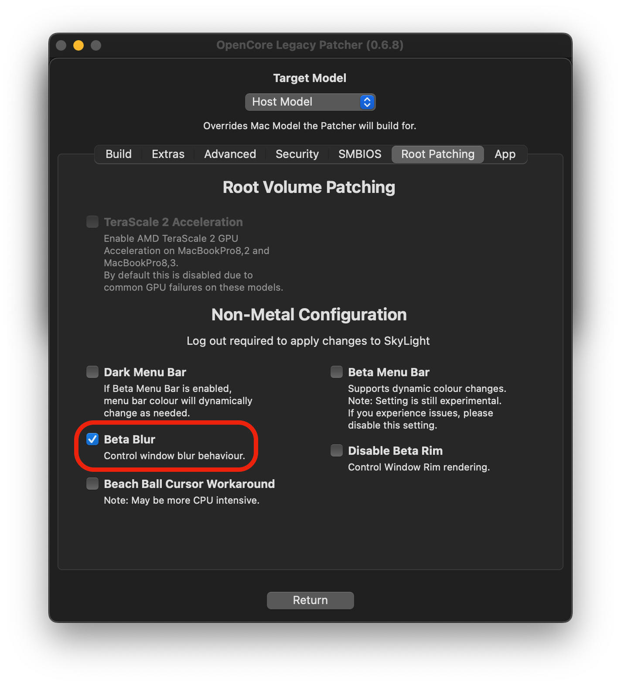

# Probleme mit Nicht-Metal-GPUs

Diese Seite richtet sich an Nutzer, die allgemein Probleme mit macOS Big Sur und neuer sowie den Legacy-Grafikbeschleunigungs-Patches haben. Falls du nicht weißt, was als Nicht-Metal-GPU gilt, sieh dir die Übersicht in der [FAQ](FAQ.md#was-bedeutet-metal-und-nicht-metal) an.

* [Firefox und Thunderbird funktionieren nicht (HD 3000)](#firefox-und-thunderbird-funktionieren-nicht-hd-3000)
* [Fehlerhafte Hintergrund-Unschärfe](#fehlerhafte-hintergrund-unscharfe)
* [Ältere Nicht-Metal-Apps herunterladen](#altere-nicht-metal-apps-herunterladen)
* [Zoom startet nicht](#zoom-startet-nicht)
* [Apps können keine Sonderberechtigungen erteilt werden (z. B. Kamerazugriff für Zoom)](#apps-konnen-keine-sonderberechtigungen-erteilt-werden-z-b-kamerazugriff-fur-zoom)
* [Probleme mit den Apps Fotos und Karten](#probleme-mit-den-apps-fotos-und-karten)
* [„Fertig“ lässt sich beim Bearbeiten eines Widgets in der Seitenleiste nicht drücken](#„fertig-lasst-sich-beim-bearbeiten-eines-widgets-in-der-seitenleiste-nicht-drucken)
* [Safari-Erweiterungen lassen sich nicht erlauben](#safari-erweiterungen-lassen-sich-nicht-erlauben)


## Firefox und Thunderbird funktionieren nicht (HD 3000)

Firefox und Thunderbird funktionieren auf HD 3000 nicht mehr, [da Mozilla die Unterstützung für HD 3000 in v145 entfernt hat.](https://hg-edge.mozilla.org/releases/mozilla-release/rev/32d4368e5a2a869bdc1f4556f020c1a6bea2a9c0) Das kann auf Systemen mit dieser GPU, die in Mac-Modellen von 2011 steckt, zu Systemhängern und anderem unvorhersehbarem Verhalten führen. Als Abhilfe muss die Hardwarebeschleunigung deaktiviert werden. Wenn dein System im normalen Modus einfriert, boote in den sicheren Modus, indem du beim Start `Shift` gedrückt hältst, und deaktiviere die Hardwarebeschleunigung in Firefox und Thunderbird, wo immer möglich.

::: details Betroffene Mac-Modelle (zum Aufklappen klicken)

* MacBook Pro 2011 13", 15" und 17"
* MacBook Air 2011 11" und 13"
* Mac mini 2011-Modelle ohne dedizierte Radeon-GPU

:::

## Fehlerhafte Hintergrund-Unschärfe

Mit den Nicht-Metal-Beschleunigungs-Patches werden viele Menüs mit Hintergrund-Unschärfe standardmäßig verzerrt dargestellt, wenn du den Mauszeiger darüber bewegst. Ab Version 0.4.1 kannst du die neue Funktion „Beta Blur“ aktivieren, um das Problem zu beheben:


<div align="left">
             
</div>

Beachte, dass „Beta Blur“ langsamere Hardware stärker belasten kann.
## Ältere Nicht-Metal-Apps herunterladen

Viele Apple-Apps sind inzwischen direkt auf Metal angewiesen, ältere Builds dieser Apps funktionieren unter Big Sur aber weiterhin. Unten findest du ein Archiv vieler Apps wie Pages, iMovie und GarageBand.

* [Apple-Apps für Nicht-Metal-Macs](https://archive.org/details/apple-apps-for-non-metal-macs)

Hinweis: Dieses Archiv setzt voraus, dass du diese Apps über den Mac App Store besitzt. Dortania duldet keine Raubkopien.

## Zoom startet nicht

Zoom ist derzeit teilweise auf Metal angewiesen und benötigt daher einen kleinen Binär-Patch. Dosdude1 stellt dafür ein praktisches Skript bereit:

* [Zoom-Fix für Nicht-Metal](https://dosdude1.com/catalina/zoomnonmetal-new.command.zip)

## Apps können keine Sonderberechtigungen erteilt werden (z. B. Kamerazugriff für Zoom)
Unter Ventura 13.3 und neuer sind die Berechtigungen wegen neuer erforderlicher Patches derzeit wieder defekt. Nutze TCCPlus aus dem aufklappbaren Bereich „Workaround“, um das Problem zu umgehen.

Für 13.2.1 und älter ist das Problem ab Version 0.2.5 vollständig behoben.

::: details Workaround für 0.2.4, Ventura 13.3+

Durch die Verwendung von amfi_get_out_of_my_way=1 fragt macOS beim App-Start nicht nach Sonderberechtigungen und lässt die Einträge in den Systemeinstellungen weg. Um das zu umgehen, empfehlen wir, tccplus zur Verwaltung der Berechtigungen zu installieren.

[TCCPlus herunterladen](https://github.com/jslegendre/tccplus)

Beispiel mit Discord und Mikrofonberechtigung:

```sh
# Öffne das Terminal und führe die folgenden Befehle aus
cd ~/Downloads/
chmod +x tccplus
./tccplus add Microphone com.hnc.Discord
```

Falls du mit `tccplus` Probleme hast, kannst du `com.apple.TCC` auch manuell patchen, um Berechtigungen hinzuzufügen:

```sh
# App-ID ermitteln (im Beispiel Zoom.us):
$ osascript -e 'id of app "zoom.us"'
# Ausgabe: us.zoom.xos

$ sudo sqlite3 ~/Library/Application\ Support/com.apple.TCC/TCC.db "INSERT or REPLACE INTO access VALUES('kTCCServiceMicrophone','us.zoom.xos',0,2,0,1,NULL,NULL,NULL,'UNUSED',NULL,0,1541440109);"

$ sudo sqlite3 ~/Library/Application\ Support/com.apple.TCC/TCC.db "INSERT or REPLACE INTO access VALUES('kTCCServiceCamera','us.zoom.xos',0,2,0,1,NULL,NULL,NULL,'UNUSED',NULL,0,1541440109);"
```

:::

## Probleme mit den Apps Fotos und Karten

**Ab macOS Monterey funktionieren Karten und alles, was darauf aufbaut (z. B. „Wo ist?“ oder „Orte“ in Fotos), auf Nicht-Metal-Systemen nicht, da sie Metal voraussetzen.**

::: details Für Big Sur (zum Aufklappen klicken)

Wegen des Metal-Backends scheint die erweiterte Farbausgabe dieser Apps die Bedienoberfläche stark zu beeinträchtigen. Als Abhilfe hat es laut [Nutzerberichten](https://forums.macrumors.com/threads/macos-11-big-sur-on-unsupported-macs-thread.2242172/post-29870324) sehr geholfen, die Farbausgabe des Monitors von „Milliarden“ auf „Millionen“ Farben umzustellen. Apps, mit denen sich das leicht einstellen lässt, sind [SwitchResX](https://www.madrau.com), [ResXreme](https://macdownload.informer.com/resxtreme/) und [EasyRes](http://easyresapp.com).

:::


## „Fertig“ lässt sich beim Bearbeiten eines Widgets in der Seitenleiste nicht drücken

Workaround: Drücke Tab, Tab und dann Shift-Tab oder nur Shift-Tab (ggf. mehrmals), bis die Schaltfläche „Fertig“ hervorgehoben ist. Drücke dann die Leertaste, um sie auszulösen – genau wie in jedem anderen Dialog mit einer hervorgehobenen Schaltfläche.


## Safari-Erweiterungen lassen sich nicht erlauben

Wegen eines Fehlers in den Legacy-Beschleunigungs-Patches können Safari-Erweiterungen nicht aktiviert werden.

Mit folgendem Werkzeug lässt sich das Problem umgehen:

* [Non-Metal Safari Extensions](https://github.com/moosethegoose2213/Non-Metal-Safari-Extensions/)
