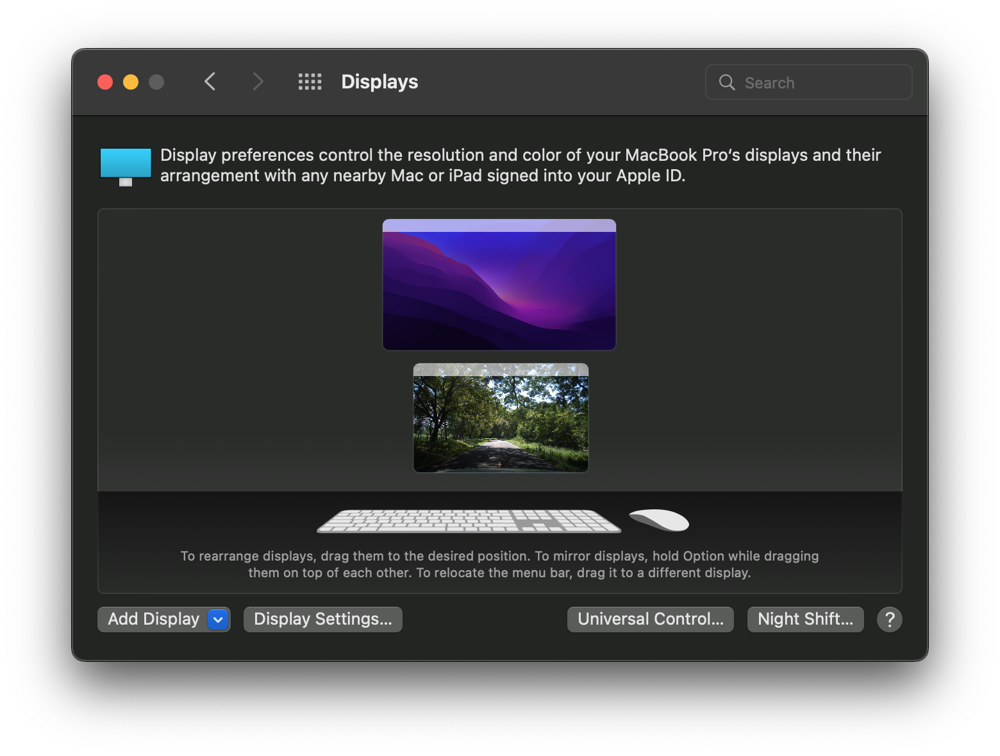
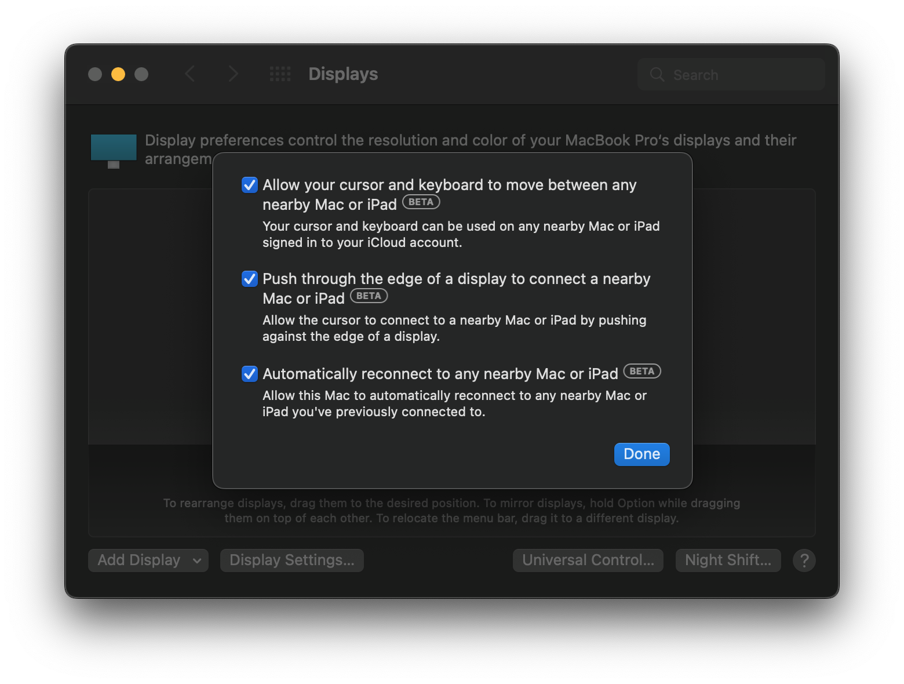
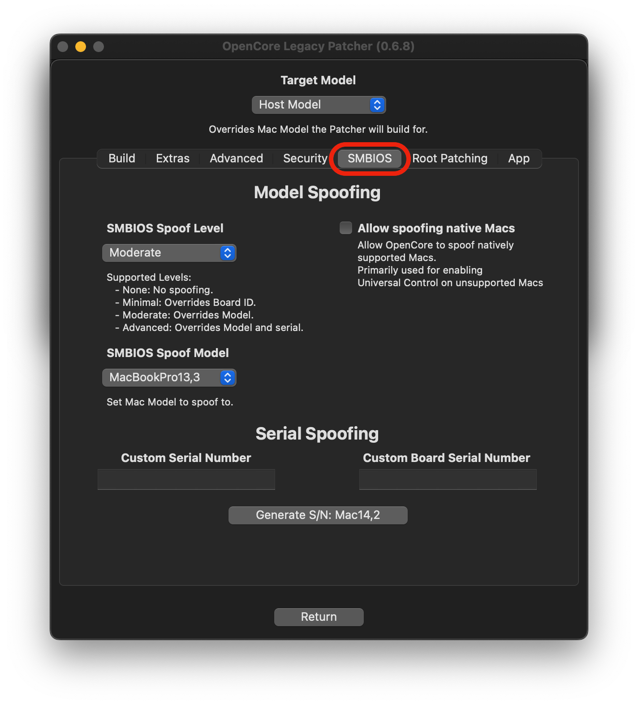
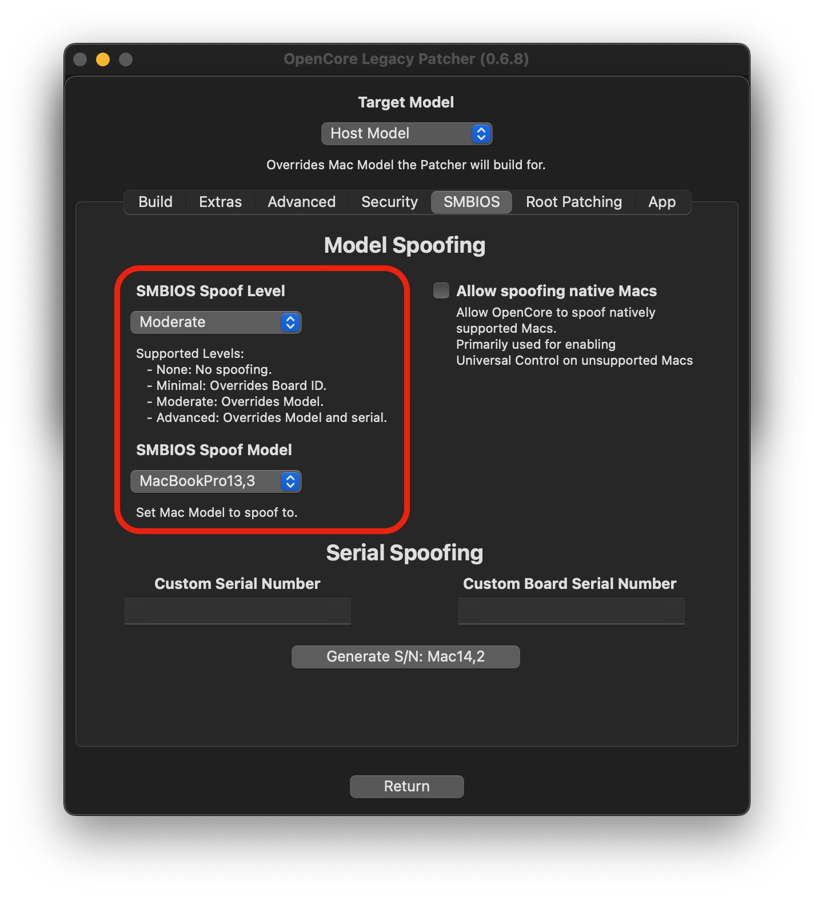
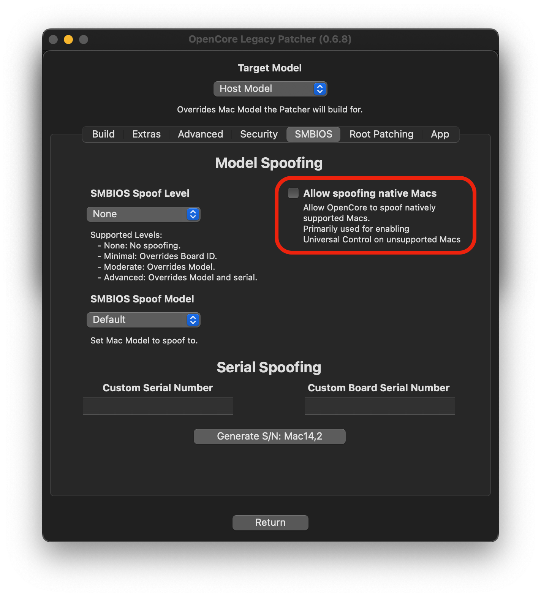

# Universelle Steuerung auf nicht unterstützten Macs

Die universelle Steuerung (Universal Control) wurde mit macOS 12 Monterey eingeführt. Mit ihr kann ein Mac andere Macs und/oder iPads steuern, Eingabegeräte gemeinsam nutzen und gleichzeitig Dateien zwischen ihnen austauschen. Mit OpenCore und FeatureUnlock lässt sich die universelle Steuerung auf den meisten nicht unterstützten Macs freischalten, sofern sie die auf dieser Seite genannten technischen Anforderungen erfüllen.

::: warning Hinweis

Diese Funktionen werden nicht aktiv getestet und können jederzeit kaputtgehen. Diese Seite richtet sich vor allem an Bastler – abgesehen vom Support auf Discord (siehe Ende der Seite) gibt es keine offizielle Unterstützung.

:::

## Universelle Steuerung aktivieren

Wenn du alle Anforderungen erfüllst, kannst du die universelle Steuerung in den meisten Fällen in den Display-Einstellungen aktivieren, indem du die entsprechenden Optionen anhakst. Wenn du sie mit einem iPad nutzen möchtest, aktiviere die universelle Steuerung auch auf dem iPad.

| Display-Einstellungen | Einstellungen der universellen Steuerung |
| :--- | :--- |
|  |  |

Die meisten Mac-Modelle ab 2011 sollten ohne Weiteres funktionieren. Ältere Macs wie die MacBook Pros von 2008 bis 2011 benötigen jedoch eine neuere WLAN-/Bluetooth-Karte. Mehr dazu im [Abschnitt zu den Anforderungen.](None#anforderungen-fur-die-universelle-steuerung)

Einige Modelle, die Monterey nativ unterstützen, stehen auf einer Sperrliste – mehr dazu im [Abschnitt zu gesperrten Modellen](None#gesperrte-modelle).

## Anforderungen für die universelle Steuerung

Technische Anforderungen:

* Wi-Fi 4 (802.11n)
* Bluetooth 4.0
* macOS Monterey 12.4 oder neuer
* iPadOS 15.4 oder neuer (falls zutreffend)
* OpenCore Legacy Patcher 0.4.3 oder neuer

In der [Modelltabelle](None#modelltabelle) unten siehst du, ob du Hardware aufrüsten musst und welche Hardware bei den betroffenen Macs genau ausgetauscht werden muss. Hilfe zum Austausch der WLAN-Karte in älteren Modellen von 2008 bis 2011 findest du bei Bedarf im Kanal `#hardware` auf dem [Discord-Server](https://discord.gg/rqdPgH8xSN).

Weitere Anforderungen:

* Alle Geräte sind mit demselben iCloud-Account angemeldet.
* Die Zwei-Faktor-Authentifizierung ist für deine Apple-ID aktiviert.
* Bluetooth und WLAN sind eingeschaltet. Eine Verbindung ist nicht nötig, es reicht, wenn beides eingeschaltet ist.
* Handoff ist in den iCloud-Einstellungen aktiviert.
* Die betreffenden Geräte befinden sich in unmittelbarer Nähe zueinander.

### Modelltabelle

Diese Tabelle zeigt, welche Modelle die universelle Steuerung ab Werk (out of the box, OOB) unterstützen und welche nicht, und was für die Unterstützung nötig ist.
Hinweis: Bei AirPort-Upgrades sind nur die besten bzw. neuesten Karten aufgeführt.

::: details MacBook

|   SMBIOS   | WLAN-/BT-Version | UC ab Werk  | Kommentar |
|------------|-----------------|------------|---------|
| MacBook5,1 | Wi-Fi 4 / BT 2.0 EDR |   NEIN  | Einen Broadcom-USB-Bluetooth-Dongle (4.0+) verwenden |
| MacBook5,2 | WiFi 4 / BT 2.1 EDR  | ^^ | Original-AirPort-Karte durch eine mPCIe-Adapterplatine mit USB-Anschluss und eine BCM94360CS2-Karte ersetzen  |
| MacBook6,1 | ^^ | ^^ | Original-AirPort-Karte durch eine BCM94331PCIEBT4CAX/BCM94331PCIEBT4-Karte ersetzen |
| MacBook7,1 | ^^ | ^^ | ^^ |
| MacBook8,1 | WiFi 4 + BT 4.2 |  JA  | Die universelle Steuerung funktioniert. |

:::

::: details MacBook Air

| SMBIOS | WLAN-/BT-Version | UC ab Werk  | Kommentar |
|--------|-----------------|------------|---------|
| MacBookAir2,1 | Wi-Fi 4 / BT 2.1 EDR |  NEIN  | Einen Broadcom-USB-Bluetooth-Dongle (4.0+) verwenden |
| MacBookAir3,1 | ^^ | ^^ | Original-AirPort-Karte durch eine BCM94360CS2-Karte ersetzen |
| MacBookAir3,2 | ^^ | ^^ | ^^ |
| MacBookAir4,1 | Wi-Fi 4 +  BT 4.0 |  JA  | Die universelle Steuerung funktioniert. |
| MacBookAir4,2 | ^^ | ^^ | ^^ |
| MacBookAir5,1 | ^^ | ^^ | ^^ |
| MacBookAir5,2 | ^^ | ^^ | ^^ |
| MacBookAir6,1 | Wi-Fi 5 + BT 4.0 | ^^ | ^^ |
| MacBookAir6,2 | ^^ | ^^ | ^^ |
| MacBookAir7,1 | ^^ |  NEIN  | Die Hardware unterstützt UC.   [**Spoofing erforderlich.**](None#gesperrte-modelle)|
| MacBookAir7,2 | ^^ | ^^ | ^^ |

:::

::: details MacBook Pro

| SMBIOS | WLAN-/BT-Version | UC ab Werk   | Kommentar |
|--------|-----------------|-------------|---------|
| MacBookPro4,1 | Wi-Fi 4   /   BT 2.1 EDR |  NEIN  | Original-AirPort-Karte durch eine mPCIe-Adapterplatine mit USB-Anschluss und eine BCM94360CS2-Karte ersetzen |
| MacBookPro5,1 | ^^ | ^^ | Einen Broadcom-USB-Bluetooth-Dongle (4.0+) verwenden |
| MacBookPro5,2 | ^^ | ^^ | ^^ |
| MacBookPro5,3 | ^^ | ^^ | ^^ |
| MacBookPro5,4 | ^^ | ^^ | ^^ |
| MacBookPro5,5 | ^^ | ^^ | ^^ |
| MacBookPro6,1 | ^^ | ^^ | ^^ |
| MacBookPro6,2 | ^^ | ^^ | Original-AirPort-Karte durch eine BCM94331PCIEBT4CAX/BCM94331PCIEBT4-Karte ersetzen |
| MacBookPro7,1 | ^^ | ^^ | Einen Broadcom-USB-Bluetooth-Dongle (4.0+) verwenden |
| MacBookPro8,1 | Wi-Fi 4 + BT 2.1 EDR | ^^ | Original-AirPort-Karte durch eine BCM94331PCIEBT4CAX/BCM94331PCIEBT4-Karte ersetzen |
| MacBookPro8,2 | ^^ | ^^ | ^^ |
| MacBookPro9,1 | Wi-Fi 4 + BT 4.0 |  JA  | Die universelle Steuerung funktioniert. |
| MacBookPro9,2 | ^^ | ^^ | ^^ |
| MacBookPro10,1 | ^^ | ^^ | ^^ |
| MacBookPro10,2 | ^^ | ^^ | ^^ |
| MacBookPro11,1 | Wi-Fi 5 + BT 4.0 | ^^ | ^^ |
| MacBookPro11,2 | ^^ | ^^ | ^^ |
| MacBookPro11,3 | ^^ | ^^ | ^^ |
| MacBookPro11,4 | Wi-Fi 5 + BT 4.2 |  NEIN  | Die Hardware unterstützt UC.   [**Spoofing erforderlich.**](None#gesperrte-modelle) |
| MacBookPro11,5 | ^^ | ^^ | ^^ |
| MacBookPro12,1 | ^^ | ^^ | ^^ |
:::

:::details Mac mini

| SMBIOS | WLAN-/BT-Version | UC ab Werk | Kommentar |
|--------|-----------------|------------|---------|
| Macmini3,1 | Wi-Fi 4 + BT 2.1 EDR  |   NEIN   | Ein Upgrade erfordert umfangreiche elektrische Änderungen und Gehäusemodifikationen, daher stattdessen einen Broadcom-USB-Bluetooth-Dongle (4.0+) verwenden. |
| Macmini4,1 | ^^ |  ^^ | ^^ |
| Macmini5,1 | Wi-Fi 4 + BT 4.0 |  JA  | Die universelle Steuerung funktioniert. |
| Macmini5,2 | ^^ | ^^ | ^^ |
| Macmini5,3 | ^^ | ^^ | ^^ |
| Macmini6,1 | ^^ | ^^ | ^^ |
| Macmini6,2 | ^^ | ^^ | ^^ |
| Macmini7,1 | Wi-Fi 5 + BT 4.0 |  NEIN  | Die Hardware unterstützt UC.   [**Spoofing erforderlich.**](None#gesperrte-modelle) |

:::

:::details iMac

|  SMBIOS  | WLAN-/BT-Version | UC ab Werk | Kommentar |
|----------|-----------------|------------|---------|
| iMac7,1  | Wi-Fi 4 + BT 2.0 EDR  |  NEIN  | Original-AirPort-Karte durch eine mPCIe-Adapterplatine mit USB-Anschluss und eine BCM94360CD-Karte ersetzen
| iMac8,1  | ^^ | ^^ | ^^ |
| iMac9,1  | Wi-Fi 4 / BT 2.1 EDR  | ^^ | ^^ |
| iMac10,1 | ^^ | ^^ | ^^ |
| iMac11,1 | ^^ | ^^ | ^^ |
| iMac11,2 | ^^ | ^^ | ^^ |
| iMac11,3 | ^^ | ^^ | ^^ |
| iMac12,1 | ^^ | ^^ | Original-AirPort-Karte durch eine mPCIe-Adapterplatine mit USB-Anschluss und eine BCM943602CD-Karte ersetzen
| iMac12,2 | ^^ | ^^ | ^^ |
| iMac13,1 | Wi-Fi 4 + BT 4.0 |  JA  | Die universelle Steuerung funktioniert. |
| iMac13,2 | ^^ | ^^ | ^^ |
| iMac13,3 | ^^ | ^^ | ^^ |
| iMac14,1 | Wi-Fi 5 + BT 4.0 | ^^ | ^^ |
| iMac14,2 | ^^ | ^^ | ^^ |
| iMac14,3 | ^^ | ^^ | ^^ |
| iMac14,4 | ^^ | ^^ | ^^ |
| iMac15,1 | ^^ | ^^ | ^^ |
| iMac16,1 | Wi-Fi 5 + BT 4.2 |  NEIN  | Die Hardware unterstützt UC.   [**Spoofing erforderlich.**](None#gesperrte-modelle) |
| iMac16,2 | ^^ | ^^ | ^^ |

:::

:::details Mac Pro

| SMBIOS    | WLAN-/BT-Version | UC ab Werk  | Kommentar |
|-----------|-----------------|---------|---------|
| MacPro3,1 | Wi-Fi 4 + BT 2.0 EDR |  NEIN  | Original-AirPort-Karte durch eine mPCIe-Adapterplatine und eine BCM943602CD-Karte ersetzen |
| MacPro4,1 | Wi-Fi 4 + BT 2.1 EDR | ^^ | Original-AirPort-Karte durch eine mPCIe-Adapterplatine mit USB-Anschluss und eine BCM943602CD-Karte ersetzen |
| MacPro5,1 | ^^ | ^^ | ^^ |
| MacPro6,1 | Wi-Fi 5 + BT 4.0 | ^^ | Die Hardware unterstützt UC.   [**Spoofing erforderlich.**](None#gesperrte-modelle) |

* Hinweis: Einige ältere Mac-Pro-Konfigurationen wurden in der Grundausstattung möglicherweise ohne WLAN-Karte ausgeliefert.

:::

:::details Xserve ;p

| SMBIOS    | WLAN-/BT-Version | UC ab Werk  | Kommentar |
|-----------|-----------------|---------|---------|
| Xserve2,1 | – |  NEIN  | Eine PCIe-BCM943602CD-Karte einbauen |
| Xserve3,1 | ^^ | ^^ | ^^ |

:::

## Gesperrte Modelle

Folgende Modelle hat Apple per Sperrliste von der universellen Steuerung ausgeschlossen:

- MacBookAir7,x – MacBook Air Anfang 2015, 11" / 13"
- MacBookPro11,4 – MacBook Pro Mitte 2015, 15" (Intel Iris)
- MacBookPro11,5 – MacBook Pro Mitte 2015, 15" (dGPU)
- MacBookPro12,x – MacBook Pro Anfang 2015, 13"
- iMac16,x – iMac Ende 2015, 21"
- Macmini7,x – Mac mini 2014
- MacPro6,x – Mac Pro Ende 2013

Die Hardware dieser Modelle könnte die universelle Steuerung unterstützen, wegen der Sperrliste ist SMBIOS-Spoofing aber der einzige Weg, sie dort zu nutzen. SMBIOS-Spoofing gaukelt Teilen von macOS vor, auf einem anderen Gerät zu laufen.

Mit SMBIOS-Spoofing erkennt der Handshake der universellen Steuerung ein anderes SMBIOS, sodass sich auch ein gesperrter Mac mit anderen Macs und iPads per universeller Steuerung verbinden kann.

| Situation | Bedingung | Lösung |
|-----------|-----------|---------|
| Verbindung Mac <-> Mac | Von Monterey nicht unterstützt | Kein Spoofing nötig |
| Verbindung Mac <-> iPad | Von Monterey nicht unterstützt | Kein Spoofing nötig |
| Verbindung Mac <-> Mac | Einer oder beide sind gesperrt | Spoofing auf gesperrten Macs erforderlich |
| Verbindung Mac <-> iPad | Gesperrter Mac | Spoofing auf dem gesperrten Mac erforderlich |

:::warning Warnung

Bevor wir fortfahren: Bedenke, dass SMBIOS-Spoofing eine fortgeschrittene Funktion von OpenCore ist. Unbedachter Einsatz kann wichtige Funktionen beeinträchtigen und deine Installation unbrauchbar machen. Sobald du mit Spoofing bootest, wird dringend empfohlen, dabei zu bleiben und macOS nicht ohne OpenCore zu starten.

:::

### So funktioniert das Spoofing

::: details macOS Sequoia

Starte zuerst OpenCore Legacy Patcher T2.

Öffne dann **Settings** und den Tab **SMBIOS** und setze das SMBIOS Spoof Level auf **Moderate**. Setze als SMBIOS Spoof Model **das Modell, das in der Tabelle der Spoofing-Modelle unten neben deinem nativen Modell steht.**

Beachte, dass „Allow native models“ und „Allow Native Spoofs“ – anders als unter Monterey – **NICHT** aktiviert sind. Das ist Absicht: Diese Optionen sind seit Sonoma nicht mehr relevant, und ihre Aktivierung führt zu Startproblemen.

| Hauptansicht der Einstellungen | SMBIOS-Einstellungen |
| :--- | :--- |
|  |  |

::: details Tabelle der Spoofing-Modelle (zum Aufklappen klicken)

Spoofing auf jedes Modell mit nativer Sequoia-Unterstützung sollte funktionieren. Der Einfachheit halber sind hier die ältesten Macs aufgeführt, die Sequoia nativ unterstützen.

**Zur Erinnerung:** Macs, die nicht in dieser Tabelle stehen, funktionieren ohne Spoofing – auch Systeme, die Sequoia nicht nativ unterstützen –, sofern die übrigen Anforderungen erfüllt sind, da sie nicht gesperrt sind.

| Mac-Bezeichnung | Natives SMBIOS | Spoofing-SMBIOS |
|-------------|---------------|--------------|
| MacBook Air Anfang 2015, 11" / 13" | MacBookAir7,x | MacBookAir9,1 |
| MacBook Pro Anfang 2015, 13" | MacBookPro12,x | MacBookPro15,2 |
| MacBook Pro Mitte 2015, 15" | MacBookPro11,4 / 11,5 | MacBookPro15,2 |
| iMac Ende 2015, 21" | iMac16,x | iMac19,2 |
| Mac mini Ende 2014  | Macmini7,x | MacMini8,1 |
| Mac Pro Ende 2013 | MacPro6,x | MacPro7,1 |

:::

::: details macOS Sonoma

Starte zuerst OpenCore Legacy Patcher T2.

Öffne dann **Settings** und den Tab **SMBIOS** und setze das SMBIOS Spoof Level auf **Moderate**. Setze als SMBIOS Spoof Model **das Modell, das in der Tabelle der Spoofing-Modelle unten neben deinem nativen Modell steht.**

Beachte, dass „Allow native models“ und „Allow Native Spoofs“ – anders als unter Monterey – **NICHT** aktiviert sind. Das ist Absicht: Diese Optionen sind unter Sonoma nicht mehr relevant, und ihre Aktivierung führt zu Startproblemen.

| Hauptansicht der Einstellungen | SMBIOS-Einstellungen |
| :--- | :--- |
|  |  |

::: details Tabelle der Spoofing-Modelle (zum Aufklappen klicken)

Spoofing auf jedes Modell mit nativer Sonoma-Unterstützung sollte funktionieren. Der Einfachheit halber sind hier die ältesten Macs aufgeführt, die Sonoma nativ unterstützen.

**Zur Erinnerung:** Macs, die nicht in dieser Tabelle stehen, funktionieren ohne Spoofing – auch Systeme, die Sonoma nicht nativ unterstützen –, sofern die übrigen Anforderungen erfüllt sind, da sie nicht gesperrt sind.

| Mac-Bezeichnung | Natives SMBIOS | Spoofing-SMBIOS |
|-------------|---------------|--------------|
| MacBook Air Anfang 2015, 11" / 13" | MacBookAir7,x | MacBookAir8,1 |
| MacBook Pro Anfang 2015, 13" | MacBookPro12,x | MacBookPro15,2 |
| MacBook Pro Mitte 2015, 15" | MacBookPro11,4 / 11,5 | MacBookPro15,2 |
| iMac Ende 2015, 21" | iMac16,x | iMac19,2 |
| Mac mini Ende 2014  | Macmini7,x | MacMini8,1 |
| Mac Pro Ende 2013 | MacPro6,x | MacPro7,1 |

:::

::: details macOS Ventura

Starte zuerst OpenCore Legacy Patcher T2.

Öffne dann **Settings** und den Tab **SMBIOS** und setze das SMBIOS Spoof Level auf **Moderate**. Setze als SMBIOS Spoof Model **das Modell, das in der Tabelle der Spoofing-Modelle unten neben deinem nativen Modell steht.**

Beachte, dass „Allow native models“ und „Allow Native Spoofs“ – anders als unter Monterey – **NICHT** aktiviert sind. Das ist Absicht: Diese Optionen sind unter Ventura nicht mehr relevant, und ihre Aktivierung führt zu Startproblemen.

| Hauptansicht der Einstellungen | SMBIOS-Einstellungen |
| :--- | :--- |
|  |  |

::: details Tabelle der Spoofing-Modelle (zum Aufklappen klicken)

Spoofing auf jedes Modell mit nativer Ventura-Unterstützung sollte funktionieren. Der Einfachheit halber sind hier die ältesten Macs aufgeführt, die Ventura nativ unterstützen.

**Zur Erinnerung:** Macs, die nicht in dieser Tabelle stehen, funktionieren ohne Spoofing – auch Systeme, die Ventura nicht nativ unterstützen –, sofern die übrigen Anforderungen erfüllt sind, da sie nicht gesperrt sind.

| Mac-Bezeichnung | Natives SMBIOS | Spoofing-SMBIOS |
|-------------|---------------|--------------|
| MacBook Air Anfang 2015, 11" / 13" | MacBookAir7,x | MacBookAir8,1 |
| MacBook Pro Anfang 2015, 13" | MacBookPro12,x | MacBookPro14,1 |
| MacBook Pro Mitte 2015, 15" | MacBookPro11,4 / 11,5 | MacBookPro14,3 |
| iMac Ende 2015, 21" | iMac16,x | iMac18,2 |
| Mac mini Ende 2014  | Macmini7,x | MacMini8,1 |
| Mac Pro Ende 2013 | MacPro6,x | MacPro7,1 |

:::

::: details macOS Monterey

Starte zuerst OpenCore Legacy Patcher T2. Öffne dann **Settings**, wechsle zum Tab **App** und hake **Allow native models** an.

Wechsle anschließend zum Tab **SMBIOS**, hake **Allow spoofing native Macs** an und setze das SMBIOS Spoof Level auf **Moderate**. Setze als SMBIOS Spoof Model **das Modell, das in der Tabelle der Spoofing-Modelle unten neben deinem nativen Modell steht.**

| Hauptansicht der Einstellungen | SMBIOS-Einstellungen |
| :--- | :--- |
|  |  |

::: details Tabelle der Spoofing-Modelle (zum Aufklappen klicken)

Jedes Modell nach den offiziell gesperrten Macs sollte unterstützt werden. Der Einfachheit halber sind hier die ältesten Macs mit Unterstützung für die universelle Steuerung aufgeführt.

**Zur Erinnerung:** Macs, die nicht in dieser Tabelle stehen, funktionieren ohne Spoofing – auch Systeme, die Monterey nicht nativ unterstützen –, sofern die übrigen Anforderungen erfüllt sind, da sie nicht gesperrt sind.

| Mac-Bezeichnung | Natives SMBIOS | Spoofing-SMBIOS |
|-------------|---------------|--------------|
| MacBook Air Anfang 2015, 11" / 13" | MacBookAir7,x | MacBookAir8,1 |
| MacBook Pro Anfang 2015, 13" | MacBookPro12,x | MacBookPro13,1 |
| MacBook Pro Mitte 2015, 15" | MacBookPro11,4 / 11,5 | MacBookPro13,3 |
| iMac Ende 2015, 21" | iMac16,x | iMac18,2 |
| Mac mini Ende 2014  | Macmini7,x | MacMini8,1 |
| Mac Pro Ende 2013 | MacPro6,x | MacPro7,1 |

:::

**Hinweis:** Sofern du OpenCore nicht auf einem anderen Gerät erstellst als dem Zielgerät, ändere das Modell in der Hauptansicht der Einstellungen **nicht**. Wichtig zu verstehen: OCLP richtet sich nach diesem Modell, unabhängig davon, welches Modell du per Spoofing vorgibst – dein Mac ist weiterhin das, was das native SMBIOS anzeigt.

Erstelle und installiere OpenCore abschließend erneut und starte wieder ins Betriebssystem. Aktiviere die universelle Steuerung wie im [Abschnitt „Universelle Steuerung aktivieren“](None#universelle-steuerung-aktivieren) beschrieben.

Dein Mac sollte dich jetzt auffordern, dich erneut bei iCloud anzumelden. Wenn diese Aufforderung erscheint, hast du das SMBIOS-Spoofing erfolgreich eingerichtet. Andernfalls prüfe, ob du alle oben genannten Schritte korrekt befolgt hast, oder bitte auf dem Discord-Server im Kanal [#misc-help](https://discord.gg/rqdPgH8xSN) um weitere Hilfe.
