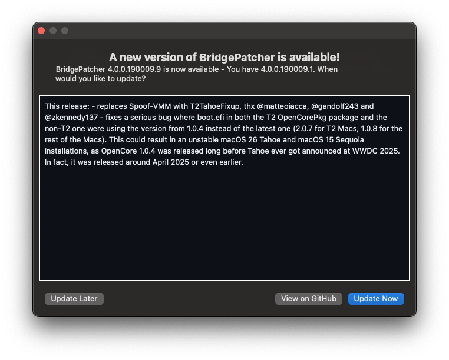
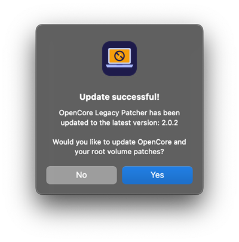
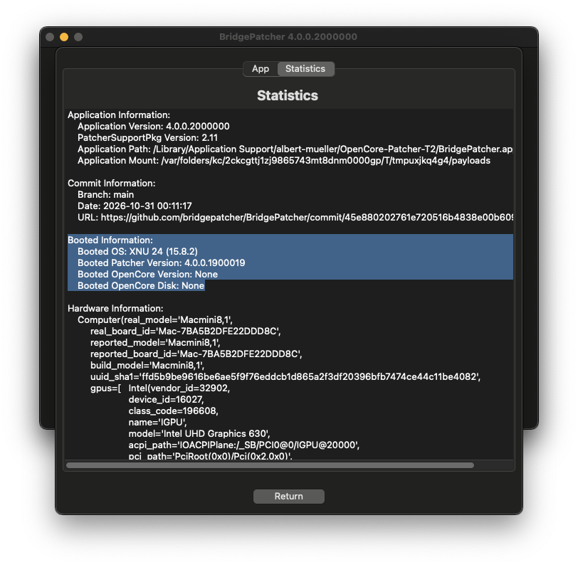
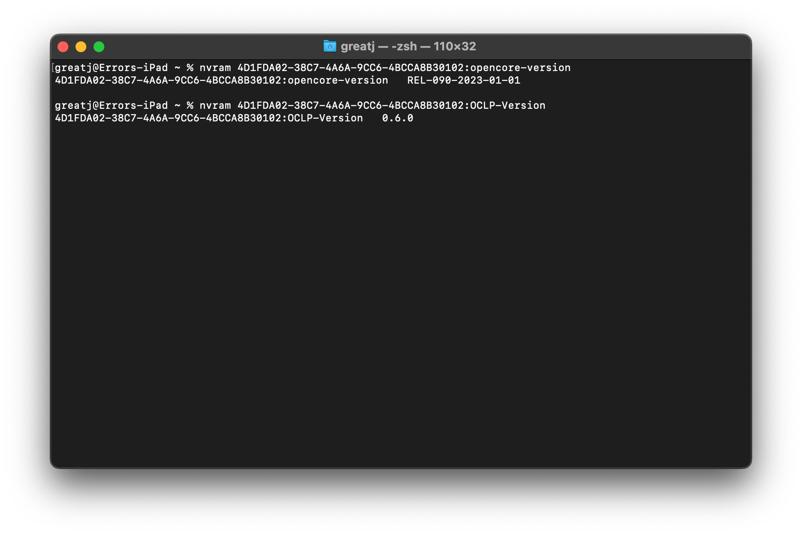
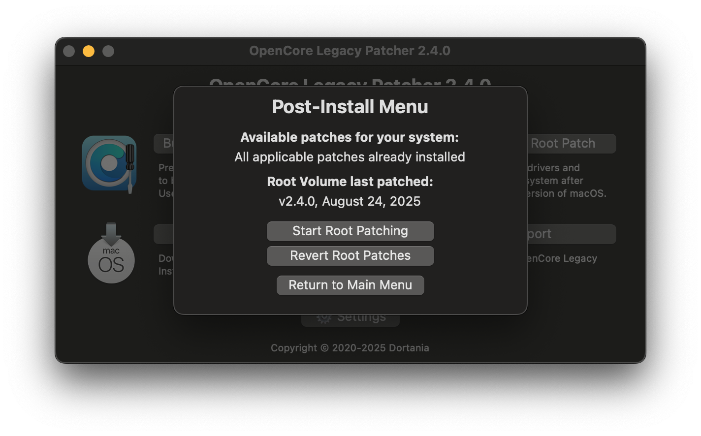

# Aktualisieren

Diese Anleitung erklärt, wie du App, Bootloader und Patches vollständig auf den neuesten Stand bringst.

## App, OpenCore und Patches aktualisieren

Beim Öffnen prüft die App, ob eine neuere Version verfügbar ist. Wird ein Update gefunden, lädt die App es automatisch herunter und installiert es – ohne Rückfrage.

* Du kannst auch jederzeit über die Schaltfläche `Check for updates` in den Einstellungen nach Updates suchen.
* Automatische Updates sind deaktiviert, wenn die App aus dem Quellcode oder als Spezial-Build ausgeführt wird.

[Die neueste Version kannst du auch hier manuell herunterladen.](https://github.com/oclp-t2/BridgePatcher/releases)

Nach dem Update fragt die App, ob du OpenCore und die Root-Patches aktualisieren möchtest.

* Wenn du keine Einstellungen ändern musst, klicke bei der Frage zum Patch-Update auf „Yes“ und folge dem Ablauf, um OpenCore und die Root-Patches automatisch zu aktualisieren.
   * Wenn du Einstellungen ändern möchtest, wähle „No“ und nimm deine Einstellungen vor.
   * Wenn du „No“ gewählt hast, musst du OpenCore manuell erstellen und installieren und anschließend die neuen Root-Patches manuell installieren, damit du das neueste OpenCore mit deinen Einstellungen und die Fehlerbehebungen für die Patches auf dem Laufwerk nutzt. Manche Updates enthalten allerdings nur Sicherheitskorrekturen – nach einem reinen Sicherheitsupdate ändert das Neuerstellen von OpenCore vermutlich nichts.


| Update verfügbar (bei deaktivierten automatischen Updates) | App-Update erfolgreich, Frage zum Patch-Update |
| :--- | :--- |
|  |  |


#### BridgePatcher- und OpenCore-Version prüfen

Um zu prüfen, welche Version des OpenCore-Bootloaders und des Patchers du gerade nutzt, öffne die BridgePatcher-App, gehe zu `Settings -> App` und suche nach „Booted Information“. Alternativ kannst du die Version mit den folgenden Befehlen im Terminal prüfen.

Status und Version der Root-Patches siehst du im Hauptmenü im Bereich `Post Install Volume Patch`.

```bash
# OpenCore-Version
nvram 4D1FDA02-38C7-4A6A-9CC6-4BCCA8B30102:opencore-version
# Patcher-Version
nvram 4D1FDA02-38C7-4A6A-9CC6-4BCCA8B30102:BridgePatcher-Version
```


| Version in der App | Version im Terminal | Version der Root-Patches |
| :--- | :--- | :--- |
|  |  |  |


## BridgePatcher auf ein macOS-Update vorbereiten

Für macOS-Updates wird in der Regel empfohlen, die neueste BridgePatcher-Version zu nutzen. Dieser Abschnitt beschreibt, wie du BridgePatcher auf das neueste Update vorbereitest.

### Große Upgrades

Dieser Abschnitt gilt für große Upgrades, etwa `Sonoma (14)` -> `Sequoia (15)`.

1. Stelle sicher, dass die BridgePatcher-App auf dem neuesten Stand ist.
2. Erstelle nach dem App-Update OpenCore neu auf dem internen Laufwerk, um den Bootloader zu aktualisieren.
   * Du kannst auch die Root-Patches aktualisieren; das ist in diesem Schritt aber optional, da sie durch das Update ohnehin entfernt werden.
2. Lade die gewünschte macOS-Version herunter und erstelle mit BridgePatcher einen USB-Installationsstick, wie in der Anleitung [macOS-Installer erstellen](INSTALLER.md) beschrieben. Folge dann der Anleitung [OpenCore und macOS booten](BOOT.md), um den Installer auf deinem USB-Stick zu starten.
3. Starte die macOS-Installation und folge dem Ablauf. Benutze das Festplattendienstprogramm nicht, wenn du dein Laufwerk nicht löschen willst.
4. Installiere nach der Installation die [Root-Patches](POST-INSTALL.md#post-install-volume-patches-anwenden) erneut.

**Hinweis:** Große Upgrades können auch über die Systemeinstellungen funktionieren, auf Macs mit USB 1.1 wird davon aber dringend abgeraten, da USB nach der Installation überhaupt nicht mehr funktioniert. Auf allen anderen Modellen ist ein Update über die Systemeinstellungen in Ordnung, und du solltest keine Probleme haben, da macOS die Patches beim Upgrade ohnehin überschreibt.

### Kleine Updates

Dieser Abschnitt gilt für kleine Updates, auch „Punkt-Updates“ genannt, etwa `12.x`, `13.x` usw.

1. Stelle sicher, dass die BridgePatcher-App auf dem neuesten Stand ist.
2. Erstelle OpenCore neu auf dem internen Laufwerk, um den Bootloader zu aktualisieren.
   * Du kannst auch die Root-Patches aktualisieren; das ist in diesem Schritt aber optional, da sie durch das Update ohnehin entfernt werden.
3. Starte das Update über die Systemeinstellungen.
    * Wenn dein System [KDKSupportPkg](POST-INSTALL.md#kdk-kernel-debug-kit) benötigt, beginnt BridgePatcher automatisch mit dem Download, solange du mit dem Internet verbunden bist und der [Hintergrundprozess](PROCESS.md) aktiviert ist.
4. Gehe nach der Installation in die BridgePatcher-App und installiere die [Root-Patches](POST-INSTALL.md#post-install-volume-patches-anwenden) erneut.

::: warning Wichtig

Einige Systeme benötigen unter Sequoia nach einem Update beim Root-Patching [MetallibSupportPkg](POST-INSTALL.md#metallibsupportpkg), für dessen Download eine Internetverbindung nötig ist. Erkennt BridgePatcher keine Internetverbindung, bietet es zunächst nur einen Patch für WLAN an. Du musst dann neu starten, dich mit dem Internet verbinden und das Root-Patching für die übrigen Patches erneut ausführen.

:::
