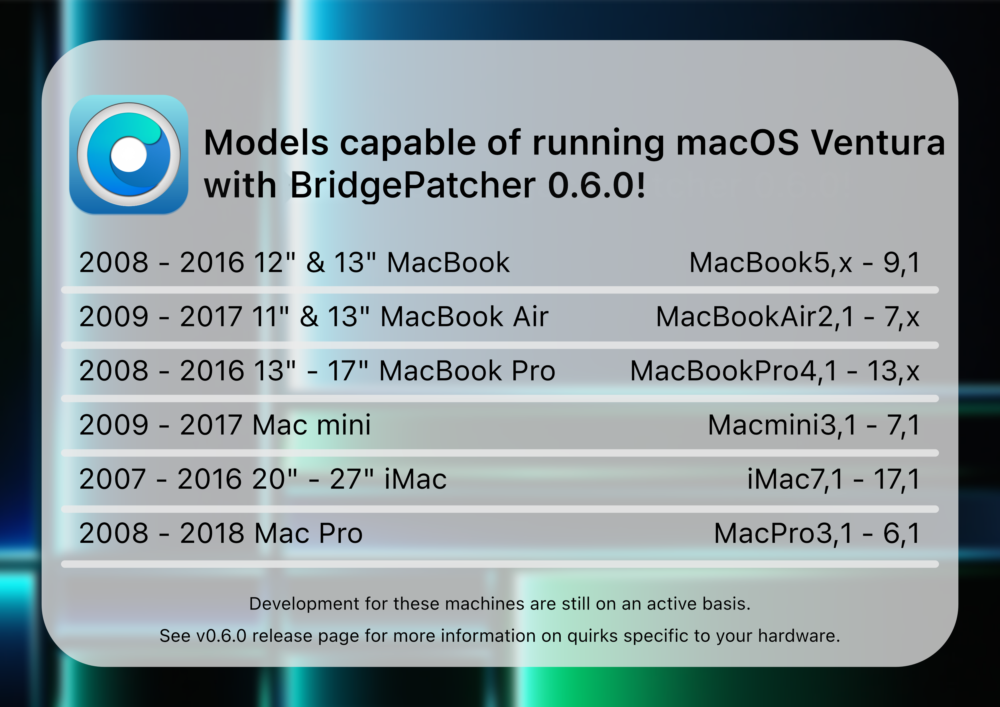

# macOS Ventura

Mit der Veröffentlichung von OpenCore Legacy Patcher v0.5.0 und neuer wurde erste Unterstützung für macOS Ventura auf den meisten Metal-fähigen Macs implementiert. Diese Seite informiert über aktuelle Probleme und wird aktualisiert, sobald neue Patch-Sets entwickelt und in den Patcher aufgenommen werden.

## Neu fallen gelassene Hardware

Mit Ventura wurde eine große Menge Intel-Hardware fallen gelassen, sodass auf den folgenden Modellen (zusätzlich zu den bereits zuvor entfernten) OpenCore Legacy Patcher T2 nötig ist:

* iMac16,1 (21,5 Zoll, Ende 2015)
* iMac16,2 (21,5 Zoll und 21,5 Zoll 4K, Ende 2015)
* iMac17,1 (27 Zoll 5K, Ende 2015)
* MacBook9,1 (12 Zoll, Anfang 2016)
* MacBookAir7,1 (11 Zoll, Anfang 2015)
* MacBookAir7,2 (13 Zoll, Anfang 2015)
* MacBookPro11,4 (15 Zoll, Mitte 2015, iGPU)
* MacBookPro11,5 (15 Zoll, Mitte 2015, dGPU)
* MacBookPro12,1 (13 Zoll, Anfang 2015)
* MacBookPro13,1 (13 Zoll, Ende 2016)
* MacBookPro13,2 (13 Zoll, Ende 2016)
* MacBookPro13,3 (15 Zoll, Ende 2016)
* Macmini7,1 (Ende 2014)
* MacPro6,1 (Ende 2013)

## Aktueller Stand

OpenCore Legacy Patcher T2 unterstützt Ventura auf den unten aufgeführten Modellen, einige Herausforderungen bleiben jedoch bestehen. Informationen dazu findest du weiter unten auf dieser Seite.

Für ältere Hardware siehe die folgenden Abschnitte:

* [Aktuelle Probleme](#aktuelle-probleme)
  * [Unterstützung für AMD Polaris, Vega und Navi auf Mac Pros vor 2019 und iMacs vor 2012](#unterstutzung-fur-amd-polaris-vega-und-navi-auf-mac-pros-vor-2019-und-imacs-vor-2012)
  * [Unterstützung für USB 1.1 (OHCI/UHCI)](#unterstutzung-fur-usb-1-1-ohci-uhci)

Das Team gibt sein Bestes, die genannten Probleme zu untersuchen und zu beheben, kann aber keinen Zeitrahmen nennen.

## Aktuelle Probleme

### Unterstützung für AMD Polaris, Vega und Navi auf Mac Pros vor 2019 und iMacs vor 2012

Nutzer von Mac Pros aus den Jahren 2008 bis 2013 (MacPro3,1–6,1) und iMacs aus den Jahren 2009 bis 2011 (iMac9,1–12,2) sollten beachten, dass macOS Ventura für native Grafikbeschleunigung nun [AVX2.0-Unterstützung in der CPU](https://de.wikipedia.org/wiki/Advanced_Vector_Extensions#AVX2) voraussetzt. Auch wenn deine GPU nativ unterstützt wird, kannst du Ventura mit diesen GPUs also nicht offiziell betreiben.

* CPUs mit AVX2.0-Unterstützung sind Haswell oder neuer – damit lässt sich kein Mac Pro vor 2019 aufrüsten.

Derzeit unterstützt OpenCore Legacy Patcher T2 nur das Patchen des Grafik-Stacks für AMD Polaris und Vega, damit AVX2.0 nicht mehr benötigt wird. Wir haben kürzlich eine AMD RX 6600 gespendet bekommen, sodass das Projekt künftig hoffentlich auch AMD Navi auf Macs vor Haswell unterstützen kann. Einen Zeitrahmen können wir jedoch nicht nennen.

Folgende GPUs sind betroffen:

| GPU-Architektur | Modellfamilien | Unterstützt |
| :--- | :--- | :--- |
| AMD Polaris | RX 4xx/5xx (10er/20er-Serie) |  Mit Patches unterstützt  |
| AMD Vega    | Vega 56/64/VII (10er/20er-Serie) | ^^ |
| AMD Navi    | RX 5xxx/6xxx (10er/20er-Serie) |  Nicht unterstützt  |

### Unterstützung für USB 1.1 (OHCI/UHCI)

Bei Penryn-Systemen und Mac Pros vor 2013 wurde die Unterstützung für USB 1.1 in macOS Ventura komplett entfernt. Auch wenn USB 1.1 unwichtig erscheinen mag, hängen viele wichtige Geräte deines Systems daran, darunter:

* Tastatur und Trackpad bei Laptops
* IR-Empfänger
* Bluetooth

Auf [der Fehlerbehebungsseite](TROUBLESHOOT-HARDWARE.md#tastatur-maus-und-trackpad-funktionieren-im-installer-oder-nach-einem-update-nicht) erfährst du, wie du dieses Problem umgehen kannst.

### Grafikunterstützung und Probleme

Unter den folgenden Links findest du weitere Informationen zur Unterstützung von Legacy Metal und Non-Metal sowie zu den jeweiligen Problemen.

* [Legacy Metal](https://github.com/dortania/OpenCore-Legacy-Patcher/issues/1008)
* [Non-Metal](https://github.com/dortania/OpenCore-Legacy-Patcher/issues/108)

### Behobene Probleme

::: details Unterstützung für ältere WLAN-Karten (behoben in v0.6.0 und neuer)

Für Systeme, die unter macOS Monterey Root-Patches für WLAN benötigten, hat macOS Ventura dieses Patch-Set leider unbrauchbar gemacht. Derzeit werden folgende WLAN-Karten nicht unterstützt:

* Atheros: alle Modelle
* Broadcom: BCM94328 und BCM94322

Folgende Geräte wurden ab Werk mit diesen Karten ausgeliefert:

* iMac12,x und älter
* Macmini3,1 und älter
* MacBook5,x und älter
* MacBookAir2,1 und älter
* MacBookPro7,1 und älter
  * MacBookPro6,x ist ausgenommen
* MacPro5,1 und älter

BCM943224, BCM94331, BCM94360 und BCM943602 werden von OpenCore Legacy Patcher T2 weiterhin vollständig unterstützt. Ziehe nach Möglichkeit ein Upgrade auf eine dieser Karten in Betracht.

:::

::: details Non-Metal-Grafikbeschleunigung (behoben in v0.6.0 und neuer)

Das Team arbeitet mit Hochdruck daran, Non-Metal zum Laufen zu bringen – das ist jedoch unsere größte Herausforderung seit Big Sur.

Apple hat den Grafik-Stack erheblich verändert, um aufwendige Effekte und insbesondere Stage Manager zu ermöglichen. Wir halten dich über die Entwicklung auf dem Laufenden, aber jetzt ist nicht der beste Zeitpunkt, nach Terminen zu fragen.

Folgende GPUs sind betroffen:

* NVIDIA:
  * Tesla (8000er- bis 300er-Serie)
* AMD:
  * TeraScale (2000er- bis 6000er-Serie)
* Intel:
  * Iron Lake
  * Sandy Bridge (2000er- bis 3000er-Serie)

Folgende Geräte wurden ab Werk mit einer nicht unterstützten GPU ausgeliefert:

* iMac7,1 – iMac12,x
* MacBook5,1 – MacBook7,1
* MacBookAir2,1 – MacBookAir4,x
* MacBookPro4,1 – MacBookPro8,x
* Macmini3,1 – Macmini5,x
* MacPro3,1 – MacPro5,1
* Xserve2,1 – Xserve3,1

:::
