# Windows im UEFI-Modus installieren

Moderne Windows-Versionen unterstützen offiziell zwei Firmware-Arten: UEFI und BIOS. Wer Windows über den OCLP-Bootpicker booten möchte, muss wissen, dass dort nur UEFI-Installationen von Windows erscheinen.
Viele ältere Macs unterstützen UEFI-Installationen von Windows nicht „offiziell“, was zu fehlgeschlagenen Installationen und seltsamem Verhalten führt. Mit OCLP lassen sich jedoch fast alle dieser Probleme vermeiden.

::: warning Achtung

Wenn du Windows mit OpenCore bootest, wird dringend empfohlen, im Festplattendienstprogramm eine neue 200 MB große **MS-DOS (FAT)**-Partition anzulegen und OpenCore dort zu installieren. So verhinderst du, dass Windows OpenCore auf der EFI-Partition mit seinem eigenen Bootloader überschreibt und Bootprobleme verursacht.

::::


## Mindestanforderungen

Diese Anleitung behandelt die Installation eines modernen Windows (10/11) ohne Boot-Camp-Assistenten.

* Wegen Hardware- und Firmware-Einschränkungen werden UEFI-Installationen von Windows nur auf folgenden Geräten empfohlen:

  * MacBook 2015 oder neuer (`MacBook8,x`+)
  * MacBook Air 2011 oder neuer (`MacBookAir4,x`+)
  * MacBook Pro 2011 oder neuer (`MacBookPro8,x`+)
  * Mac mini 2011 oder neuer (`Macmini5,x`+)
  * Mac Pro 2009* oder neuer (`MacPro4,1`+), aufgerüstete GPU empfohlen
  * iMac 2010 oder neuer (`iMac11,x`+), aufgerüstete GPU empfohlen
  * Xserve 2009* (`Xserve3,1`), aufgerüstete GPU empfohlen


*Auf Systemen mit `MacPro4,1`, `MacPro5,1` und `Xserve3,1` gibt es Probleme mit dem Windows-Installer; folge der Anleitung im Abschnitt zur DISM-Installation.

Wenn dein Gerät nicht aufgeführt ist, lässt sich UEFI-Windows wahrscheinlich trotzdem installieren, es kann aber zu Stabilitäts- oder Treiberproblemen kommen.

## Laufwerk partitionieren und formatieren

Für die Installation brauchst du:
* Einen USB-Stick mit mindestens 8 GB für den Windows-Installer
* Mindestens 30 GB freien Speicher auf einem vorhandenen oder leeren Laufwerk für die Windows-Installation

### USB-Stick formatieren

Öffne das Festplattendienstprogramm in macOS und formatiere den USB-Stick als ExFAT mit dem Schema „Master Boot Record“:

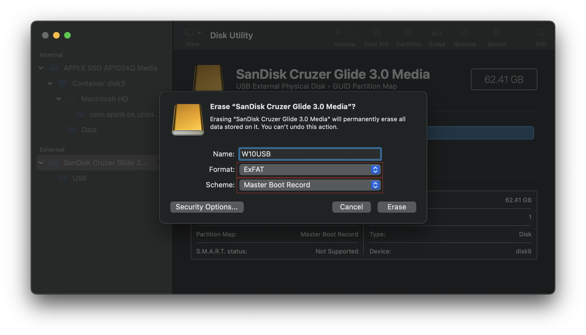

### Ziellaufwerk formatieren

Wähle als Nächstes im Festplattendienstprogramm das Laufwerk, auf dem du Windows installieren möchtest, und lege eine ExFAT-Partition an (wenn du das gesamte Laufwerk formatierst, achte darauf, dass das Schema „GUID-Partitionstabelle“ verwendet wird):

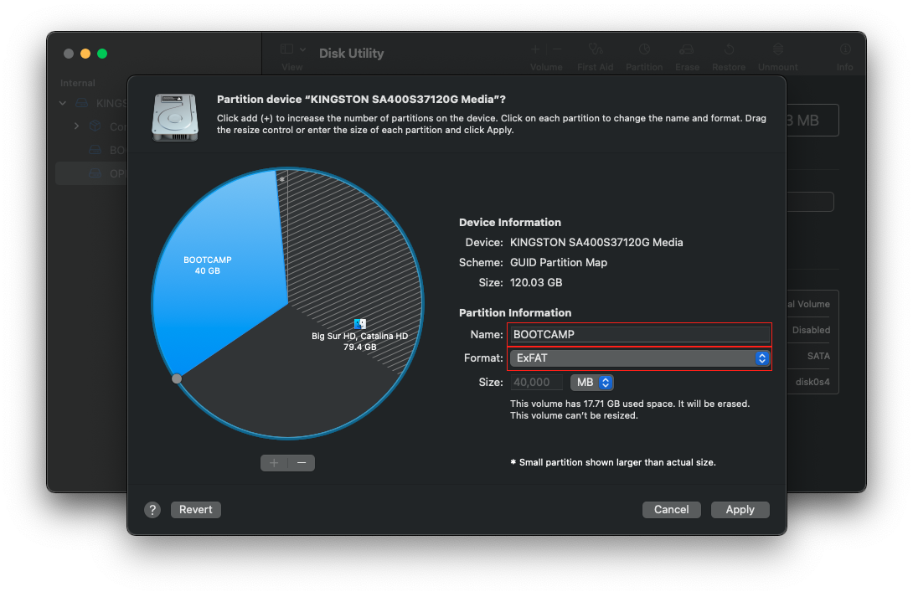


:::warning Achtung

Wenn du das falsche Laufwerk löschst, kann das zu Datenverlust führen! Prüfe bitte genau, ob du das richtige Laufwerk bzw. die richtige Partition löschst.

:::

Wenn du dasselbe Laufwerk für macOS und Windows nutzen möchtest, empfehlen wir, eine eigene Partition nur für OpenCore anzulegen. So hat Windows die ESP für sich allein, und OpenCore bleibt in seinem eigenen Bereich.

Empfohlen sind 200 MB, und die Partition **muss** als FAT32 formatiert sein, damit OpenCore korrekt funktioniert. Installiere OpenCore anschließend auf der neuen Partition – entweder indem du es mit [MountEFI](https://github.com/corpnewt/MountEFI) von der ESP verschiebst oder die OpenCore-Patcher.app erneut ausführst.

* Hinweis 1: Bei Geräten mit einem eigenen Laufwerk für Windows ist eine separate Partition für OpenCore nicht nötig.
* Hinweis 2: Eine separate Partition für OpenCore ist auch nicht nötig, wenn die Windows-Bootdateien entfernt werden, die der originale Bootpicker erkennt. Weitere Informationen findest du unter „Die Windows-Option aus dem originalen Bootpicker entfernen“.
* Hinweis 3: Wir empfehlen, OpenCore von der ESP/EFI-Partition zu deinstallieren, wenn du diese neue OpenCore-Partition anlegst, damit du im Bootpicker des Mac die OpenCore-Builds nicht verwechselst.

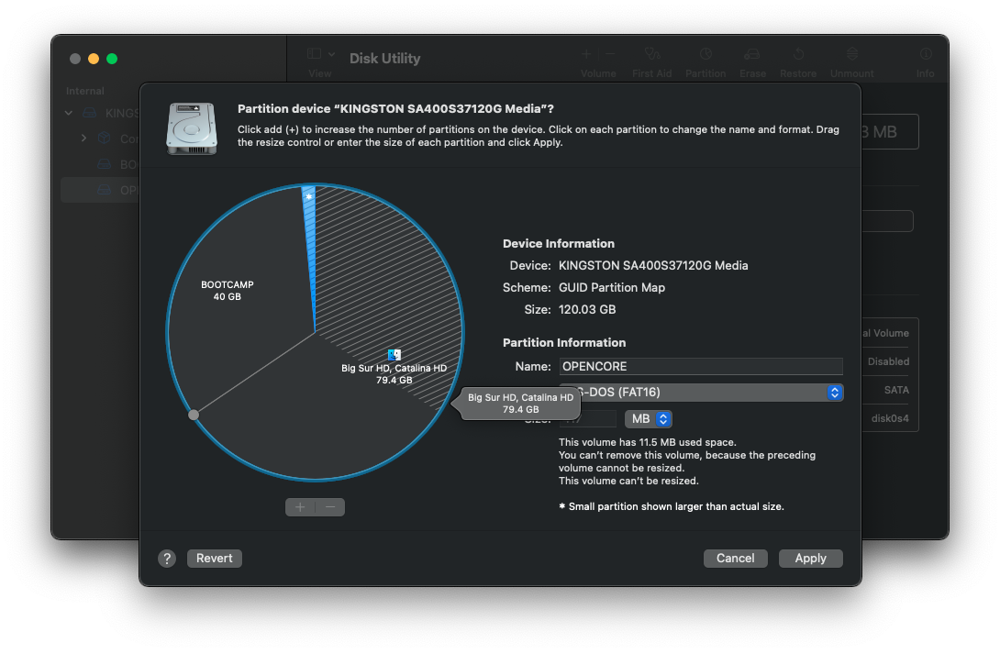

## Windows-Installer erstellen

Die neuesten Windows-Installationsimages kannst du über folgende Links bei Microsoft herunterladen:

* [Windows-10-Datenträgerimage (ISO-Datei) herunterladen](https://www.microsoft.com/de-de/software-download/windows10ISO)

* [Windows-11-Datenträgerimage (ISO-Datei) herunterladen](https://www.microsoft.com/de-de/software-download/windows11)

Hänge die .iso-Datei nach dem Download ein:

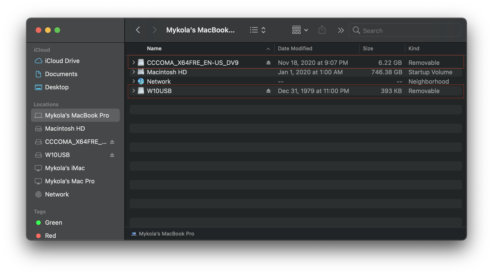

Öffne dann das Terminal und verwende den Befehl `rsync` mit dem Image als Quelle und deinem USB-Stick als Ziel. (Ersetze „CCCOMA_X64“ durch den Partitionsnamen des eingehängten Images und „InstallWin10“ durch den Namen deines USB-Sticks.)

```
rsync -r -P /Volumes/CCCOMA_X64/ /Volumes/InstallWin10
```

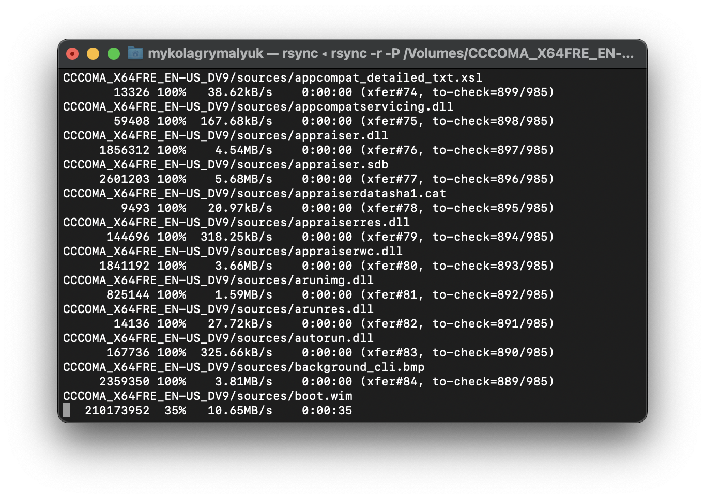

Der Befehl `rsync` braucht etwas Zeit – hol dir also einen Kaffee und lehn dich zurück. Danach sollte das Wurzelverzeichnis des USB-Sticks so aussehen:

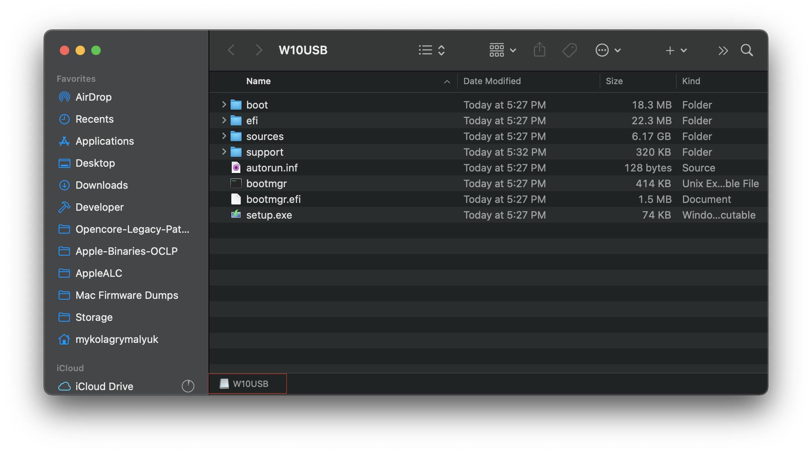

* Achte darauf, dass diese Ordner und Dateien im Wurzelverzeichnis des USB-Sticks liegen, sonst bootet der Stick nicht.


## Installationsablauf

Nach dem Neustart solltest du im OCLP-Bootpicker eine neue Bootoption namens „EFI Boot“ oder „Windows“ sehen, eventuell mit dem Boot-Camp-Symbol.

:::warning Achtung

Wenn du nicht über OCLP gebootet hast, siehst du möglicherweise **zwei** Bootoptionen namens „Windows“ und „EFI Boot“. Wähle keine davon, sondern boote in OCLP, um fortzufahren.

:::


### Installation: Microsoft-Methode

Gehe nach dem Booten in den Windows-Installer so vor wie auf jedem anderen Windows-Rechner. Erscheint eine Fehlermeldung mit „Windows could not prepare the computer to boot into the next phase of installation“ („Der Computer konnte von Windows nicht für den Start in die nächste Installationsphase vorbereitet werden“), folge dem nächsten Abschnitt dieser Anleitung (DISM-Installation).

::: details Windows 11 installieren

Wenn du Windows 11 installierst, musst du [das Windows-Setup anpassen](https://www.bleepingcomputer.com/news/microsoft/how-to-bypass-the-windows-11-tpm-20-requirement/), um die Installation auf nicht unterstützten Geräten zu erlauben.

:::

### Installation: DISM-Methode

Gehe nach dem Booten in den Windows-Installer wie gewohnt vor, bis du zum Abschnitt „Wo möchten Sie Windows installieren?“ mit der Laufwerksformatierung gelangst.

Wenn du ein Laufwerk auswählen sollst, wähle die gewünschte Partition aus und lösche sie mit „Löschen“. Wenn du Windows auf einem leeren Laufwerk installieren möchtest, lösche alle Partitionen auf diesem Laufwerk.
Klicke nach dem Löschen des Laufwerks bzw. der Partition auf „Neu“, um die Windows-Systempartitionen anzulegen.

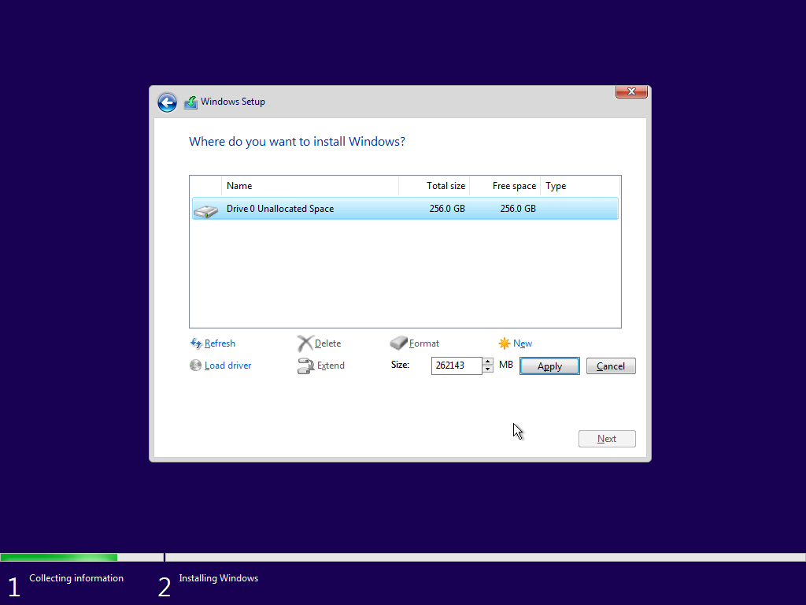

Du wirst aufgefordert, das Anlegen der Systempartitionen zu bestätigen; klicke auf „OK“.

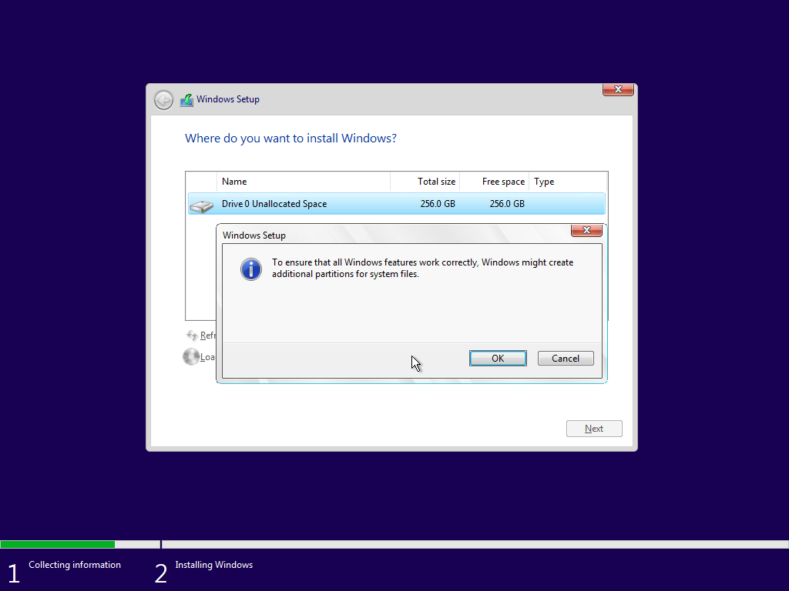

Wähle nach dem Anlegen der Partitionen die Hauptpartition (die größte) aus und klicke auf „Formatieren“. Dadurch wird die Partition mit dem Dateisystem NTFS formatiert.

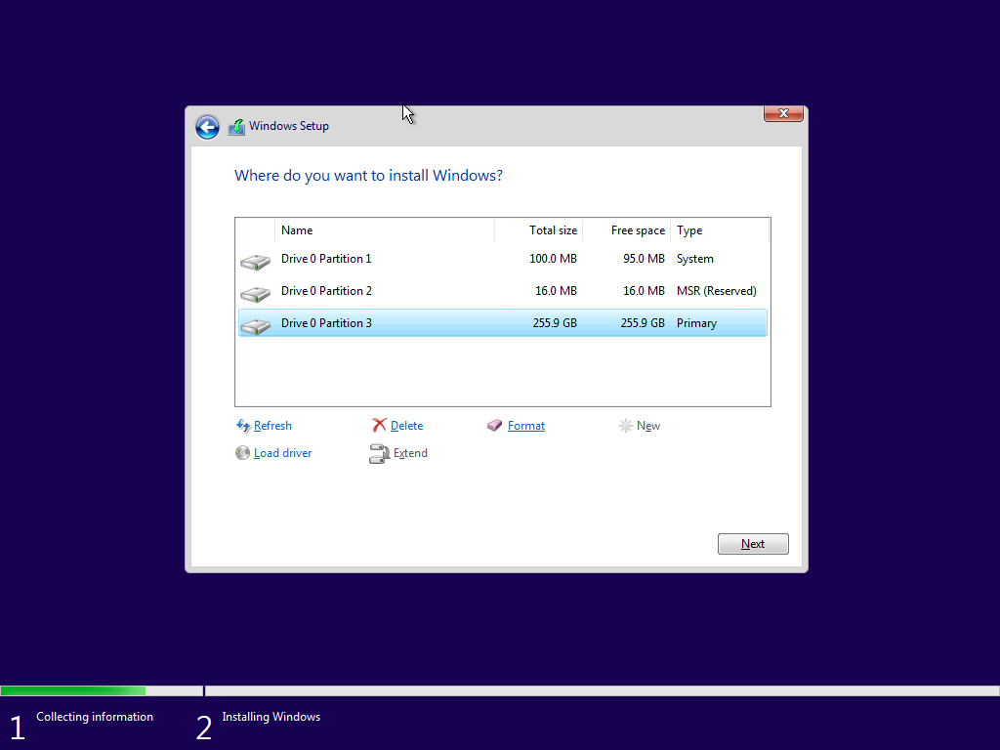

Öffne nach dem Formatieren mit SHIFT + F10 die Eingabeaufforderung. Führe dann den Befehl `diskpart` und anschließend `list vol` aus. Damit erhältst du eine Liste der Volumes deines Systems. Merke dir die Laufwerksbuchstaben der Windows-Hauptpartition (größte, NTFS), der EFI-Partition (100 MB, FAT32) und des Windows-Installers (meist Laufwerk D). Schließe diskpart mit `exit`.

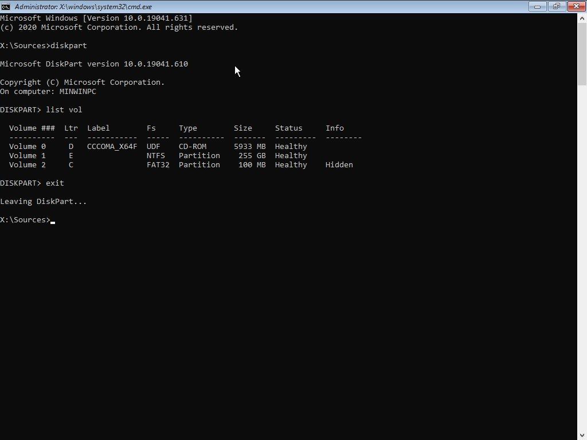

Lass dir jetzt mit `dism /Get-WimInfo /WimFile:D:\Sources\install.wim` die verfügbaren Windows-Editionen anzeigen (ersetze D durch den Laufwerksbuchstaben des Installers). In dieser Anleitung verwenden wir Option 6 für Windows 10 Pro.

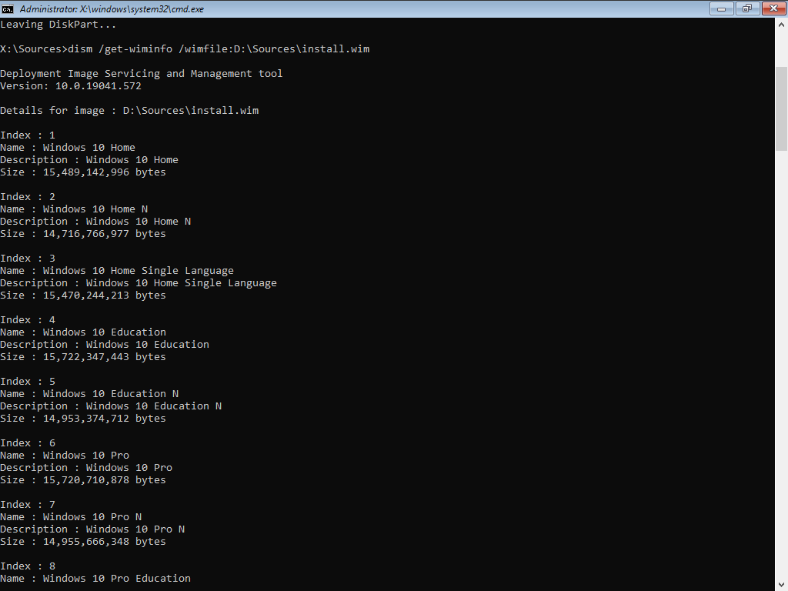

Nun kannst du die Bereitstellung starten. Führe `dism /Apply-Image /ImageFile:D:\Sources\install.wim /index:6 /ApplyDir:E:` aus und ersetze dabei „D“ durch den Laufwerksbuchstaben des Installers, „6“ durch die gewünschte Windows-Edition und „E“ durch den Laufwerksbuchstaben der Windows-Partition.

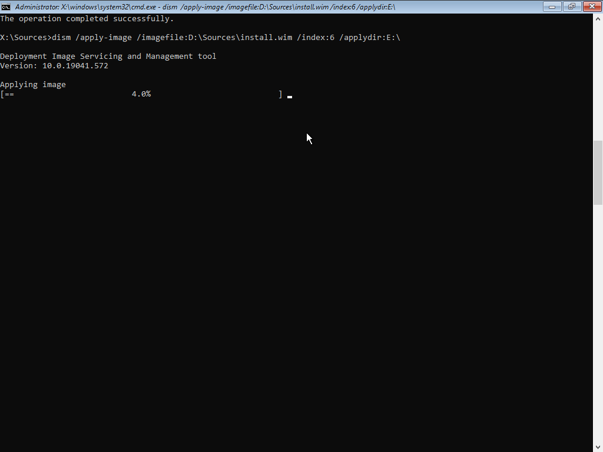

Sobald `dism` fertig ist, führe `bcdboot E:\Windows` aus (ersetze „E“ durch den Laufwerksbuchstaben der Windows-Hauptpartition), um die Bootdateien zu erstellen.

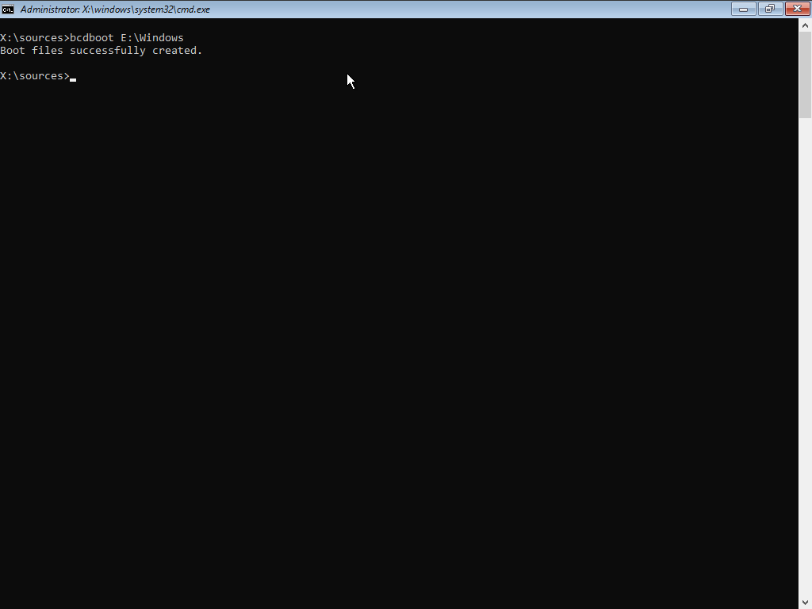

Windows ist jetzt installiert. Es sollte im OCLP-Bootpicker als „EFI Boot“ oder „Windows“ mit Boot-Camp-Symbol erscheinen.

:::warning Achtung

Starte nach dem Erstellen der Bootdateien auf einem MacPro4,1, MacPro5,1 oder Xserve3,1 **AUF KEINEN FALL** neu! Ein Fehler im Windows-Bootloader macht das System vollständig unbrauchbar, wenn er über den originalen Bootpicker geladen wird. Einen Workaround findest du im Abschnitt „Installation: Die Windows-Option aus dem originalen Bootpicker entfernen“.

:::

### Installation: Die Windows-Option aus dem originalen Bootpicker entfernen

Auf MacPro4,1, MacPro5,1 und Xserve3,1 wird **DRINGEND EMPFOHLEN**, die Windows-Bootoption aus dem originalen Bootpicker zu entfernen, um eine Beschädigung des Secure-Boot-NVRAM und ein unbrauchbares System zu verhindern.

Öffne in der Windows-Setup-Umgebung mit `cmd` ein Eingabeaufforderungsfenster.

Wechsle dann mit `C:` auf die EFI-Partition (ersetze „C“ durch den Laufwerksbuchstaben der EFI-Partition). Führe anschließend `cd EFI` aus, um in den EFI-Ordner zu wechseln, und dann `rmdir Boot /S /Q`, um die Bootdateien zu entfernen, die der originale Bootpicker erkennt. Der OCLP-Picker kann Windows weiterhin erkennen und booten.

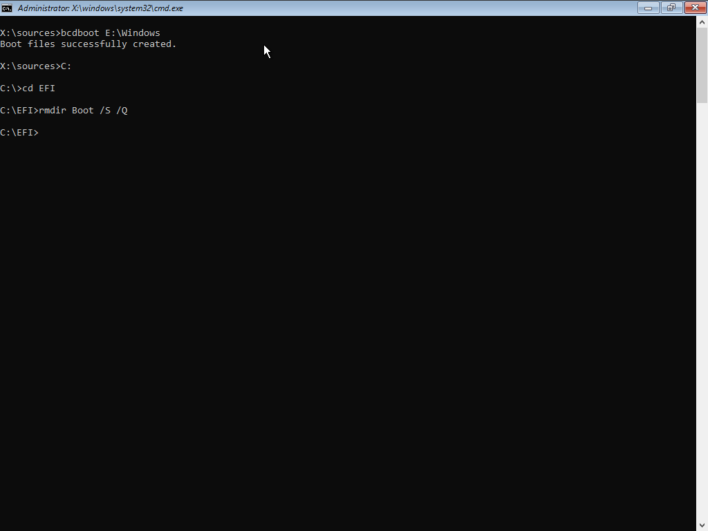

Mit dem Befehl `dir` kannst du prüfen, ob der Ordner `Boot` entfernt wurde:

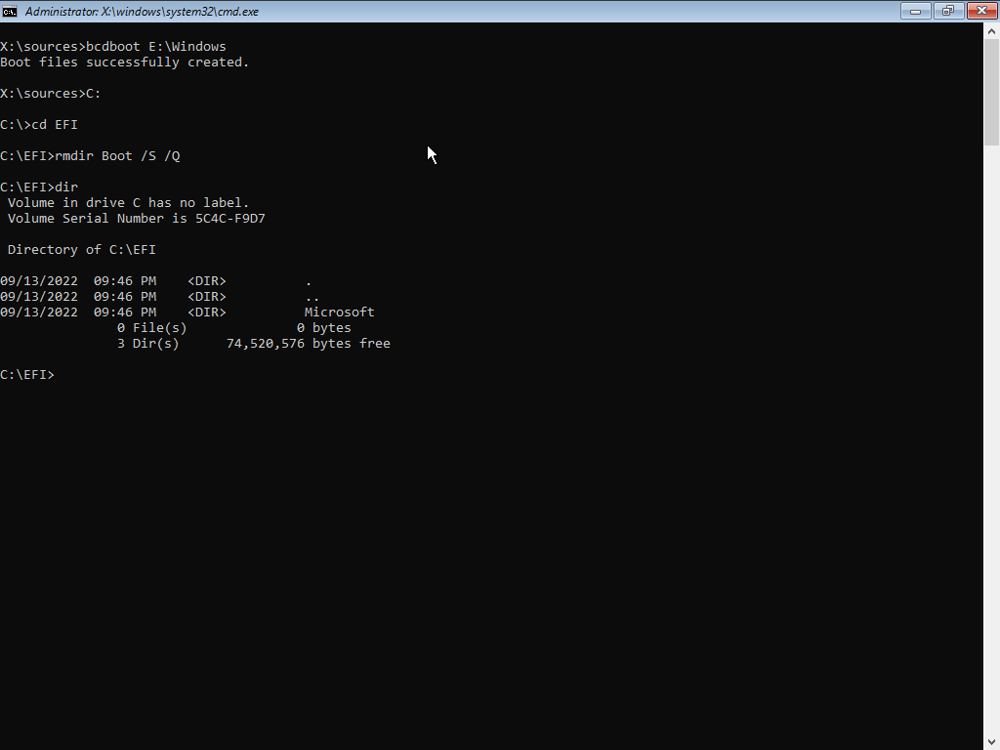

Falls du die Bootdateien aus irgendeinem Grund nicht im Windows-Setup entfernen kannst, fahre das System herunter, boote in macOS, hänge deine EFI-Partition mit [MountEFI](https://github.com/corpnewt/MountEFI) ein und entferne den Ordner `Boot` (er sollte ein aktuelles Änderungsdatum haben und `Bootx64.efi` enthalten).


## Nach der Installation

### Boot-Camp-Software installieren

Lade zunächst das Werkzeug Brigadier über folgenden Link herunter:

* [Brigadier herunterladen](https://github.com/timsutton/brigadier/releases/download/0.2.4/brigadier.exe)

Verschiebe Brigadier nach dem Download der Einfachheit halber auf den Desktop.

Öffne eine Eingabeaufforderung als normaler Benutzer und führe `cd desktop` aus.

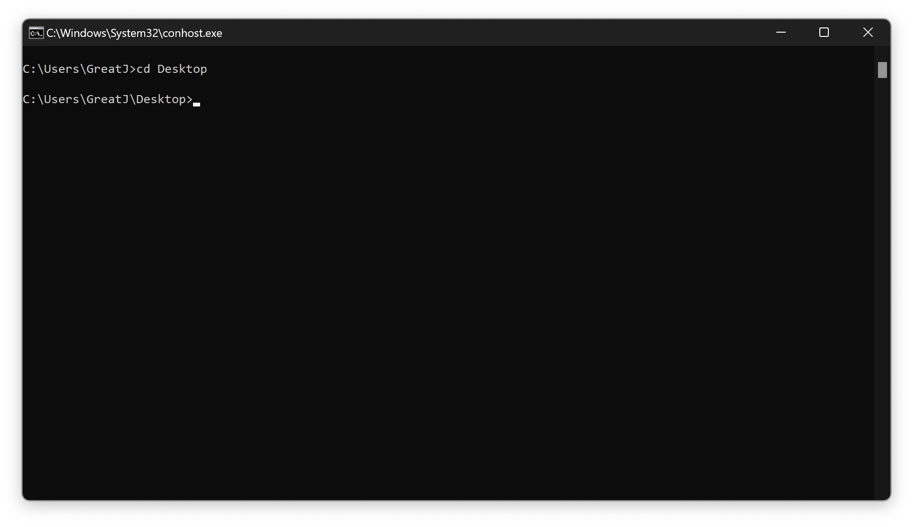

Führe dann `.\brigadier.exe --model=MODEL1,1` aus und ersetze dabei „MODEL1,1“ durch das SMBIOS-Modell deines Geräts.

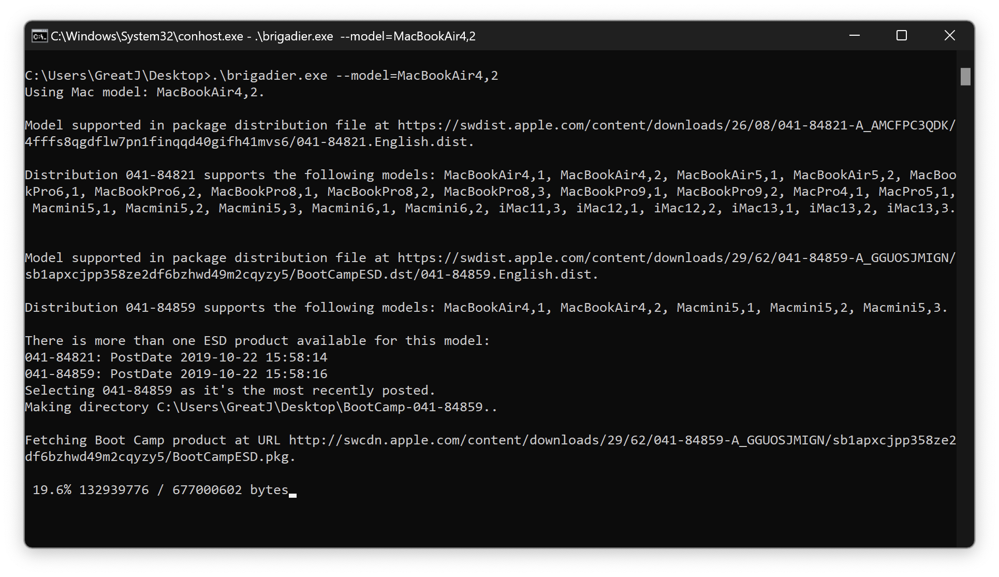

Nach dem Download der Boot-Camp-Software kannst du sie installieren, indem du `Setup.exe` oder `\Drivers\Apple\BootCamp.msi` (bzw. `BootCamp64.msi`, falls vorhanden) ausführst.

### Boot Camp 6 auf nicht unterstützten Geräten installieren

Lade zunächst das Werkzeug Brigadier über folgenden Link herunter:

* [Brigadier herunterladen](https://github.com/timsutton/brigadier/releases/download/0.2.4/brigadier.exe)

Verschiebe Brigadier nach dem Download der Einfachheit halber auf den Desktop.

Öffne eine Eingabeaufforderung als normaler Benutzer und führe `cd desktop` aus.


Führe dann `.\brigadier.exe --model=MacPro7,1` aus. Dadurch wird das neueste Boot-Camp-6-Paket heruntergeladen.


Nach dem Download der Boot-Camp-Software kannst du Boot Camp 6 installieren, indem du `\Drivers\Apple\BootCamp.msi` in einer Eingabeaufforderung mit Administratorrechten ausführst.

## Fehlerbehebung

### „This version of Boot Camp is not intended for this computer model.“

Wenn du OpenCore mit SMBIOS-Spoofing der Stufe „Moderate“ oder höher erstellt hast, erhältst du beim Installieren der Boot-Camp-Treiber eine Fehlermeldung. Das kannst du beheben, indem du OpenCore mit einer niedrigeren Spoofing-Stufe neu erstellst oder den Installer über `Drivers/Apple/BootCamp.msi` startest.

| Setup.exe | BootCamp.msi |
| :--- | :--- |
| 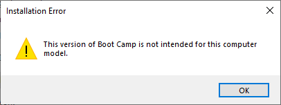 | 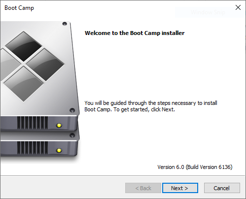 |

::: details Besonderheiten von BootCamp.msi

Bei Bedarf kannst du es als Administrator über die Kommandozeile starten:

```
set __COMPAT_LAYER=WIN7RTM && start \path\to\BootCamp\Drivers\Apple\Bootcamp.msi'
```

Ersetze dabei `\path\to` durch den Speicherort des Boot-Camp-Ordners.

Wenn du Boot-Camp-4.0-Treiber hast, kannst du in den `Eigenschaften` der Datei auch die Kompatibilität auf `Vorherige Windows-Version` umstellen (der obige Befehl erledigt das bereits).

:::

### Bluescreen auf dem iMac12,x nach der Treiberinstallation

Intels iGPU-Treiber für die HD-3000-Serie unterstützen das Booten von Windows im UEFI-Modus nicht. Die empfohlene Lösung ist, die iGPU einfach zu deaktivieren: [iMac 12,1 Windows 10 Boot Loop – Fix Intel Graphics issue](https://zzq.org/?p=39)

### Schwarzer Bildschirm mit NVIDIA Tesla nach der Treiberinstallation

Die NVIDIA-Tesla-GPUs in Macs von 2008 bis 2010 unterstützen das Booten von Windows im UEFI-Modus nicht. Ohne Low-Level-Patches kannst du UEFI-Windows auf diesen Geräten nicht nutzen.
